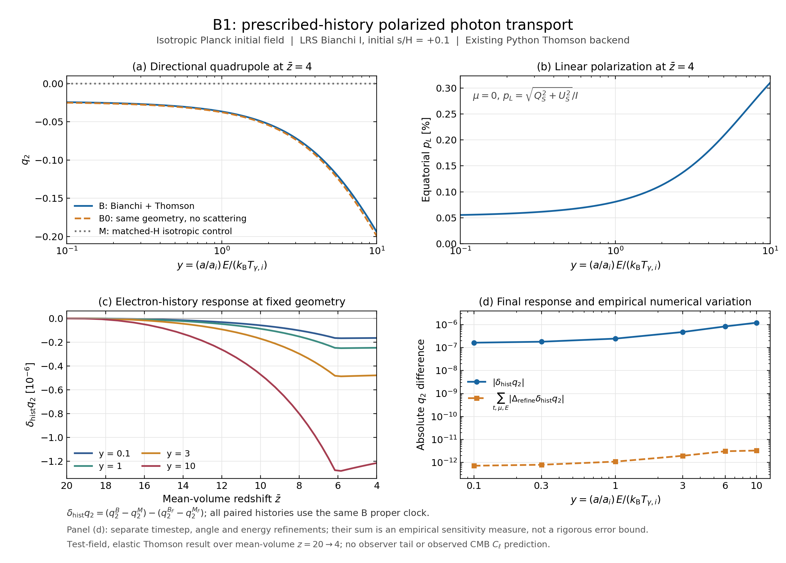

# B1 — 처방된 전자 이력과 편광 Thomson 수송의 실제 반응

2026-10-12 · 실행 상태: **EXECUTED_SCOPED_PYTHON** · 원래 Rust/native 연결: **HOLD_RUNTIME_ENVIRONMENT**

## 결과

BASS_HE PR27에서 정한 B1의 여섯 대조군을 실제로 계산했다. 고정된 REI 전자 이력을 실제 Thomson 충돌 깊이에 연결하고, 동일한 평균 H(a) 아래의 방향 반응과 전자 이력 선택 효과를 분리했다. 기준 실행은 시간128구간, Gauss–Legendre 방향24개×방위각8개, 에너지263개다. 33개 저장 시각에서 보호된 에너지 구간 0.1≤y≤10의 96개 노드를 분석했다.

평균 부피 redshift z=4, y=1에서 B의 사중극비는 −0.0364636000, 무충돌 B0는 −0.0375267811이다. Thomson 산란으로 사중극의 절댓값이 약2.83% 줄고, 적도 방향 선형 편광도 p_L=0.0008083203=0.08083203%가 생성됐다. 같은 기하에서 전자 이력만 FLRW 이력으로 바꾸면 사중극의 차이는 −2.46431894e−7이다. 이 차이는 큰 방향 반응의 약6.76ppm에 해당한다. 이 수치는 선정된 진단 시나리오의 계산이며 관측적 허용값이나 보편적인 Bianchi 효과 크기가 아니다.

이번 실행은 기존 Python Thomson 원문을 호출했다. 실제 Rust compiler/prebuilt library를 확보하지 못했으므로 Rust 호출은0이며, Python–Rust parity와 PR27의 원래 native 연결 요구는 미완료다. 기존 원자 계산·재이온화 ODE·NCP 계산을 새로 실행하지 않았다. 최종 채택 범위는 [독립 판정](review/DECISION.json)과 [검토문](review/DECISION_REVIEW_KO.md)에 별도로 기록한다.

## 1. 과학 질문과 대조군

질문은 평균 팽창과 전자 이력을 통제한 상태에서 비등방 방향 수송이 사중극·편광을 만드는지, 그리고 전자 이력 선택이 그 결과를 얼마나 바꾸는지다. 평균 H만 사용하는 스칼라 Q/τ 비교를 넘어 실제 방향 복사장을 계산했다.

| Case | 기하 | 전자 이력 / 깊이 | 시계 |
|---|---|---|---|
| F | FLRW | 기존 FLRW 이력 | F |
| M | B와 같은 평균 H(a)의 등방 대조기하 | B 이력 | B |
| B | 초기 r=s/H=+0.1인 LRS Bianchi I | B 이력 | B |
| B0 | B와 동일 | 충돌 깊이만0 | B |
| B_F | B와 동일 | F 이력을 B 시계로 재투영 | B |
| M_F | M과 동일 | B_F와 같은 재투영 이력 | B |

모든 case의 최초 복사장은 동일한 등방 Planck 함수이고 초기 편광은0이다. 이후 별도 광자 방출은0으로 둔다. REI의 R15 유효 방출률은 처방된 이온화 이력을 정한 source이며, 이 실험의 광자 방출 스펙트럼으로 사용하지 않는다. B/M의 동일 mean-H 대조는 평균 팽창률 효과와 방향성 전파 효과를 분리한다.

주 결과는

\[
q_2(E,t)=\frac{\int d\Omega\,P_2(\mu)I_E}
{\int d\Omega\,I_E},\quad P_2(\mu)=\frac{3\mu^2-1}{2},
\]
\[
\Delta q_2=q_2^B-q_2^M,\qquad
\delta_{\rm hist}q_2=(q_2^B-q_2^M)-(q_2^{B_F}-q_2^{M_F}).
\]

이 q2는 정규화된 복사 세기의 방향 모멘트다. 온도 multipole a20 또는 CMB Cℓ와 같지 않다. Screen basis는 공통 orthonormal tetrad의 meridional (eθ,eφ)이며 Q_S=Iθ−Iφ로 정한다. Filling factor Q와 Stokes Q_S를 구분한다. 편광도는 p_L=√(Q_S²+U_S²)/I이고 본문 표는 적도 μ=0의 값을 사용한다.

## 2. 기존 입력과 새 연결

### 원래 이력의 재사용

REI RUN002의 FLRW/rp01 dense history와 기존 N4 cell을 30,729,916-byte C02B 백업에서 한 번 취득했다. 원 archive SHA와 선택한 member의 원래 manifest SHA/bytes를 확인했다. 두 history는 같은 16,384개 u=ln(a/a_i) 셀과 16,385개 edge를 갖는다. 구간은 a_i=1/21부터 a_f=1/5이며 마지막 B의 b=0.05905212749063961이다. 원래 ODE를 재적분하지 않았다.

원 producer는 각 u 셀에서 nΣ/H를 midpoint 값으로 평가하고 capped Q에 대해 ∫Qdu를 계산한다. 따라서 FLRW 이력을 B proper clock에 처방할 때는

\[
\Delta\tau_{F\to B,i}^{\rm BASS}
=
\frac{\sigma_{T,\rm BASS}}{\sigma_{T,\rm REI}}
\frac{H_F(u_{i+1/2})}{H_B(u_{i+1/2})}
\Delta\tau_{F,i}^{\rm REI}
\]

를 사용했다. 이는 원 Q 셀 적분과 midpoint density를 보존하는 시계 변환이다. 다른 시간 셀의 평균 ne_eff를 순간 밀도로 복사한 것이 아니다. 원 N4 셀 평균에 저장된 B 시간폭을 곱하는 별도 대수 경로와 합계 차이는1.39e−17이었다. 이 검사는 새 입력 투영의 확인이고, 기존 재이온화 정확도의 독립 재검증은 아니다.

상수는 c=299792458 m/s, σT,BASS=6.6524587e−29 m², σT,REI=6.6524587321e−29 m²다. 실제 충돌 깊이는 cσT n̄e Δt이며 추가 a⁻³, 1+z, Doppler 계수는 넣지 않는다.

| 처방 / 시계 | BASS 상수의 구간 충돌 깊이 |
|---|---:|
| F / F | 0.03744182108819489 |
| B / B | 0.03741570883862251 |
| F / B | 0.03742736057725936 |

같은 B clock에서 전자 이력 선택에 따른 깊이 차이는 −1.16517386368e−5다. 서로 다른 clock의 원래 F−B τ 차이와 구분한다.

### 복사장·에너지·근사

기존 bass의 planck_state 기본 함수형 F=1/expm1(y)를 사용했다. 넓은 계산 구간 ln y∈[−8,5]는 기존 test_q7b_modeb.py의 명시적 benchmark 선택을 재사용한 것이며 함수 자체의 기본 구간[−6,4]와 구분한다.

\[
y=\frac{a}{a_i}\frac{E}{k_BT_{\gamma,i}},\qquad
\frac{E}{k_BT_{\gamma,i}}=y\,e^{-u}.
\]

Tγ,i는 benchmark 에너지 척도로 남긴다. 가스 온도20000 K 또는 관측 CMB 온도와 동일시하지 않는다. 고정 시각의 같은 y는 모든 방향에서 같은 물리 에너지다. 비등방 covariant momentum의 같은 성분/크기에서 각도를 섞는 방식은 사용하지 않는다. 이 구분은 기존 Q7b 비교에서 이미 중요하게 확인된 사항이다.

초기 screen coherency의 두 대각성분은 Fθ=Fφ=F/2다. 이 정규화에서 I_E=[2E³/(h³c²)] tr F이고 h=2πℏ다. CSV의 Ibar_y3는 y³ tr F의 각도 평균이라는 무차원 스펙트럼이다. 지배 가정은 공간적으로 균질한 LRS Bianchi I, 비틸트·비상대론적 전자, elastic Thomson, test-field 복사장이다. E≪m_ec² 범위가 필요하다. 열적 에너지 재분배, 이온화 feedback, 복사 응력의 중력 backreaction은 포함하지 않는다.

### Liouville와 실제 충돌 호출

(-,+,+,+)에서 a⊥=a exp(−b), a∥=a exp(2b)를 사용한다. 기존 diagonal null-covector 특성선을 frozen LRS grid에 연결한 backward map은

\[
D=\sqrt{(1-\mu^2)e^{-2\Delta b}+\mu^2e^{4\Delta b}},\quad
\mu_{\rm old}=\frac{\mu e^{2\Delta b}}{D},\quad
y_{\rm old}=yD.
\]

Meridional screen의 회전은 이 LRS 조건에서0이다. Occupation을 pullback하고, 추가 redshift amplitude나 solid-angle Jacobian을 곱하지 않는다. 관측량 적분은 target 방향의 solid-angle 가중치로 수행한다.

Liouville 반구간 → 원래 Thomson 정확 충돌 지수 전체구간 → Liouville 반구간을 적용했다. b는 원래 half-edge 값을 사용하고 충돌 깊이는 fine cell measure를 합산한다. 따라서 새로 평가한 시간오차는 Liouville/충돌의 내부 순서 결합에 관한 것이다.

축대칭 screen의 두 대각성분을 Cartesian coherency 9성분으로 확장한 뒤 각 물리 에너지 slice에서 원래 polarization.py::collide를 호출한다. 충돌 후 U/V와 방위각 불변성의 잔차를 측정한 다음 축대칭 표현으로 환원한다. 양의 대각 occupation의 로그를 μ와 ln y에서 cubic 보간하며, edge에서는 endpoint polynomial을 명시적으로 외삽한다. 분석 범위는 경계로부터 충분히 떨어진 0.1≤y≤10으로 제한한다.

## 3. 실제 수치 결과

z=4의 기준 실행 결과다. 원래 double 숫자는 CSV/NPZ에 보존했다.

| y | q2(B) | q2(B0) | pL,B(μ=0) | δhist q2 | δhist pL(μ=0) | q2 paired 변화량 합 |
|---:|---:|---:|---:|---:|---:|---:|
|0.1|−0.0242712008|−0.0249789403|5.53871644e−4|−1.64069429e−7|−1.28824817e−7|7.23e−13|
|0.3|−0.0267349546|−0.0275145663|6.06398318e−4|−1.80738930e−7|−1.41089878e−7|7.98e−13|
|1|−0.0364636000|−0.0375267811|8.08320305e−4|−2.46431894e−7|−1.88552582e−7|1.09e−12|
|3|−0.0711895712|−0.0732595333|1.46381886e−3|−4.78044095e−7|−3.47157904e−7|1.96e−12|
|6|−0.1279969358|−0.1316798360|2.34244454e−3|−8.39884449e−7|−5.75298028e−7|3.09e−12|
|10|−0.1940922859|−0.1995547959|3.10247958e−3|−1.21463824e−6|−7.97008608e−7|3.31e−12|

F/M/M_F는 q2와 pL의 영점을 유지한다. B0는 비등방 사중극을 만들지만 편광을 만들지 않는다. B의 산란은 사중극을 완화하면서 편광을 생성한다. B 이력은 같은 B clock에 처방한 F 이력보다 충돌 깊이가 작기 때문에, B의 사중극은 조금 더 음수이고 편광도는 조금 더 작다. 이 부호는 독립적인 1차 shear/Thomson oracle과 일치한다.

따라서 평균 H를 통제한 방향 반응과 이력 선택 반응을 실제로 분리했다. 이 결과는 전체 원자/native 경로를 먼저 끝내지 않아도 처방된 이력의 수송 관측량을 얻을 수 있음을 보여 준다. 향후 ionizing spectrum·종별 가열·양방향 feedback에 원자 입력이 얼마나 중요한지는 이번 결과가 판정하지 않는다.

## 4. 검증의 범위와 판정 근거

| 확인 | 실제 근거 / 최대 관측값 |
|---|---|
| F/M/M_F 등방 q2 null | 2.69e−15 |
| F/M/M_F 적도 pL null | 2.93e−14 |
| B0 무편광 null | 4.36e−14 |
| 실제 collision intensity 적분 보존 | 상대8.77e−15 |
| 환원 전 U/I, V/I | 3.90e−16, 6.56e−17 |
| 모든 실행의 최소 양의 occupation | 1.90e−73; clipping 없음 |
| 실제 저장된 B 상태의 collision 대 독립 dense-matrix expm | 상대1.78e−15 |
| B0 전체33시각×96에너지 대 exact one-shot | q2 절대1.2261e−7 |
| B0 별도 보고6에너지의 exact 비교 | q2 절대2.4911e−8 |
| B0 Ibar exact 비교 | 상대8.6608e−7 |

B0의 exact 비교만으로 작은 history signal의 정확도를 주장하지 않는다. 작은 효과의 판정은 paired difference 자체를 따로 세분한 증거에 근거한다.

기준(128 time,24 μ,257 base energy)에 대해 시간만256, μ만48, base energy만513으로 각각 바꿨다. 원래6개 보고 에너지를 추가하여 실제 에너지 수는263 또는519다. 각 비교에서 B와 B_F를 같은 방식으로 계산했다. 민감도 척도는 세 paired 변화량의 절댓값 합과, 네 항 차이에 대한 측정된 등방 null의4배를 더한 값이다. 초기점은 상대값을 만들지 않고 absolute NULL로 기록했다.

0.1≤y≤10의96개 에너지×초기를 제외한32개 시각=3072점에서 이 척도/반응비의 최대값은 q2에서1.07854%, 적도 편광에서1.19429%였다. 모두 사전에 정한10% 탐색 기준을 만족한다. z=4에서 최대값은 각각0.0004883%,0.0031951%다.

이는 **관측된 수치 민감도**다. 엄밀한 포함 구간, 연속극한 정리, 통계적 신뢰구간 또는 전체 모델 오차 상계가 아니다. 원 producer의 셀 내부 closure·물리 입력·재이온화 해 자체를 이번에 재채택하지도 않았다. 결과에는 그 frozen-input scope가 유지된다.

## 5. 실제 실행 비용과 NCP 결정

첫 B pilot은1.6804초였다. 여섯 기준 case와 여섯 refinement case의12개 실행은 HERE에서 독립 작업3개씩 진행했고 campaign wall time은55.2247초였다. Pilot을 포함한13개 수송 실행의 CPU 시간 합은149.8259초, 단일 process 최대 RSS는92132 KiB(약89.97 MiB)였다. 이 시간은 수송 campaign 측정이며 입력 취득·구현·문서화까지 포함한 전체 작업시간이 아니다.

수송 collision stage1856개 중 positive-depth stage1728개, 기존 upstream의 에너지별 호출은545472회였다. 별도로 작은 wrapper smoke1 stage/2 slices와 독립 collision 대조1 stage/263 slices가 있다. 이 내부 호출 수는 독립 물리 시나리오 개수가 아니다.

Runtime: CPython3.12.14, NumPy2.3.5, SciPy1.17.0, Linux x86_64. 각 scientific process의 OpenBLAS/OMP/MKL thread는1로 지정했다. 이 작업에 새 NCP allocation은 필요하지 않다.

현재 새 NCP work list는[]다. E13C11도 PARKED_PENDING_OBSERVABLE_NEED를 유지한다. Rust compiler 확보와 짧은 Python/native 대조만을 위해64코어128GB 호스트를 새로 사용하는 작업은 만들지 않는다.

## 6. 미완료와 다음 범위

1. **Rust/native 연결과 parity:** 코드와 FFI는 준비했지만 컴파일/실행은 NOT_RUN이다. 최초 환경 실패와 시도 결과를 보존했다. Python 결과로 이 gate를 PASS로 바꾸지 않는다.
2. **소비자 저장소 통합:** 이번 dossier는 BASS_HE 연구 branch에 게시하는 공동 실험 결과다. 별도 rei_bianchi/bass production code에 병합됐다는 의미가 아니다.
3. **물리적 확장:** cold Thomson, 처방 이력과 test-field 범위를 넘는 feedback·열적 재분배·관측 mapping은 후속 질문이다. 이번 작은 반응을 전체 재이온화 source/closure 불확실성으로 해석하지 않는다.
4. **다음 계산 선택:** 현재 수치 기준은 충족했으므로 같은 범위의 추가 정밀화는 중단한다. 다른 시나리오나 feedback을 선택할 때 바뀔 관측량과 필요한 입력을 먼저 지정한다.

## 산출물과 재현

- [전체 에너지·시각 history response CSV](analysis/B1_HISTORY_RESPONSE.csv)
- [보고 에너지6개의 시각별 CSV](analysis/B1_REPORT_POINTS.csv)
- [z=4 여섯 case 비교 CSV](analysis/B1_FINAL_COMPARISON.csv)
- [수치 평가와 runtime/identity](analysis/B1_NUMERICAL_ASSESSMENT.json)
- [그림 PDF](figures/B1_overview.pdf)
- [독립 exact/collision 대조](review/B1_ACTUAL_ORACLE_COMPARISON.json)
- [실행 contract](SCIENTIFIC_CONTRACT.md)
- [NCP handoff](NCP_LOCAL_CODEX_HANDOFF_KO.md)

원본 source와 입력의 byte identity, 실제 실행 receipt, 최초 환경 실패, root의 실행 코드와 독립 oracle을 함께 보존했다. 전체 전달 packet에는 선택한 원본 입력과 모든 수송 결과가 포함된다. 기존30MB C02B와206MB E13 archive를 중복 포함하지 않는다.

## 원 소스

- [BASS_HE PR27 계획](https://github.com/cosmosapjw-quantum/BASS_HE/blob/c3e797e0998cececc7cb7d0a502fc4e66f33fafc/DEVELOPMENT_PLAN_KO.md)
- [REI reduced history](https://github.com/cosmosapjw-quantum/rei_bianchi/blob/f66929c23ea3fa6e39dd4808e5b27d136c568a03/research/broad_history_20261010/REPORT_KO.md)
- [REI diagonal photon characteristics](https://github.com/cosmosapjw-quantum/rei_bianchi/blob/17f8d0daa72e0f76a49cde01b110f650a6688c42/rust/rei_microphysics/src/bianchi_i.rs)
- [BASS 기존 N4 수신](https://github.com/cosmosapjw-quantum/bass/blob/2325a42c0954e949bb57f53976d0c9a9d9a9a362/research/accel02_n4_20261011/REPORT_KO.md)
- [실제 호출한 Python Thomson source](https://github.com/cosmosapjw-quantum/bass/blob/2325a42c0954e949bb57f53976d0c9a9d9a9a362/bianchi/q/polarization.py)
- [기존 Planck IC](https://github.com/cosmosapjw-quantum/bass/blob/2325a42c0954e949bb57f53976d0c9a9d9a9a362/bianchi/q/modeb.py)
- [공통 physical-energy 충돌과 broad-domain benchmark](https://github.com/cosmosapjw-quantum/bass/blob/2325a42c0954e949bb57f53976d0c9a9d9a9a362/tests/test_q7b_modeb.py)
- [미실행 Rust 원문](https://github.com/cosmosapjw-quantum/bass/blob/2325a42c0954e949bb57f53976d0c9a9d9a9a362/_rustcore/src/kinetic/pol_collide.rs)

근거 상태: 특성선·cell 재투영·대칭 극한은 derived; 저장 결과와 paired 변화는 numerically checked; 실제 Python source 호출·CSV 내보내기는 implementation-verified; native/parity는 blocked; 전체 continuum·관측 모델은 unresolved/out of scope다.

