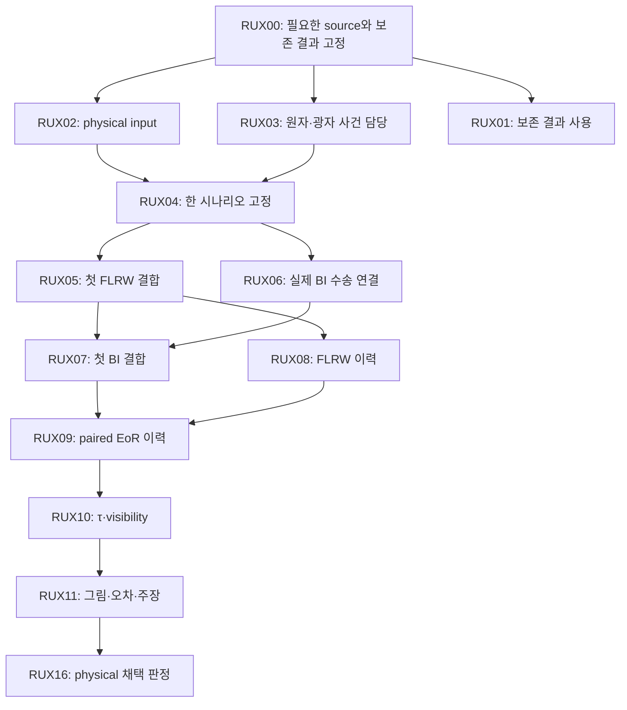

# BASS_HE–REI 연구계획 재편: B1 결과를 보존하고 physical EoR 경로로 이동

2026-10-12 KST · 사용자 첨부 RUX DAG의 후속 실행계획

## 1. 이번 결정

다음 주 연구 경로는 **물리 입력과 원자 사건의 담당 계산을 확인하고 → 하나의 시나리오를 고정하고 → 첫 FLRW/Bianchi 결합 구간을 계산하고 → 실제 H/He 이력과 BASS 관측량으로 이어가는 순서**다. 첨부 DAG의 RUX00–RUX16 식별자를 모두 유지한다. 실제 의존성은 [ACTIVE_DAG.json](ACTIVE_DAG.json)에 기록한다.

방금 끝난 B1은 별도의 보존 결과로 편입한다. 고정된 reduced 전자 이력, 등방 Planck 초기 복사장, cold elastic Thomson, test-field, 초기 s/H=+0.1, 평균 부피 z20→4 조건의 **실제 Python 결과는 PROMOTE_SCOPED_PYTHON**이다. 원래 B1 Rust/native 연결과 Python–Rust parity는 **HOLD_RUNTIME_ENVIRONMENT / NOT_RUN**이다. 이 결과로 RUX06의 보존형 수송 전체 또는 RUX10의 physical history/observer-tail 조건이 완료됐다고 판단하지 않는다. [B1 독립 판정](../review/DECISION.json)

**이번 재편은 계획 변경이다. RUX 물리 실행은 새로 하지 않았으며 새 NCP 작업은 0개다.** 첨부 파일에 적힌 원격 archive의 존재·상태는 해당 문서의 보고로 보존한다. 이번에 그 archive 내부를 새로 열거나 physical admission을 완료한 것은 아니다. 원본 4개와 SHA는 [입력 manifest](SOURCE_ATTACHMENTS_MANIFEST.json)에 보존했다.

## 2. 이전 계획에서 바뀐 점

| 항목 | 재편 후 적용 |
|---|---|
| 직전 우선 과제였던 B1 | 한정된 Python 과학 결과를 완료 기준으로 보존. 동일 실행·추가 세분 반복 종료 |
| 다음 물리 질문 | 일반적인 ‘선택 feedback’ 대기 상태를 RUX00 → RUX02/RUX03 → RUX04의 구체적 입력·사건 검토로 전환 |
| 계획의 중심 저장소 | physical H/He 결합 계산은 rei_bianchi가 담당. BASS_HE는 원자 입력의 의미·적용범위, bass는 수송·관측량 수신을 담당 |
| 첨부 handoff의 RUX02 다음 RUX03 | RUX00 뒤 RUX02와 RUX03의 독립 부분을 병렬 진행. 선택된 입력에 대한 최종 정합성은 RUX04에서 합침 |
| RUX01 보존 결과 | B1의 이미 작성된 CSV·그림·판정을 추가. F08/SYNC02/SYNC03의 기존 결과와 서로 다른 조건을 유지 |
| RUX06·RUX10 | B1에서 확인한 부분만 재사용하고, 실제 결합 코드의 미확인 조건을 별도 작업으로 남김 |
| HE/CR/HH 정밀 확장 | RUX12–14의 정식 paired 영향 평가는 RUX11 뒤. 과정의 필요성·짧은 민감도 선별은 RUX03/RUX04에서 먼저 수행 |
| E13C11 및 고비용 재계산 | 실제 소비자 관측량의 오차 원인이 확인될 때만 재개. 현재 PARKED |
| 계산 분담 | 경량 작업 HERE, 실측된 중량의 독립 미완료 작업만 NCP |

RUX12–14를 선택 경로로 둔다는 것은 기본 HI/HeI/HeII 흡수·이온화·재결합·광가열을 생략한다는 뜻이 아니다. 선택 시나리오가 요구하는 기본 과정은 RUX03/RUX04의 필수 조건이다. 고에너지 입자 보정, 특수 HH 과정, 추가 HE 정밀화의 필요성을 그 기본 과정과 구별한다.

## 3. 완료 증거와 새 과제를 연결하는 방법

| 보존 입력 | 그대로 쓸 수 있는 것 | 이번 재편에서 승격하지 않는 것 |
|---|---|---|
| B1 | 동일 물리 에너지에서의 Python Thomson 호출, frozen cell의 B proper-clock 투영, LRS 특성선, 여섯 대조군, paired 수치 민감도, CSV·그림 | 실제 Rust 연결, 보존형 frequency-face flux 망원합, source-backed H/He 결합 이력, 관측 CMB 예측 |
| REI reduced history / BASS N4 | B1이 실제 사용한 입력·단위·시계 연결과 고정 SHA | reduced Q를 종별 xHII/xHeII/xHeIII 또는 QV로 재명명; 해당 입력을 완전한 physical EoR admission으로 처리 |
| F08 / SYNC02 / SYNC03 | 첨부 문서가 가리키는 보존된 합성/조건부 결과. RUX00에서 필요한 원본 영수증과 정확한 ref를 확인한 뒤 재사용 | 합성 짧은 구간을 cosmological history로 확대; 조건부 유한 구간 τ를 observer까지의 총 τ로 확대 |
| HE E13 / CR / HH | 각 source별로 이미 채택된 유한 범위·점 진단·사건 모멘트와 제한 | 유한 구간 폭을 전체 물리 오차로 처리; 광자 stock을 rate로 처리; 미완성 native/continuum을 PASS로 처리 |

**RUX06 잔여:** B1의 semi-Lagrangian occupation pullback과 충돌 중 적분 보존은, 선택된 rei_bianchi 보존형 수송의 광자 수 장부·주파수 경계 유량 상쇄를 대신하지 않는다. 실제 소비자 코드와 선택한 에너지 격자에서 새로 연결된 부분만 확인한다.

**RUX10 잔여:** B1의 깊이 재투영은 수신 측 단위·시계 근거로 재사용한다. 그러나 RUX09에서 채택된 actual proper n_e(t), visibility 정의·정규화, 선언한 관측자 구간의 꼬리 입력은 별도로 필요하다. 꼬리가 없으면 유한 구간 결과를 보고하고 총 τ 주장은 HOLD로 둔다.

기존 B1의 z4,y1 수치는 q2(B)=−0.0364635999884, 적도 pL(B)=0.000808320304873, δhist q2=−2.46431894099e−7이다. 이 처방 비교가 전체 source·closure·열적 불확실성을 평가한 것은 아니다. [B1 보고서](../REPORT_KO.md) · [수치 평가](../analysis/B1_NUMERICAL_ASSESSMENT.json)

## 4. 실행 DAG와 병렬 순서

그림은 주 실행 순서의 요약이다. RUX11은 RUX08·RUX09의 실제 이력도 직접 소비한다. RUX12–15의 조건과 정확한 의존성은 DAG JSON을 따른다. 서로 독립인 쌍은 **RUX02/RUX03**, **RUX05/RUX06**, **RUX07/RUX08**이다. 한 trajectory 내부의 시간 구간을 독립 작업처럼 병렬화하지 않는다.

| 단계 | 과제 | 다음 단계로 넘길 결과 | 장소 |
|---|---|---|---|
| 0 | RUX00 | 사용 source의 exact commit/tree/blob, 필요한 원본 영수증, 완료/미완료 경계 | HERE |
| 1 | RUX02 + RUX03 | PHYSICAL_INPUT_ADMISSION, ATOM_OWNER_MATRIX, RATE_DOMAIN_MAP | HERE 병렬 |
| 1 별도 | RUX01 | 저장된 결과의 용도별 그림·장부. 이미 있는 B1 그림은 링크로 재사용 | HERE |
| 2 | RUX04 | 하나의 source-backed FLRW/BI 시나리오, 입력·근사·허용오차 고정 | HERE |
| 3 | RUX05 + RUX06 | 첫 FLRW 실제 결합 구간 + 실제 BI 수송의 변경 부분 검증 | HERE 병렬 |
| 4 | RUX07 + RUX08 | 첫 BI 결합 구간 + FLRW 다중 시기 이력 | HERE 우선 |
| 5 | RUX09 | 동일 source·closure의 FLRW/BI 이력과 차이의 수치 민감도 | HERE pilot 후 필요 시 NCP |
| 6 | RUX10 + RUX11 | τ·visibility, 종별 이력·온도·광자, 오차별 장부와 그림 | HERE |
| 7 | RUX16 | 독립 물리 채택 판정과 재현 가능한 공개 범위 | HERE |

RUX08이 실측 결과 무거워지더라도 단일 FLRW 이력의 시간 순서를 쪼개지 않는다. 먼저 계산 방법과 실제 미완료 scenario 수를 확인해 DAG의 실행 배치를 명시적으로 갱신한다.

## 5. 다음 연구 루프의 정확한 범위

다음 작업 묶음은 **RUX00의 필요한 부분을 확정한 뒤 RUX02/RUX03를 진행하여, 첫 실행 가능한 physical 시나리오 또는 정확한 누락 항목을 반환하는 것**이다. 이 계획을 작성한 이번 단계에서 그 입력 검사를 완료했다고 기록하지 않는다.

### RUX00 — 필요한 정보만 고정

7개 저장소와 17개 source를 매번 전체 재감사하지 않는다. 이번에 실제로 소비할 소스·영수증·입력의 범위를 정하고, 이미 고정된 B1/source 기록을 가져온 뒤 빠진 ref 또는 이후 바뀐 부분만 확인한다. 10월 4일 GLOBAL_DAG의 pending 기록은 당시 계획으로 유지한다. 뒤의 완료 영수증을 원래 파일에 소급 기입하지 않는다.

### RUX02 — archive 존재와 physical 채택을 분리

첨부 문서의 v2 handoff와 P01/P02A/P03A/source-delta는 **후보**다. 먼저 내부 manifest와 포함 관계를 확인한다. 선택에 필요한 최소 archive/member만 취득하고, 상위 packet에 동일 byte의 필요한 입력이 이미 있으면 중복 복구를 중단한다. 실제로 사용한 byte는 검증하되 파일명이나 존재 사실만으로 PASS하지 않는다.

각 후보에서 다음 필드를 표로 확인한다: 초기 epoch와 aV·방향별 shear/배경, H/He 초기 비율과 온도, 실제 광자 spectrum·시간 의존 방출률, normalization·escape·clumping과 sink 가정, proper/comoving 단위, 원자 과정 적용범위, executable callback의 source pin. 구체적 source와 근거가 없는 값은 UNKNOWN/MISSING으로 남긴다.

필수 항목이 남으면 **PHYSICAL_HOLD + 누락 필드 목록 + 그 필드를 채울 단일 입력 선정 과제**로 닫는다. 그 대신 더 큰 HE 정밀도 campaign을 시작하지 않는다. RUX03의 독립된 정리와 기존 결과의 사용은 계속 가능하다.

### RUX03 — 사건이 한 번씩 계산되도록 고정

종별 HI/HeI/HeII 흡수 단면적과 binding cutoff, 재결합·충돌 이온화·가열의 담당 구현, 지원 domain과 단위를 기록한다. Case A의 명시적 재결합 광자와 case B OTS를 같은 사건에 겹치지 않게 한다. 국소 HI 흡수와 effective mean-free-path sink도 같은 광자를 두 번 소모하지 않도록 한다. rate, 누적 photon stock, 순간 inventory, 가열 power와 누적 energy를 구분한다.

특히 원 첨부 지침대로 **Verner 단면적의 photon cutoff와 이온화 binding energy를 별도 필드로 보존**한다. `photon_cross_section_cutoff_eV`와 `ionization_binding_energy_eV`를 종별로 기록하고 각각의 source·용도를 확인하며, 두 값을 서로 대체하거나 같다고 가정하지 않는다.

가스 proper frame, photon/energy normalization과 c, ℏ, kB를 명시하고 metric은 (-,+,+,+)를 유지한다. 첨부 문서의 F08 13.7 eV fixture를 H/He 전체 광이온화 스펙트럼으로 채택하지 않는다. helium 주장이 필요한 경우 그 문턱을 지지하는 실제 spectrum이 필요하고, 그렇지 않으면 주장 범위를 줄인다.

RUX03에서 HE/CR/HH의 적용범위와 대략적인 관측량 관련성을 먼저 확인한다. 가능한 경우 기존 저장값·RHS의 한 점 또는 짧은 구간으로 선별한다. 아직 physical scenario가 없으면 민감도 계산도 조건부 진단으로 표시한다. 이 선별은 RUX12–14의 완성된 physical paired 영향 평가를 미리 PASS시키지 않는다.

### RUX04 — 출력 보기 전에 고정

RUX02/RUX03가 정합적일 때 한 시나리오를 고른다. FLRW와 BI에 공통인 source·closure·원자율·IC와, 의도적으로 다른 배경·shear를 구분한다. 선택 관측량, 비초기/근영점 처리, 수치 허용오차, 보존 기준과 지원 에너지·온도·시간 범위를 결과 전에 고정한다. B1의 10% 탐색 기준을 모든 EoR 정확도 목표에 자동 복사하지 않는다.

## 6. 물리 계산과 주장에 대한 완료조건

RUX05/07은 기존 coupled_primary, angular_photons, axisym_radiation, homogeneous_rates 등의 해당 경로를 재사용한다. 같은 흡수 사건이 광자 소모, 종별 이온화와 가열에 연결되는지 확인하고 nuclei·charge·photon·energy 장부, 양의 종 분율·온도, 시간 carry와 group-boundary 유량을 저장한다. 새 solver를 만드는 것이 기본 과제가 아니다.

선택 코드가 Rust 실행을 필요로 한다면 실제 허용된 compiler/runtime이 있어야 한다. B1의 Python 성공은 그 실행 환경을 제공하지 않는다. 빌드가 막히면 RUNTIME_ENVIRONMENT_HOLD로 분리하고 물리 입력 누락으로 기록하지 않는다. 대체 backend를 쓰는 경우 사전에 범위와 검증 요구를 명시하며 native 완료를 선언하지 않는다.

RUX08/09에서는 xHII, xHeII, xHeIII, Tg, Γs, proper ne와 광자 장부를 출력한다. redshift는 우선 mean-volume 좌표로 명시한다. 방향 전파만의 효과를 주장하려면 평균 H를 맞춘 대조 또는 그에 상응하는 분해가 있어야 한다. 같은 source의 전체 배경 차이와 방향 수송 차이를 섞지 않는다.

수치, 원자 입력, source, 기하, 공간 closure의 오차·불확실성을 별도 열로 둔다. 단순한 두 모델 차이는 그 전체 불확실성 추정량이 아니다. homogeneous xHII를 QV로 바꾸거나 patchy 21 cm 스펙트럼을 주장하지 않는다. τ의 적분 구간과 observer tail이 부족하면 유한 구간 결과로 한정한다.

## 7. 선택 확장과 BASS_HE의 역할

| 노드 | 활성화 조건 | 먼저 할 가벼운 일 | 계속 보존할 제한 |
|---|---|---|---|
| RUX12 HE | 관련 전이·율의 불확실성이 선택 관측량 오차에 실제로 기여 | provider domain·사건 모멘트 확인과 bounded perturbation 선별 | E13 유한 폭≠전체 physical 오차; 2,440경로 재실행 자동 배정 없음 |
| RUX13 CR | hard photon/secondary electron/deposition을 선택 모델이 요구 | 기존 흡수·광가열과 추가 hard-particle 담당 구분, 점 응답 확인 | CR OFF baseline의 가정 명시; wide propagated error의 미완료 유지 |
| RUX14 HH | 이름이 정해진 HH 과정이 종·온도·관측량에 기여 | stoichiometry, threshold heating, 지원 domain 확인 | 기존 native/continuum 제한 유지, 서로 다른 채널 대체 금지 |
| RUX15 공간 구조 | QV, topology, patchy 21 cm 등 공간 관측량을 실제로 선택 | density–ionization correlation과 공간 RT 가정 확정 | one-zone 결과만으로 공간 예측 불가 |

정식 RUX12–15는 첨부 DAG처럼 RUX11을 선행으로 둔다. 앞 단계에서 필요한 과정의 누락이 발견되면 RUX04의 선택 시나리오를 보류하고 **그 과정 하나의** 선행 작업을 명시적으로 추가한다. 모든 정밀 연구를 다시 필수 의존성으로 만들지 않는다.

RUX13에는 추가 확인이 필요하다. 첨부 S15가 보고하는 point photon-stock 진단만으로 hard-particle/deposition provider가 구현·검증됐다고 연결할 수 없다. 현재 그 과정 매핑은 **UNRESOLVED**다. 저장소의 CR 약자에서 물리 과정을 추정하지 않고, 이름이 정해진 과정·담당 함수·지원 domain과 실제 출력 계약을 RUX03에서 확인한다. 확인 전에는 S15를 hard-particle 실행 근거로 사용하지 않는다.

BASS_HE의 당장 필요한 기여는 RUX03에서 소비자가 요청한 rate/event/heat의 의미와 지원 범위를 정확히 전달하는 것이다. E13C11은 소비자 정확도 병목이나 독립 수학 질문이 지정될 때만 재개한다. rei_bianchi/bass의 production 통합·병합을 이번 BASS_HE 문서 게시로 대신하지 않는다.

## 8. HERE와 NCP 분담

B1의 실제 12-run campaign은 HERE에서 약55.2초, pilot 포함 CPU 합149.8초, process 최대 RSS 약90 MiB였다. 이 완료 계산을 64코어 환경에서 다시 수행할 필요가 없다. [실제 계산 비용](../analysis/B1_NUMERICAL_ASSESSMENT.json)

NCP의 후보는 RUX09의 많은 독립 미완료 이력, 실제 요구가 생긴 RUX12–15의 무거운 계산이다. 먼저 HERE에서 wall/CPU/RSS와 필요한 작업량을 측정한다. 입력·전달·회수까지 포함한 예상 총시간과 실제 병렬 이득이 있어야 작업을 만든다. 코어를 채우기 위해 scenario나 precision sweep을 추가하지 않는다.

NCP packet에는 관측량·정확도·물리 입력 채택 상태, exact source/input, **미실행 독립 work list**, 작업당 측정 비용·메모리, 실행 명령, fresh output/checkpoint/실패 보존·반환 규칙이 필요하다. RUX04·RUX07 등 해당 선행 gate를 충족하지 못하면 물리 campaign을 시작하지 않는다. 이번 새 work list는 **[]**다.

64코어/128GB는 사용자가 알려 준 예정 사양이다. 실제 실행 때 affinity/quota/NUMA와 가용 메모리를 확인한 뒤 rank/thread 수를 정한다. MPI/OpenMP/BLAS 중첩을 피하고 실제 가용 RAM의 최소20%를 남긴다. 각도는 Thomson 충돌로 결합되고 시간은 인과적으로 이어지므로 자동적인 독립 병렬 단위가 아니다.

## 9. 게시와 다음 전달

이번 BASS_HE draft 변경에는 완료된 B1 dossier와 이 후속 계획을 함께 둔다. 최상위 DEVELOPMENT_PLAN_KO.md에서 이 문서와 ACTIVE_DAG를 연결한다. 원래 B1 보고서·실행 receipt·독립 판정은 byte를 바꾸지 않는다. 첨부 원본 DAG도 별도 보존하고 새 overlay가 어떤 상태·일정만 바꿨는지 [REUSE_AND_GAP_MAP.json](REUSE_AND_GAP_MAP.json)에 기록한다.

후속 구현 PR 묶음은 제안이다: RUX00–03 intake, RUX04–05 첫 FLRW, RUX06–07 첫 BI, RUX08–09 이력, RUX10–11·16 관측량/채택. 아직 이들 rei_bianchi/bass PR을 만들거나 과학 실행을 완료한 것은 아니다. 실제 BASS_HE 게시 commit/PR은 packet의 PUBLICATION.json과 외부 전달 영수증을 따른다.

다음 실행자는 [새 local/NCP handoff](NCP_LOCAL_CODEX_HANDOFF_KO.md)를 사용한다. 기존 상위 폴더의 B1 handoff는 그 연구 루프의 종료 기록이며, 다음 일정은 이 새 계획이 우선한다. 다음 루프는 입력·사건의 구체적 채택 여부를 먼저 결론내고, 같은 범위의 보존 결과 재실행과 재귀 검토를 반복하지 않는다.

## 근거

- [사용자 첨부 원본 DAG](inputs/REI_ATOMIC_REUSE_DAG_20261012.json): 17개 RUX 노드, source registry, 미실행·선택 경로의 경계.
- [사용자 첨부 계획](inputs/REI_ATOMIC_REUSE_PLAN_20261012.md) 및 [handoff](inputs/REI_ATOMIC_REUSE_CODEX_HANDOFF_20261012.md): 원본 작업 조건과 source별 보고된 제한.
- [B1 독립 판정](../review/DECISION.json), [보고서](../REPORT_KO.md), [실제 계산 평가](../analysis/B1_NUMERICAL_ASSESSMENT.json): 이번 세션에서 실제 완료된 범위.
- [기존 PR27 계획](https://github.com/cosmosapjw-quantum/BASS_HE/blob/c3e797e0998cececc7cb7d0a502fc4e66f33fafc/DEVELOPMENT_PLAN_KO.md): 앞선 B1 우선순위와 E13 대기 상태.

계획의 채택은 물리 결과의 채택과 다르다. 이 문서는 완료 증거의 범위를 보존하면서 다음 작업의 순서와 완료조건을 결정한다.
