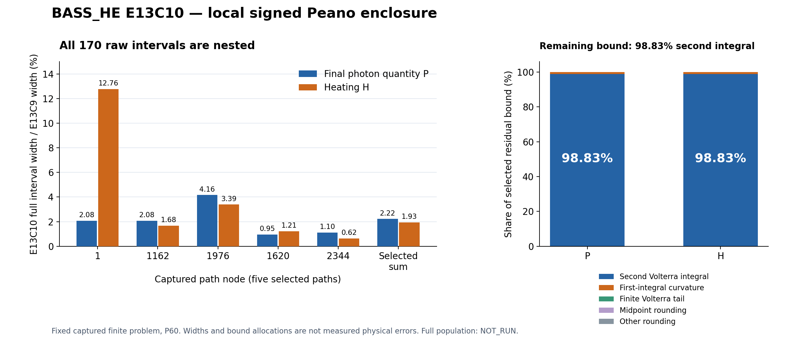

# BASS_HE E13C10 — 첫 적분의 부호 있는 곡률 상계와 국소 채택

기록 일자: 2026-10-12 UTC. 현재 연구 노드: `HE_E13C10_FIRST_MIDPOINT_BOUND_LOCAL01`.

## 결과와 의미

끊긴 지점에서 실제 E13C9 백업과 다음 연구 노드를 복구한 뒤, 첫 적분의 중점 오차 상계를 개선하는 E13C10을 실행했다. **선택한 5개 captured OFF 경로, 12개 segment, 170개 raw 구간 모두 이전 E13C9 채택 구간에 포함되고 폭이 증가하지 않는다.** 실제 독립 판정은 **`PROMOTE_SCOPED_LOCAL_SIGNED_CURVATURE_FIRST`**다. 선택 경로의 양의 원래 가중치를 적용한 정확한 합산에서 P 구간 폭은 **97.7836860203%**, H 구간 폭은 **98.0689999175%** 감소했다.

이 수치는 광자량이나 가열량 자체가 그만큼 변했다는 뜻이 아니다. 동일한 고정 유한 문제의 값을 보증하는 **수치 포함 구간의 폭**이 줄었다. 전체 2,440개 경로의 개선율, 실제 해와의 측정 오차 또는 물리 정확도는 이번 결과에 포함되지 않는다. E13C8의 전체 유한 합산 채택과 E13C9의 국소 채택은 보존하며, E13C10 전체 경로 계산은 **NOT_RUN**, physical·continuum·production·receiver는 **HOLD**다.

근거: [실제 독립 결정](review/independent/INDEPENDENT_DECISION.json), [독립 검토서](review/independent/INDEPENDENT_REVIEW_KO.md), [정확한 가중 합산](analysis/ACTUAL/LOCAL_ANALYSIS.json), [선택 raw 결과의 identity](analysis/ACTUAL/SELECTED_CANDIDATE.json).

## 1. 실제 수치 결과

모든 경로의 interval precision은 P60이다. N은 첫 적분의 원래 격자이며, M은 유지한 E13C9 두 번째 보정 격자다. 새 중점값 평가는 하지 않았다.

| Node | 판별하는 경우 | N_first | M_second | P 폭 감소 | H 폭 감소 | 실제 경로 시간 |
|---:|---|---:|---:|---:|---:|---:|
| 1 | HI, 저장된 최대 D 포함 | 1024 | 128 | 97.9199% | 87.2382% | 10.8701 s |
| 1162 | HI+HeI | 1024 | 256 | 97.9239% | 98.3213% | 24.3629 s |
| 1976 | HI+HeI+HeII | 1024 | 128 | 95.8434% | 96.6141% | 16.2851 s |
| 1620 | HeII mask 전환, 3 segments | 512 | 128 | 99.0507% | 98.7861% | 20.9418 s |
| 2344 | source OFF/OFF/ON, 3 segments | 512 | 128 | 98.8952% | 99.3766% | 20.2431 s |

| 선택 5개 경로의 가중합 | E13C9 구간 폭 | E13C10 구간 폭 | 감소율 |
|---|---:|---:|---:|
| P_final | 1.83702702468600293091209E-22 | 4.07142867588229839073736E-24 | 97.7836860203% |
| H_total_eV | 4.13086716341852351327605E-21 | 7.97670483331586145025232E-23 | 98.0689999175% |

이 표본은 HI/HeI/HeII 종과 mask/source event, serial carry의 구현 위험을 판별하도록 선택했다. 전체 분포를 대표하는 통계 표본이 아니다. P는 원래 photon/number 단위, H는 원래 eV 가중 단위를 유지했다.

## 2. 물리 문제를 유지하며 바꾼 수치 표현

원래 photon 방정식과 frozen 기준을 사용한다.

\[
P'=q-\Lambda P,\quad P_f'=q_f-\Lambda_fP_f,\quad
r=(q-q_f)-(\Lambda-\Lambda_f)P_f.
\]

E13C9에서 채택한 첫 변분과 부호 있는 두 번째 Volterra 보정, finite remainder는 그대로 둔다. 이번 변경은 첫 변분의 17개 적분량을 감싸는 수치 구간에만 있다. 정규화 좌표 \(x=u/h\)와 고정 event-free cell \([a,b]\), \(d=b-a=1/N\), \(m=(a+b)/2\)에 대해

\[
\int_a^b f(x)\,dx-d f(m)=\int_a^bK(s)f''(s)\,ds,
\quad
K(s)=\begin{cases}(s-a)^2/2,&a\le s\le m,\\(b-s)^2/2,&m\le s\le b.\end{cases}
\]

커널은 음이 아니고 전체 질량은 \(d^3/24\), 각 반 셀의 질량은 \(d^3/48\)이다. 원래 whole-cell Jet2가 실제 두 번째 도함수의 구간 \(D_{\rm whole}\)을 제공한다. 이번에 왼쪽 반 셀의 \(D_{\rm left}\)를 추가로 평가하면

\[
\int_0^h f(u/h)\,du\in Q_N+
\sum_j\frac{h}{48N^3}\left(D_{{\rm left},j}+D_{{\rm whole},j}\right).
\]

오른쪽 반 셀은 whole-cell의 부분집합이므로 그 부분의 도함수도 같은 whole-cell 구간으로 포함된다. 이 식은 양의 가중 커널을 갖는 두 적분을 직접 감싸며, 실패 구간과의 교집합이나 clipping을 사용하지 않는다. 곡률의 부호를 유지해 불필요한 대칭 반경을 줄인다. C²만 가정하며, 네 번째 도함수나 일반적인 3차 폭 수렴률을 주장하지 않는다.

원래 중점 합 \(Q_N\)은 동일 source·input·segment·N·P의 full RESULT SHA로 묶어 재사용했다. 먼저 실행했던 같은-N 두 경로의 whole-cell 곡률도 정확한 RESULT SHA와 cell 좌표를 검증해 재사용했다. 나머지 경로는 whole-cell와 left-half를 각각 한 번 평가했다. 중점 평가 0회는 실제 실행 기록으로 확인된다.

매 segment의 incoming center/radius는 새 carry로 전파한다. E13C9의 부호 있는 두 번째 적분 및

\[
(|G_k|+T_k)\eta+T_kDS,\qquad S=|c_{\rm new}|+\eta_{\rm new}+B_r
\]

를 새 incoming 값으로 계산한다. tail 계산에는 원래 input-independent fine-grid bounds를 재사용한다. signed energy seam, photon stitch, species 합산, cutoff와 binding energy 구분, 정확한 binary64 lift와 원래 에너지 변환은 유지했다. 새 gas 진화, source나 closure 변경은 없다.

근거: [고정 과학 계약](SCIENTIFIC_CONTRACT.md), [양의 커널 직접 유도와 대안](theory/THEORY_OPTIONS.md), [first_midpoint.py](code/first_midpoint.py), [최종 조립 diff](evidence/FINAL_FIRST_PATH_DERIVATION.diff), [diff의 역사 구분](evidence/DERIVATION_DIFF_STATUS.md).

## 3. 실패를 보존하고 원인에 맞춰 보완한 과정

최초 N32 두 경로는 계산 자체는 완료됐지만 raw admission을 통과하지 못했다. Node1은 12/34, node1976은 0/34 nested였다. 특히 node1의 H 폭은 기존의 약 2,253.74배여서, 거친 곡률 구간의 의존성 폭이 문제임을 확인했다. 폭이 좁아진 QN/QE도 기존 끝점을 넘을 수 있었다. 나머지 세 N32와 조건부 N64는 실행하지 않고 superseded로 기록했다.

다음 같은-N signed whole-cell 두 경로는 모든 폭이 줄었으나 node1은 33/34, node1976은 26/34 nested였다. Node1의 QN 끝점 초과는 약 2.72e−83이었다. Node1976에는 HeI 항과 새 carry 전파의 약 1.55e−9 old-width 상대 끝점 초과도 있었다. 작은 값이라는 이유로 허용 오차를 늘리지 않았다. 국소 first integral이 들어맞더라도 재중심화와 다음 segment 조립에서 포함 관계가 자동 보장되지는 않음을 확인했다.

반 셀의 양의 Peano 질량을 이용한 현재 보완 후에는 두 경로가 34/34를 통과했고, 나머지 세 경로도 첫 실행에서 모두 통과했다. 추가 해상도·정밀도 sweep은 하지 않았다. 과거 코드·lock·raw 결과와 첫 판단 기록은 그대로 보존했다. 이력의 실패 상태를 성공으로 덮어쓰지 않았다.

근거: [최초 N32 판단](evidence/FIRST_N32_RAW_ADMISSION_FINDING.json), [같은-N 끝점 판단](evidence/FIRST_SAME_N_RAW_ADMISSION_FINDING.json), [보존한 코드 revisions](evidence/SOURCE_REVISIONS), [최종 raw 선택](analysis/ACTUAL/SELECTED_CANDIDATE.json).

## 4. 독립성, 실제 검증과 한계

| 검증 범위 | 실제 실행과 결과 |
|---|---|
| 정확한 다항식 이론 통제 | 8개 다항식×5격자, 207 checks, 실패 0, 약 0.041초 |
| 최초 signed 구현 | 12 cases×2격자, 2,290 checks, 실패 0; 초기 revision의 증거 |
| cached midpoint 변경 | 12 cases, 941 checks, 실패 0; 해당 revision의 증거 |
| 현재 half-cell 변경 | 6 cases×fresh/cached parent, 993 checks, 실패 0; 0.4769초 |
| 현재 half-cell 실제 호출 | toy coefficient 144회=whole48+left96, midpoint0, 별도 cache setup0 |
| 실제 captured 결과 | 5개 경로·12 segments, 170/170 raw nested 및 nonincrease |
| 독립 Fraction 감사 | 413,507 checks, 실패 0, 9.5172초; science kernel import·호출 0 |

현재 제조 통제는 양·음 quadratic, 부호가 바뀌는 cubic, 정확한 zero, 종별 상쇄, L=0을 포함한다. P140 폐형식 oracle의 17개 출력이 구간에 포함되고, fresh/cache parent 방식이 동일한 endpoint를 생성하며 cache가 보존되는지 확인했다. 세 revision의 제조 이력을 합친 4,224 checks는 **모두 현재 소스를 실행한 수치가 아니다**. 현재 half-cell 코드에 직접 해당하는 것은 993 checks다.

후보와 제조 설계에 참여하지 않은 reviewer가 원래 17개 source pin, input·N·P·parent identity, 9,216개 cell의 split Peano 산술, midpoint 보존, 새 carry·tail·seam·가중치를 별도로 읽고 재구성했다. 170개 raw metric, 205개 보존식 재구성 검사, 양의 bound allocation이 정확히 일치했다. 검토의 실제 판정 파일이 채택 권한을 가지며, 그 전에 생성된 RESULT/분석의 PENDING 문자열은 역사 상태로 보존했다.

이 검증은 공유된 Python Decimal exp primitive나 원래 물리 계수 모델까지 독립적으로 증명하지 않는다. Jet2의 2차 도함수 convention과 원래 계수 구현은 source-bound 검토 대상이다. Python 문서는 exp의 반올림 및 Decimal 의미를 확인하는 참고이며, 이번 Peano 식의 증명은 직접 유도했다. 형식 증명기 인증 또는 물리 모형 검증으로 표시하지 않는다.

근거: [현재 제조 보고서](tests/MANUFACTURED/HALF_CELL_CONTROL_REPORT_KO.md), [실행 영수증](tests/MANUFACTURED/EXEC03_HALF_CELL/RECEIPT.json), [독립 원시 감사](review/independent/EXEC01_FINAL/REVIEW_RESULTS.json), [공식 문서와 source 근거](references/EXTERNAL_SOURCE_NOTES.md).

## 5. 실제 계산 비용과 NCP 경계

이번에 실행한 진단 포함 경로는 총 **9회**, 실제 계수 평가 **24,320회**다. 새 first-integral 계수 평가는 18,688회, 새 path 조립 중 second correction 평가는 5,632회다. 이전 전체 경로 work unit과 원래 first-variation quadrature를 재실행한 횟수는 0회다. 단, incoming center가 같게 유지된 일부 low-level second-correction 산술은 새 조립에서 결정적으로 반복될 수 있다.

네 실제 batch의 wall 합은 **62.2811초**이며, 최종 다섯 경로를 수행한 두 batch는 **42.0999초**다. 이 수치는 연구 전체의 경과 시간이 아니다. 진단 포함 경로별 process CPU 합은 **125.5438초**, 최종 경로 CPU 합은 **92.6655초**다. 가장 긴 경로는 **24.3629초**, 경로 process의 개별 최대 RSS는 **173,412 KiB=169.35 MiB**다. 독립 감사의 별도 최대 RSS는 196,068 KiB다. 전체 동시 process memory peak와 CPU utilization은 측정하지 않았다.

실행 호스트는 `d48c07c99ee6`, CPython3.12.14, affinity0–8이다. provider attestation은 없다. 로컬 제한은 최대3 workers, 경로당120초·1GiB였고 실제 경로 모두 그 안에서 완료됐다. 다른 호스트·다른 workload 시간을 나눠 NCP speedup으로 표시하지 않는다.

따라서 **현재 새 NCP work unit은 0개**다. 64코어·128GB를 쓸 이유는 실제로 남아 있는 무거운 병렬 문제와 그 결과의 과학적 효용이어야 한다. 이번 국소 계산은 여기서 모두 마무리했다. 기존 2,331개 heavy return과 전체 2,440개 finite 합산도 보존하며 재실행하지 않았다.

기존 E13C8의 전체 유한 결과를 읽으면 P의 relative full interval width는 약 **1.07071908e−13**, H는 약 **5.76346954e−13**다. 이는 고정 captured 유한 목표의 수치 포함 폭이며 continuum 오차와 무관하다. 정확한 full observable·허용 폭·그 기준을 더 좁힐 필요성이 지정되지 않은 상태에서 이번 5개 경로의 개선율을 전체에 외삽해 heavy job을 만들지 않았다. 0에 가까운 ledger midpoint로 relative width를 계산해 큰 값을 얻는 것도 새 계산 필요성의 근거가 아니다.

향후 실제 중량 batch가 필요하면 source/input/work lock을 먼저 고정하고, 완료되지 않은 독립 path 단위만 편성해야 한다. path 안의 segment는 순서를 지켜 carry를 전달한다. rank×thread·BLAS/OpenMP 중첩·NUMA·affinity/quota·20% 이상 RAM 여유는 실제 자원 관측으로 결정한다. 64×1 등의 layout은 후보이며 측정 없이 최적이라고 확정하지 않는다. P60 구간 backend를 binary64로 바꾸는 것은 별개의 방법 변경이다.

근거: [NCP 행동](NCP_ACTION.json), [실제 비용 기록](analysis/ACTUAL/LOCAL_ANALYSIS.json), [기존 전체 결과와 NCP 효용 분석](analysis/NCP_SCIENTIFIC_UTILITY_MEMO_KO.md), [기존 HPC 정책](references/HPC_POLICY_KO.md).

## 6. 남은 수치 상계와 다음 연구 노드

| 선택 결과의 양의 반폭 배분 | P | H |
|---|---:|---:|
| 두 번째 signed rectangle 적분 및 carry | 98.8297170695% | 98.8338156793% |
| 첫 적분 곡률 구간 및 carry | 1.1702058174% | 1.1661477698% |
| finite Volterra tail 및 carry | 0.0000771131% | 0.0000365508% |
| 중점·기타 반올림 | 표시 정밀도에서 미미 | 표시 정밀도에서 미미 |

Fraction으로 각 반폭을 정확히 재구성한 **상계의 배분**이다. 실제 error attribution이 아니다. 첫 적분 상계를 줄이자는 E13C10의 목표는 달성했고, 같은 부분을 더 계산해 얻을 수 있는 현재 bound 감소는 약1.17%뿐이다.

다음 노드는 **`HE_E13C11_SECOND_INTEGRAL_BOUND_LOCAL01`**로 제안한다. location은 **HERE_LOCAL**, status는 **PROPOSED_NOT_RUN**이다. 새로 지배적인 coupled prefix/kernel의 두 번째 적분 상계를 엄밀한 국소 규칙으로 줄일 수 있는지 유도하고, 별도 closed-form 통제와 가장 짧은 판별 경로부터 실행해야 한다. 이번 세션에서 다음 노드를 실행한 것으로 표시하지 않는다. 실제 full-population 정확도 질문과 무거운 독립 work list가 생기기 전에는 NCP queue를 열지 않는다.

근거: [정확한 반폭 분해](analysis/ACTUAL/BOUND_ALLOCATION.json), [다음 DAG](NEXT_DAG.json).

## 7. 복구, 백업과 이어서 작업하는 방법

이번 재개에서 E13C9 COMPLETE의 bytes/SHA와 nested 원본 source/input·완료 heavy return을 확인하고 실제 restore를 한 번 수행했다. 9.0502초에 PASS_COMPLETE_RESTORE였다. 최초 로컬 expected SHA 입력의 전사 오류는 canonical 원본값으로 바로잡았으며, 그때 restore나 과학 실행은 아직 들어가지 않았다. 최초 오류와 모든 수치 실패는 보존했다. 과거 `.bin` 접미사로 실패한 NCP 전송 기록과 이번 완료 기록을 혼동하지 않는다.

새 COMPLETE에는 이번 코드·raw cell 결과·실패 이력·분석·독립 판정, 고정된 E13C9 COMPLETE/kit를 함께 넣는다. 그 predecessor에는 E13C8과 E13C7 source/input·실제 NCP 반환까지 포함돼 있으므로 추가 입력 첨부가 필요 없다. Recovery helper는 조각의 실제 bytes/SHA를 사용하고 Drive 파일명에 `.bin`이 추가되는 경우도 처리한다. 새 output만 사용하며 첫 실패를 남기고 자동 재시도하지 않는다.

새 COMPLETE build, 실제 restore, recovery kit, 원격 backup ACK/readback과 additive draft PR은 이 불변 package를 봉인한 뒤 외부 delivery receipt로 연결한다. 업로드 확인과 실제 archive-chain restore는 다른 증거이며, 어느 것도 NCP physics 실행 또는 provider attestation을 뜻하지 않는다. 승인된 Git 변경은 새 branch의 draft PR이며 merge나 force push는 없다.

현재 상태는 [CURRENT_STATE.json](CURRENT_STATE.json), 수신 작업은 [내부 NCP 인계문](NCP_HANDOFF_INTERNAL_KO.md), 경로와 실행 정책은 [REPRODUCIBILITY.md](REPRODUCIBILITY.md)를 따른다. 외부 최종 handoff에 실제 archive/kit SHA와 Drive·Dropbox 위치가 들어간다. raw RESULT의 PENDING 문구를 제거하기 위해 과학 결과를 다시 쓰거나 실행하지 않는다.

