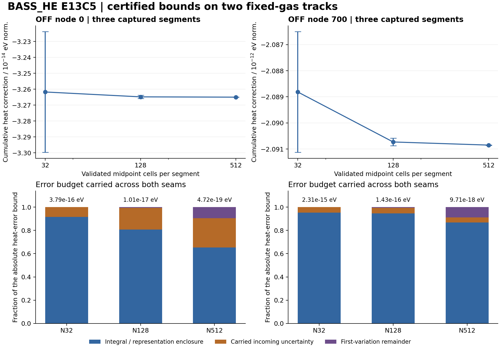

# BASS_HE E13C5 — incoming·moment·energy anchor 오차의 실제 경로 전파

작성 기준: 2026-10-11 KST. 모델 및 작업 하네스: GPT-6 Astra Pro, physmath research/coding v4.0.0. 모델 성능의 우월성은 측정하지 않았다.

## 1. 이번 루프의 결과

**서로 연결된 실제 captured 구간에서 광자 incoming 오차, 누적 moment 오차, exact-frozen/native 표현 차이, energy anchor를 함께 운반하는 구현과 bounded 계산을 완료했다.** OFF node 0과 700의 세 구간씩을 대상으로 하며, 네 seam을 지나도 incoming correction/error를 0으로 초기화하지 않는다. 이로써 E13C4의 여섯 독립 local certificate에서 남아 있던 구간 연결 문제를 선택한 두 track에서 실제로 처리했다.

Owner의 실행 완료와 independent admission을 분리한다. 최종 판정·open blockers·직접 읽은 범위는 `INDEPENDENT_REVIEW.json` 및 `INDEPENDENT_REVIEW_KO.md`가 정한다. 보고서·실행 기록·검토·인계문은 하나의 scientific package에 포함된다. 실제 Git publication과 두 백업의 ACK는 package 외부 delivery receipt에서 읽는다.

핵심 claim의 근거는 직접 유도, whole-cell interval arithmetic, 실제 실행 및 독립 exact arithmetic 검산이다. **상계는 저장된 continuous reference의 정확도를 가정하지 않는다.** E13C4에서 넘겨받은 인증 적분은 동일한 입력·N·precision을 가진 두 local 문제에만 재사용한다. 그 파일 안의 reference 비교 필드는 이번 상계 계산에 사용하지 않는다.

이 보고서의 짧게 반올림한 수치·비율·figure는 읽기용 요약이다. 정확한 certificate는 `evidence/N512_P60.json`의 모든 Decimal endpoint와 radius다. 표시한 상대 비율은 correction 크기에 대한 진단이며 물리적 허용 오차나 통계적 confidence level이 아니다.

## 2. 실제 범위와 보존한 모델

| Track | Captured ID 순서 | 새로 연결한 물리적 경계 |
|---|---|---|
| OFF / node 0 | OFF/1/0/0 → OFF/2/0/0 → OFF/2/0/1 | macro stage 전환, 13.7 eV source-on → source-off |
| OFF / node 700 | OFF/1/700/0 → OFF/2/700/0 → OFF/2/700/1 | macro stage 전환, 24.59 eV HeI active → inactive |

각 track은 첫 구간에서 captured `f0=0`, incoming defect=0으로 시작한다. 두 번째와 세 번째 구간에는 앞 구간에서 실제 계산된 correction과 그 반경을 전달한다. 이는 첫 구간의 실제 초기조건이며, 전체 continuous history를 매 구간 다시 정의한다는 뜻이 아니다.

구간 변수는 \(u=s-s_a\), \(s=\ln a\), \(0\le u\le h\), 에너지는 \(E(u)=E_0e^{-u}\)다. Photon/count 정규화는 기존 photons per H per \(d\eta\), energy·heat·redshift는 여기에 eV를 곱한 단위다. 이하 표에서 `eV norm.`은 이 정규화를 뜻한다. 불확실성 반경을 나타내는 이론 문서의 \(\eta\)는 spectral coordinate와 다른 기호 용법이다.

\[
P'=q-\Lambda P,\qquad \Lambda=\sum_i\lambda_i,\qquad
\lambda_i=\frac{c n_i\sigma_i(E)}{H}.
\]

Gas의 각 stage endpoint 사이 affine 경로, proper number density, analytic FLRW H, 세 종 HI/HeI/HeII의 기존 cross-section fit·cutoff·binding energy, 고정 event mask, 모든 energy anchor와 external source 정의를 그대로 사용한다. Source는 상속된 \(R=10^{-15}\) photons/H/s 및 \(dN/dE\propto E^{-2}\) 모델이다. 실제 atomic RCT emission spectrum을 새로 넣은 것이 아니다. Nonzero outflow는 없다.

CSV의 숫자는 먼저 binary64로 읽은 뒤 `Decimal.from_float`로 정확히 올린다. Frozen coefficient를 수학적 midpoint에서 새로 계산해 교체하지 않는다. 기록된 high-precision interval endpoint 문자열은 그대로 exact Decimal로 읽는다. Energy CSV의 erg 값은 상속된 binary64 \(1.602176634\times10^{-12}\) erg/eV의 exact lift로 나누어 비교한다. 모든 원시 row/stage와 원본 CSV hash는 `inputs/`에 포함된다.

네 seam에서 `b_prev=a_next`, `n_prev=f0_next`, 동일한 node coordinate/weight가 exact-lift 값으로 확인됐다. `anchored` flag가 0인 node 0도 energy 값의 finite representation 때문에 비영 seam을 가진다. Source/threshold의 위치와 branch는 캡처된 구간 정의를 유지하며 다시 찾지 않는다.

## 3. Incoming 오차를 포함한 유도

정확 frozen 해를 \(F\), \(L=\sum_i\lambda_{if}\), \(\delta q=q-q_f\), \(\delta\Lambda=\Lambda-L\)라 하자.

\[
e=P-F,\quad r=\delta q-\delta\Lambda F,\quad
e'+\Lambda e=r.
\]

Incoming 중심 \(c_a\), 반경 \(\varepsilon_a\ge0\)에 대해 \(|e_a-c_a|\le\varepsilon_a\)를 운반한다. Frozen homogeneous response를 유지하는 firstvariation은

\[
e_1'+Le_1=r,\qquad e_1(0)=c_a.
\]

\(\Lambda\ge0\), \(F\ge0\)이면

\[
B_r=\int_0^h(|\delta q|+|\delta\Lambda|F)\,du,
\quad S=|c_a|+\varepsilon_a+B_r,
\quad \|e\|_\infty\le S.
\]

\(J(z,h)=\int_0^h e^{-zu}\,du\), \(J(0,h)=h\)로 놓으면 각 moment의 정확한 firstvariation은 zero-incoming 적분 \(d_X\)에 다음 gain을 더한다.

| Observable | Incoming gain \(g_X\) |
|---|---|
| photon endpoint | \(W_0=e^{-Lh}\) |
| species count \(A_i\) | \(\lambda_{if}J(L,h)\) |
| total count | \(1-W_0=LJ(L,h)\) |
| absorbed energy \(B_i\) | \(\lambda_{if}E_0J(L+1,h)\) |
| heat \(H_i\) | \(\lambda_{if}[E_0J(L+1,h)-\chi_iJ(L,h)]\) |
| redshift \(Z\) | \(E_0J(L+1,h)\) |
| source number/energy | 0 |

즉 \(X_1=d_X+g_Xc_a\)다. E13C4의 effective residual kernel을 \(T_X\)라 할 때

\[
|X-X_1|\le |g_X|\varepsilon_a+S\int|T_X|.
\]

Incoming 불확실성이 생기면 총 count와 photon endpoint의 remainder가 정확히 반대가 되지 않는다.

\[
R_P+R_{A,\mathrm{tot}}=e_a-c_a,
\]

\[
B_P=W_0\varepsilon_a+S H_h,\qquad
B_{A,\mathrm{tot}}=(1-W_0)\varepsilon_a+S H_h.
\]

Energy도 \(E_hR_P+R_{B,\mathrm{tot}}+R_Z=E_0(e_a-c_a)\)다. 따라서 total energy의 incoming gain을 별도로 계산한 뒤 coefficient remainder의 유효한 두 상계 중 작은 것을 더한다. Zero-incoming photon/energy ledger를 그대로 복사하지 않는다. 종별 \(\delta\lambda_i\)의 cancellation은 photon 총량의 cancellation과 다르며, heat에는 binding-energy weight가 있으므로 종별 effective kernel을 유지한다.

## 4. Native 표현, 누적 moment 및 anchor

Captured native photon 끝점을 \(n_j\), 다음 frozen 시작값을 \(f_{0,j+1}\)라 두면

\[
e_{j+1,a}=e_{j,h}+
\underbrace{(F_{j,h}-n_j)}_{\rho_{P,j}}+
\underbrace{(n_j-f_{0,j+1})}_{\kappa_j}.
\]

이번 actual seam에서는 \(\kappa_j=0\)이지만 \(\rho_{P,j}\)는 일반적으로 0이 아니다. 새 후보는 exact-frozen 보정과 이 signed representation의 interval 중심을 함께 사용한다. Numeric midpoint 중심도 exact Decimal 값으로 정의하고, interval 끝점까지의 최대 거리를 수치 반경에 포함한다.

각 moment의 표현 차이 \(\rho_X=X_f-X_{\rm cap}\)를 별도로 포함한다. 누적 moment 반경은 이전 반경과 새 local increment 반경을 합한다. Photon attenuation으로 누적 장부의 과거 오차를 감쇠하지 않는다. 중심 덧셈의 rounding도 외향 반경에 들어간다. 이 단계에서 인증하는 native baseline은 **captured segment 값들의 정확한 실수 합**이다. 전체 spectral node의 실제 native floating-point reduction과의 차이는 다음 연구 과제다.

Native energy stock에는 독립 항이 더 있다.

\[
\rho_U=E_hF_h-u_{\rm cap}/\epsilon
=E_h(F_h-n_{\rm cap})+[E_hn_{\rm cap}-u_{\rm cap}/\epsilon].
\]

따라서 photon 표현 오차에 \(E_h\)만 곱하는 방식으로 stock certificate를 대신하지 않았다.

Energy anchor는

\[
\Delta E_j=E_{j+1,0}-E_{j,h},\qquad
J_j^{\rm anchor}=\Delta E_jP_{j,h}.
\]

Native photon baseline의 anchor correction은 \(\Delta E_j(P_{j,h}-n_j)\)이므로 photon representation도 들어간다. \(\Delta E\)와 photon interval의 네 endpoint product를 모두 포함하는 signed interval product를 사용한다. Scalar 중심/반경으로 표현할 경우 생기는 교차 불확실성 항도 이 곱 안에 포함된다.

전체 energy ledger의 부호는

\[
U_{\rm final}-U_{\rm initial}
+\sum_j(B_j+Z_j-Q_{E,j})
-\sum_jJ_j^{\rm anchor}=0.
\]

Anchor를 heat나 redshift의 물리적 정의에 흡수하지 않았다. Native captured 장부 자체의 작은 residual도 보정의 장부를 0으로 강제해 없애지 않고, native 값과 correction을 합한 true 장부에서 처리했다.

## 5. 실제 수치 결과

다음은 N512/P60에서 얻은 값이다. `C`는 true-minus-captured correction 후보이며, radius는 그 후보와 정확한 조건부 continuous 문제의 차이에 대한 계산된 절대 상계다.

| Track | 최종 photon correction C | Photon radius | 누적 heat correction C [eV norm.] | Heat radius [eV norm.] |
|---|---:|---:|---:|---:|
| OFF/0 | 3.214625618963E-13 | 1.607172671488E-18 | -3.265004694823E-14 | 4.721279916137E-19 |
| OFF/700 | 1.917944394720E-13 | 8.110833422178E-19 | -2.090850458786E-12 | 9.709034947585E-18 |

OFF node 0의 heat correction은 첫 구간의 음수 항과 이후 구간의 양수 항이 일부 상쇄된 결과다. E13C4 첫 구간의 local correction 하나를 전체 경로 heat로 읽으면 다른 양을 비교하게 된다. Node 700에서는 HeI threshold 후에도 HI 채널과 incoming photon stock이 남아 다음 heat increment에 기여한다.

Heat radius를 해당 누적 correction의 절댓값으로 나눈 값은 node 0에서 약 0.00144603%, node 700에서 약 0.000464358%다. 분모는 전체 physical heat가 아니며 어떤 adoption tolerance도 새로 정하지 않았다. 512분할의 heat budget은 다음과 같다.

| Track | 수치 적분·representation enclosure | 이전 photon의 incoming 불확실성 | firstvariation remainder |
|---|---:|---:|---:|
| OFF/0 | 65.3403% | 25.1427% | 9.51698% |
| OFF/700 | 86.6737% | 4.44084% | 8.88547% |

이 비율은 어느 항이 현재 absolute bound를 지배하는지 보여 주는 진단이다. 특히 node 0에서는 incoming 불확실성의 몫이 약 1/4이므로, 이를 매 구간 버리는 방식은 실제 보고한 bound를 재현하지 못한다. Exact-frozen/native 중심의 signed correction 자체는 이 반경 비율과 다른 양이다.

### 실제 네 energy seam

| Seam | ΔE [eV], signed interval의 표시값 | native photon 기준 anchor correction [eV norm.], interval |
|---|---:|---|
| OFF/0 1/0 → 2/0 | -1.110060978319E-15 | [-6.745538574426E-28, -6.745483926339E-28] |
| OFF/0 2/0 → 2/1 | 7.416966125399E-16 | [4.214003507909E-28, 4.214037670746E-28] |
| OFF/700 1/0 → 2/0 | 2.650724447226E-15 | [2.213787341876E-28, 2.213804664399E-28] |
| OFF/700 2/0 → 2/1 | -2.117025232553E-16 | [-1.747813289004E-29, -1.747799610835E-29] |

각 ΔE interval은 0을 포함하지 않았으며 두 양수와 두 음수가 있다. Captured photon baseline을 포함한 true anchor 합은 node 0에서 약 −2.45327×10⁻²¹, node 700에서 약 +1.34546×10⁻²⁰ eV norm.이다. Correction anchor의 10⁻²⁸–10⁻²⁹ 규모를 true 전체 anchor의 크기와 혼동하지 않는다.

완성된 photon number와 energy ledger는 두 track에서 모두 0을 포함한다. 그러나 현재 global error radius가 작은 anchor보다 크므로, 이 containment만으로 anchor 누락을 판별할 수는 없다. 따라서 실제 signed product·native stock residual·누적식을 정확 유리수로 따로 검산하고, anchor를 빼면 실패하는 exact toy도 수행했다.

### N 및 precision 비교

| 실행 | 새 coefficient 평가 | kernel elapsed [s] | peak RSS [KiB] | actual exit |
|---|---:|---:|---:|---:|
| N32_P60 | 256 | 1.120044 | 17272 | 0 |
| N128_P60 | 1024 | 3.810592 | 15672 | 0 |
| N512_P60 | 4096 | 14.929506 | 15556 | 0 |
| N32_P80 | 256 | 1.153464 | 15964 | 0 |

네 실행은 모두 직렬로 진행했고 새 kernel elapsed의 합은 약 21.014초다. 각 실행은 두 local enclosure를 재사용하고 네 local enclosure를 새로 평가한다. 총 새 coefficient evaluation은 5632회다. 이 시간은 선행 E13C4의 계산 비용을 다시 포함하지 않으며, 전체 BASS_HE 실행의 속도나 다른 모델 대비 speedup을 뜻하지 않는다. 실제 wrapper wall time은 각 `evidence/run_*/RUN.json`에 별도로 기록됐다.

N32에서 N512로 갈 때 누적 heat radius는 node 0에서 약 803.217배, node 700에서 약 238.113배 감소했다. 모든 비교된 final observable interval은 coarse/fine 및 동일 N의 P60/P80 사이에서 서로 양립했다. N32의 P60/P80 heat 중심 차이는 각각 약 1.55824×10⁻⁵⁸, 1.67790×10⁻⁵⁸ eV norm.이다. 이는 finite precision의 영향이 현재 적분/propagation bound보다 훨씬 작다는 진단이며, 일치 자체가 엄밀성의 근거는 아니다.

각 N의 포함관계는 자체적으로 whole-cell coefficient range, interval second derivative, midpoint remainder \(hM/(24N^3)\), directed arithmetic 및 analytic remainder에 근거한다. N32에서는 stiff kernel과 heat cancellation 때문에 conservative interval 폭이 더 크다. Observed 감소율을 모든 구간에 대한 일반 수렴률로 선언하지 않았다.

Figure의 error bar는 statistical confidence interval이 아니라 계산된 deterministic error bound다. Bottom panels는 local 반경의 세 주요 기여를 누적한 비율이다. 외향 accumulation rounding의 추가분은 약 10⁻⁵⁵의 비율로 표시 해상도보다 작지만 계산에서는 유지됐다.

## 6. 독립 검산과 실제 실패 기록

| 근거 층 | 실제 수행 내용 | 결과 및 제한 |
|---|---|---|
| 독립 이론 contributor | Fraction/formal exponential toy | 92 PASS, exit 0. Candidate·Decimal·physical solver import 없음 |
| 별도 recurrence contributor | Exact rational toy | 76 PASS, exit 0. Incoming/count/anchor/representation 누락 반례 포함 |
| 같은 recurrence contributor | N512 저장 결과의 exact Fraction audit | 3867 PASS = propagation 등 2241 + endpoint 순서 1626. Local certified intervals는 공유하며 다시 증명하지 않음 |
| owner saved-evidence check | 실행 exit/source 및 N/precision interval 양립성 | 106 PASS. OWNER_SELF_REVIEW이며 독립 검토로 세지 않음 |
| NCP runner 경계 | Synthetic child를 사용한 fresh parity·source mismatch·collision·timeout·tamper | 7 PASS, 새 물리 계산 0, 실제 NCP 실행 0 |
| Chat 호스트 준비 확인 | 실제 패키지 lock 및 targeted arithmetic smoke | VERIFY_ONLY_PASS, scientific_execution NOT_RUN |
| 최종 decision reviewer | Separate context/code/results/theory/contract read와 필요한 exact audit | 실제 판정 및 검토 범위는 INDEPENDENT_REVIEW.json/MD 참조 |

Scientific candidate의 네 실행은 모두 actual exit 0이었고 code/input SHA도 실행 중 바뀌지 않았다. 첫 실패를 숨기지 않기 위해 독립 검산 과정의 다음 두 종류를 원 source와 stdout/stderr와 함께 보존했다.

첫째, toy의 의도적인 잘못된 representation interval이 선택한 상단 truth endpoint를 우연히 포함하여 mutation 두 개가 FAIL이었다. Contributor는 동일한 허용 입력 범위의 하단 endpoint를 선택하여 잘못된 bound를 실제로 구별하도록 fixture를 고쳤다. 두 번째로 saved-output audit adapter가 `energy_eV`라는 존재하지 않는 필드를 읽어 KeyError로 중단됐다. 실제 `energy_eV_with_anchor_subtracted` 필드로 바로잡았다. 이는 fixture/adapter 문제이고 physical solver 실패로 분류하지 않는다. 중단된 실행이나 반복한 control을 성공 개수에 중복해 넣지 않았다.

수치 코드는 CPython 3.12.14/libmpdec 4.0.0 환경에서 실행됐다. Directed 기본 연산, exact binary64 lift, `exp`/`ln`의 correctly-rounded 값 바깥 이웃, square inequality를 덧댄 sqrt를 사용한다. Decimal noninteger power는 쓰지 않는다. 이는 문서화된 arithmetic 보장에 의존한 enclosure 구현이며 Python runtime 자체의 proof-assistant 검증은 아니다. Python 3.12 공식 `decimal` 문서의 변환·rounding·exp/ln 설명을 확인했다: https://docs.python.org/3.12/library/decimal.html . 해당 페이지는 2026-10-10 조회 시 3.12.15 문서였고 실제 실행 patch version과 구분한다.

## 7. NCP handoff의 정확한 의미

준비한 `code/ncp_execute.py`는 N512/P60의 동일 두 track을 NCP 호스트에서 직렬로 한 번 계산한다. Source/inputs/PLAN과 기준 결과 10개 파일을 pin하고, 새 결과의 as-run source SHA 및 full deterministic numerical projection을 실제로 비교한다. Environment/path/time/RSS만 비교에서 제외하고 incoming·moments·representation·anchor·ledger·rounding 값은 모두 유지한다.

기본 실행 또는 `VERIFY_ONLY_PASS`를 실제 science PASS로 올리지 않는다. 실제 child 실행, exit 0, 새 output의 identity와 numerical parity가 모두 맞을 때만 `PASS_SCOPED_HOST_PARITY`다. 새 output을 생성하지 않고 기존 결과와 hash만 맞추는 것은 이 성공 조건을 만족하지 않는다.

E13C4 반환 자료는 지정 백업에서 scoped search했으나 실제 executed return을 식별하지 못했다. Dropbox 검색은 알려진 prepared files만 반환했고 Drive 검색은 알려진 ZIP/JSON 일부도 누락했으므로 검색 범위 밖의 실행 여부는 unknown이다. E13C5의 다음 연구는 그 NCP parity가 선행조건인 DAG가 아니어서 Chat 쪽 bounded 연구를 진행했다. 이번 새 NCP work unit은 준비됐으며 실제 NCP 실행을 했다고 기록하지 않았다.

모든 인계 파일을 NCP_READY 묶음에 포함한다. `00_START_HERE_KO.md`, outer handoff, scientific ZIP, delivery receipt만으로 기존 백업에서 출발할 수 있다. 이전 루프 파일을 별도 ChatGPT 첨부로 다시 받을 필요가 없다. Actual core/remote backup identity는 업로드 이후 작성하는 외부 receipt에 보존하여 자기 archive hash와의 순환을 피한다.

## 8. 남은 문제와 다음 최소 연구

이번 결과로 조건부로 제한한 것은 두 개 photon track의 captured fixed-gas 경로다. 실제 atomic source moment·gas evolution의 수치 오차·cross-section의 모델 불확실성·coupled Newton history·전 spectral aggregate·receiver adoption을 인증한 것은 아니다. 두 stage를 지나는 두 node의 certificate와 모든 first2 node/전체 path의 uniform certificate는 다르다.

다음 과제는 `E13C6_SPECTRAL_WEIGHTED_AGGREGATE_AND_REDUCTION_ENCLOSURE`다. Positive spectral weight를 곱한 오차 합, captured segment 합과 native aggregate reduction의 차이, 모든 event/anchor/incoming 연결을 함께 정의한 뒤 실제 E13C5 비용을 바탕으로 bounded subset 또는 더 효율적인 certified all-node 전략을 선택한다. 이 설계·작은 aggregate controls·독립 판정 전에 full first2 전체 계산이나 전체 물리 claim을 자동으로 확장하지 않는다.

| 보호 항목 | 현재 상태 |
|---|---|
| baseline RCT | OFF |
| actual atomic photon/heat/recoil | null |
| physical / production | HOLD / HOLD |
| HE-F2 / F09 | OPEN |
| receiver adoption | SEPARATE |
| legacy Gamma alias | 3.543295 FAIL |
| uniform full-path / native aggregate reduction certificate | false / false |

## 9. 근거 파일

- 입력·권한·scope: PLAN.json, inputs/PATH_CONTROLS.json, inputs/INPUT_IDENTITIES.json, evidence/intake/RETURN_INVENTORY.json.
- 유도·반례: THEORY.md, evidence/theory/EXACT_TOY_RESULTS.json 및 EXECUTION.json.
- 실제 결과: evidence/N32_P60.json, N128_P60.json, N512_P60.json, N32_P80.json과 각각 START/CHECKPOINT/run directory.
- 독립 산술: evidence/independent_recurrence/CONTROL_REPORT_KO.md, CONTRIBUTION_SUMMARY.json, EXACT_TOY_RESULTS_v2.json, SAVED_PATH_AUDIT_v2.json 및 보존된 첫 실패.
- 결정: INDEPENDENT_REVIEW.json, INDEPENDENT_REVIEW_KO.md, evidence/review/.
- 인계: NCP_LOCAL_CODEX_HANDOFF_KO.md, NCP_EXECUTION_CONTRACT.json, EXECUTION_LOCK.json.
- 새 코드: code/path_enclosure.py, code/ncp_execute.py, code/check_ncp_boundary.py. 재사용 primitive/coefficient 모듈은 E13C4와 동일하다.
- 재개: NEXT_DAG.json, state/RESEARCH_STATE.json, CLOSEOUT.json. 전달 이후 실제 Git/Drive/Dropbox 상태는 외부 delivery receipt를 따른다.

## 부록: N512의 추가 moments

다음 C와 radius는 두 track 각각의 누적 true-minus-captured correction이다. Number 계열은 photon 정규화, 나머지는 eV norm.이다. 표의 반올림 수치는 표시용이며 전체 endpoint가 원본 결과에 있다.

| Track | Observable | C | Absolute radius |
|---|---|---:|---:|
| OFF/0 | A_total | -3.214617985898E-13 | 3.947734715844E-18 |
| OFF/0 | B_total_eV | -4.404027291374E-12 | 5.408396154582E-17 |
| OFF/0 | Z_eV | -5.584299375971E-18 | 4.878568272649E-23 |
| OFF/0 | QN | 7.620359864718E-19 | 2.874031248090E-24 |
| OFF/0 | QE_eV | 2.184324919639E-18 | 7.845561149196E-24 |
| OFF/0 | A_HI | -3.214617985898E-13 | 3.959204423054E-18 |
| OFF/0 | A_HeI | 0 (exact) | 0 (exact) |
| OFF/0 | A_HeII | 0 (exact) | 0 (exact) |
| OFF/0 | H_HI_eV | -3.265004694823E-14 | 4.721279916137E-19 |
| OFF/0 | H_HeI_eV | 0 (exact) | 0 (exact) |
| OFF/0 | H_HeII_eV | 0 (exact) | 0 (exact) |
| OFF/700 | A_total | -1.917937168990E-13 | 8.898097115769E-19 |
| OFF/700 | B_total_eV | -4.716206322248E-12 | 2.188041559440E-17 |
| OFF/700 | Z_eV | -1.306367522249E-17 | 5.818545219048E-23 |
| OFF/700 | QN | 7.210365027106E-19 | 2.725057461641E-24 |
| OFF/700 | QE_eV | 3.674935756678E-18 | 1.335199156604E-23 |
| OFF/700 | A_HI | -1.902229079820E-13 | 8.830669114568E-19 |
| OFF/700 | A_HeI | -1.570808917020E-15 | 8.217446541594E-21 |
| OFF/700 | A_HeII | 0 (exact) | 0 (exact) |
| OFF/700 | H_HI_eV | -2.090846342149E-12 | 9.708963144301E-18 |
| OFF/700 | H_HeI_eV | -4.116636954311E-18 | 7.498905968307E-23 |
| OFF/700 | H_HeII_eV | 0 (exact) | 0 (exact) |
