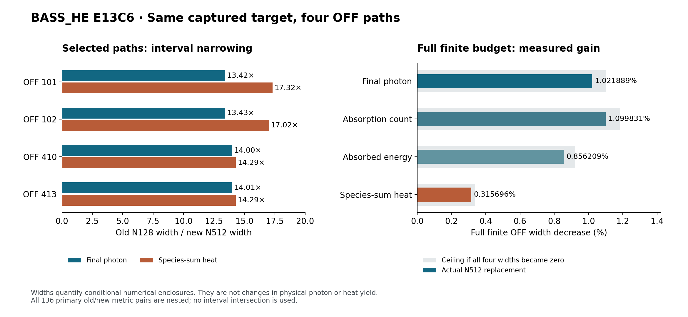

# BASS_HE E13C6 — dominant OFF complement의 동일 목표 정밀화

작성일: 2026-10-11. 연구 node: **HE_E13C6_DOMINANT_COMPLEMENT_SAME_TARGET01**. 모델·하네스: 호스트가 명시한 GPT-6 Astra Pro, research/coding harness 4.0.0. 기준 Git head: **d06b8066aafab930add24be971b494b591d87257**.

## 1. 완료한 결과

**OFF 101·102·410·413의 첫 두 captured 구간을 N512/P60으로 다시 둘러싸고, 이를 기존 유한 OFF 예산에 수용했다.** 독립 최종 판정은 **PROMOTE_SCOPED / PASS_SCOPED_DOMINANT_COMPLEMENT_N512_REFINEMENT**다. 새 네 경로의 절대량·captured 대비 correction 136개 pair 모두에서 raw new interval이 기존 interval 안에 들어갔다. 교집합은 사용하지 않았다. [R1–R3]

| 전체 OFF 관측량 | 기존 구간 폭 | N512 교체 후 폭 | 전체 폭 감소 | 선택 네 항만의 폭 감소 |
|---|---:|---:|---:|---:|
| 최종 photon | 6.2103619403300204e−17 | 6.1468989198402150e−17 | **1.0218892409%** | 92.64002867% |
| 종별 합 absorption count | 7.6145011073828241e−17 | 7.5307544428866310e−17 | **1.0998312735%** | 92.87930620% |
| 종별 합 absorbed energy | 1.4689398749904702e−15 | 1.4563626803556270e−15 | **0.8562089469%** | 92.88707381% |
| 종별 합 heat | 3.9111574389709289e−16 | 3.8988100897429156e−16 | **0.3156955306%** | 93.14567002% |
| Signed energy anchor | 5.7580118917878580e−32 | 5.7361934786296031e−32 | 0.3789226832% | 93.64817526% |
| Redshift energy | 4.2077535315703515e−21 | 4.1966872625316897e−21 | 0.2629970828% | 93.49994647% |

Photon·absorption은 원 captured weighted count 규약, energy·heat·anchor·redshift는 같은 normalization의 eV 규약이다. 모든 exact endpoint는 GLOBAL_ANALYSIS.json의 Fraction 문자열로 보존된다. 표는 읽기 위한 반올림이며 계산은 exact Fraction으로 했다. [R2]

이 감소율은 **구간 폭**의 변화다. 실제 photon 생산량이나 열 발생량이 1.02% 또는 0.316% 변했다는 뜻이 아니다. 외부에서 물리 허용오차가 주어지지 않았으므로 물리 정확도 달성 여부도 주장하지 않는다.

## 2. 끊긴 작업의 실제 상태를 먼저 갱신했다

이번 조사에서 최초 transport 실패 뒤의 새 반환인 BASS_HE_E13C5_FULL_FINITE_RESUME01_NCP_RETURN_20261011.zip을 발견했다. Dropbox에서 실제 bytes를 한 번 내려받아 검증했고 Drive의 동일 이름·크기·승인 parent metadata도 확인했다. 이 반환은 **11,335,899 bytes**, SHA-256 **3e054ff394e229ddbb991b6291d76579fc0f3d26bddb7e5fa377d7b596318695**다. 원본을 이 패키지의 evidence/predecessor 아래에 포함했다. [R4]

반환은 part002 파일명 배치, 전체 ZIP 복구, 저장된 full finite budget 합산을 각각 성공으로 기록한다. 실제 결과는 7,320 paths / 14,652 segments, audit.failed_count=0이며, invocation은 budget 1 / physics 0 / full-first2 0 / N512 0이다. 원고정 semantic 및 실제 압축해제 CSV 248,880 rows, 51,718,536 bytes의 SHA도 일치했다. intake 범위 판정은 PASS_SCOPED_RETURN_CONTENT_AND_RECORDED_HOST_PARITY, 23개 대조 실패 0이다.

따라서 이미 성공한 E13C5 복구와 full-budget을 다시 호출하지 않았다. 마지막 보조 검사에서 CHECKPOINT의 잘못된 필드 failures를 읽어 발생한 KeyError·exit 1은 그대로 보존했고, 실제 실패 수가 RESULTS.audit.failed_count=0인 것과 구별했다. 최초 22,851-byte 실패 ZIP도 새 반환 내부에 보존돼 있다.

이 반환의 호스트는 s1a0e5abed09, CPython 3.12.3이며 provider attestation은 NOT_ASSERTED다. 기록된 호스트의 결과와 입력 계약의 일치를 확인한 것이며 provider 신원을 추정하여 NCP 인증으로 격상하지 않았다. 이번 새 E13C6의 NCP 실행은 별도로 **NOT_RUN**이다.

## 3. 고정한 물리·수학 문제

원 PR21 NEXT_DAG가 지목한 ordinary OFF 후보 네 개의 원 입력을 사용했다. 각 node는 step 1/2의 segment 0 두 개로 구성되며, source-on·HI-only이고 outflow는 0이다. 실제 전체 energy trajectory는 13.7 eV source 하한보다 크고 24.59 eV HeI cutoff보다 작다. Gas 보간 stage, frozen coefficient, 원자 상수, source 식, mask와 original spectral weight를 바꾸지 않았다. [R5–R7]

원 binary64 capture를 정확한 실수로 해석한다. 즉 CSV 문자열을 임의의 새로운 decimal 입력으로 취급하지 않고 해당 binary64 값의 exact lift를 쓴다. 원 OFF SEGMENTS.csv, NODES.csv, STAGES.csv 전체와 PR20 START·RESULTS를 제공했고, 새 8개 control의 row·stage·node는 원 CSV와 필드 단위로 같아야 한다. Weight의 마지막 digits가 두 node 그룹에서 다르므로 uniform weight로 치환하지 않았다.

좌표는 \(s=\ln a_{\rm scale}\), segment 내부 \(u=s-a_j\), \(0\le u\le h_j\)다. 모델은

\[
P'=q(u)-\Lambda(u)P,\qquad
\Lambda=\sum_i\lambda_i\ge0,\qquad E(u)=E_0e^{-u}.
\]

Frozen 기준 \(F\)는 \(F'=q_f-LF\)다. 원 captured gas stage의 선형 보간으로 연속 coefficient를 정한다. Captured energy의 erg는 원 binary64 상수 \(1.602176634\times10^{-12}\)의 exact lift로 한 번 나누어 eV로 옮긴다. Binding energy와 captured mask cutoff는 서로 다른 고정 상수이며 이를 같게 고치지 않는다. 이 루프는 gas 진화나 새로운 ODE solve를 하지 않았다. [R6–R7]

입력 준비에서는 PR20의 실제 PATHS 292,932,850 bytes / 7,320 lines를 한 번 stream하고 선택 네 경로의 원본 줄을 보존했다. 원 archive와 PATHS 및 선택 line SHA를 확인했다. 원 2,434개 retained OFF 항을 직접 더하고 이전에 수용한 0·700 두 항을 더해, 앞으로 유지할 2,436개 항의 exact sum을 만들었다. 해당 합과 기존 네 항이 실제 전역 baseline의 34개 endpoint pair를 정확히 재현했다. 이 원입력 추출에는 coefficient/ODE 호출이 없다. [R5]

## 4. Incoming과 signed energy seam을 유지한 이유

첫 incoming은 정확히 0이다. 둘째 incoming은

\[
e_{2,a}=P_1(h_1)-f_{0,2}
       =[P_1(h_1)-n_1]+(n_1-f_{0,2})
\]

로 전달한다. 첫 local output에는 이미 frozen-minus-captured 표현 차이가 들어 있으므로 seam에서 이를 다시 더하지 않는다. 반대로 둘째 incoming을 0으로 재설정하면 다른 초기값 문제를 푸는 셈이다. 이미 누적된 absorption·heat·redshift moment의 반경은 다음 photon endpoint처럼 damping하지 않고 더한다. [R6–R7]

두 구간 사이 energy 차이는

\[
\Delta E=E_{0,2}-E_{0,1}e^{-h_1},\qquad
J_{\rm seam}=\Delta E\,P_1(h_1).
\]

따라서 전체 energy ledger는

\[
E_{2,h}P_2(h_2)-E_{0,1}P_1(0)
+\sum_j(B_{{\rm total},j}+Z_j-Q_{E,j})
-J_{\rm seam}=0
\]

이다. 실제 네 구간의 anchored flag가 모두 false여도 seam은 0이 아니었다.

| OFF node | 실제 \(\Delta E\)의 부호 | \(\Delta E\), eV 근삿값 |
|---|---|---:|
| 101 | 음수 | −8.4452298069e−16 |
| 102 | 음수 | −2.1566255755e−16 |
| 410 | 음수 | −8.6052278247e−16 |
| 413 | 양수 | +2.8592267238e−15 |

이를 절댓값으로 바꾸거나 heat에 흡수하지 않았다. Native energy stock과 \(E_hn\) 사이의 표현 잔차도 보존했다. Zero-containing ledger는 필요한 consistency 조건이지만 자체로 same-target나 물리적 정확성의 충분조건은 아니다. [R1–R2,R6]

## 5. 실제 계산과 사전 가설의 판정

원 PR19의 directed_interval.py, local_enclosure.py, path_enclosure.py는 실제 SHA까지 동일하게 보존했다. 새 코드는 선택·원입력 대조·bounded execution·exact saved-result analysis만 담당한다. 각각의 work unit에서 8개 segment를 모두 새로 평가했다. 다른 node의 certificate나 이전 resolution의 incoming을 복사하지 않았다. [R7–R8]

| 사전 지정 작업 | 실행시간 | 최대 RSS | 새 coefficient 평가 | 결과의 역할 |
|---|---:|---:|---:|---|
| N32 / P60 | 1.693초 | 41,408 KiB | 512 | Coarse admissibility 진단 |
| N128 / P60 | 6.166초 | 40,928 KiB | 2,048 | 동일 해상도의 기준 비교 |
| **N512 / P60** | **25.254초** | **40,924 KiB** | **8,192** | **최종 채택 결과** |
| N32 / P80 | 1.940초 | 40,916 KiB | 512 | 정밀도 민감도 대조 |

모든 작업은 exit 0, 자동 재시도 0이다. 합계 scientific work unit 4회, fresh local enclosure 32개, coefficient 평가 11,264회다. ODE/native/gas/full-first2/기존 full-budget 호출은 모두 0이다. 측정한 실행환경은 32d990e06a18, Linux 6.18.44, CPython 3.12.14, libmpdec 4.0.0, 사용 가능한 affinity 0–8이다. 프로그램은 serial 1 process/1 thread이며 provider는 NOT_ASSERTED다. 시간은 이 환경의 실제 측정값으로 NCP 소요시간의 보장이 아니다. [R8]

분석상 N32 결과는 기존보다 전체 photon 폭을 16.92887343%, heat 폭을 5.75218878% 넓힌다. 같은 목표의 호환 가능한 coarse enclosure지만 refinement로 채택하지 않는다. N128의 photon/heat 폭 변화는 유용한 수치 척도에서 0이며, 일부 끝점은 아주 작은 outward-rounding 수준에서 달랐다.

**사전 계약의 “같은 N에서 더 타이트한 remainder route를 시험한다”는 가설은 이번 N128 비교에서 입증되지 않았다.** 봉인한 계약과 실행을 사후 수정하지 않고 이 음성 결과를 기록했다. 이번 성과를 같은 해상도에서의 새 알고리즘 우월성으로 표현하지 않는다. 관측한 유의한 효과는 N512 subdivision refinement다. [R1–R3]

## 6. 수치 적분·incoming·coupling 반경의 분리

한 whole-cell second derivative bound \(M_{X,j}\)에 대해 inherited midpoint truncation 반경은

\[
r_{{\rm quad},X}
\le \sum_{j=0}^{N-1}\frac{hM_{X,j}}{24N^3}
\]

다. 고정된 global derivative bound를 추가 가정하면 이 component에 \(O(N^{-2})\) bound를 얻는다. 전체 반경의 감소율까지 자동으로 같아지는 것은 아니다.

Incoming 중심 \(c\)·반경 \(\eta\), residual \(r=\delta q-\delta\Lambda F\)에서

\[
B_r=\int(|\delta q|+|\delta\Lambda|F)\,du,\qquad
S=|c|+\eta+B_r
\]

를 쓰고 원 remainder 공식을 따른다. 출력 반경은 수치·representation 항, \(|g_X|\eta\), coefficient-coupling \(S\int|T_X|\), directed assembly rounding으로 나뉜다. Vendor의 nonlinear_upper라는 이름은 이 coefficient-coupling remainder를 가리킨다. 원 photon ODE는 선형이다. 상세 derivation과 species별 kernel은 theory/TRANSFER_THEORY_KO.md에 있다. [R6]

N512의 둘째 photon 최종 반경 구성은 다음과 같다. 열은 두 구간·세 species의 누적 반경을 같은 정의로 합쳤다.

| Node | Photon 수치·representation | Photon incoming | Photon coupling | 누적 heat 수치·representation |
|---|---:|---:|---:|---:|
| 101 | 64.508% | 17.876% | 17.616% | 74.574% |
| 102 | 64.495% | 17.911% | 17.594% | 74.523% |
| 410 | 62.534% | 24.179% | 13.288% | 81.005% |
| 413 | 62.523% | 24.218% | 13.258% | 81.059% |

아직 수치 적분 component가 상당 부분 남아 있으므로 전체 반경이 이미 analytic floor에 도달했다고 주장할 근거는 없다. 반면 동일 네 node의 해상도만 계속 올리는 전역 효율은 작다. 새 전역 photon 폭의 **99.917976%**, heat 폭의 **99.976695%**는 나머지 2,436개 retained 항에 남아 있다. [R2]

N32/P80 대조의 136개 interval은 P60과 모두 겹쳤다. 대응 끝점 이동량을 P60 구간 폭으로 나눈 값의 최대는 anchor(OFF 102)의 **1.70681955e−33**이다. 이 관측은 이번 폭 감소를 60→80자리 roundoff 감소의 효과로 설명하기 어렵다는 뜻이다. Actual coefficient 모델이나 elementary-function 구현을 독립적으로 검증했다는 뜻은 아니다. [R9]

## 7. 전역 폭 개선의 정확한 의미와 다음 우선순위

각 observable에 대해

\[
I_{\rm old}=I_{\rm retained}\oplus\bigoplus_{p\in K_4}w_pI^{\rm old}_p,\qquad
I_{\rm new}=I_{\rm retained}\oplus\bigoplus_{p\in K_4}w_pI^{\rm new}_p
\]

를 사용했다. K4는 101·102·410·413이다. A/B/H total은 old/new 양쪽 모두 세 species interval의 합이다. Old absolute 필드는 이미 weighted이므로 다시 weight를 곱하지 않았고, correction에는 원 weight를 정확히 한 번 적용했다. OFF/KF/GM 사이의 합은 하지 않았다. 일반 interval subtraction으로 기존 네 항을 제거하지 않았다. [R1–R2]

네 항만 보면 photon 폭은 **13.5870배**, heat 폭은 **14.5893배** 좁아졌다. 경로별 배수도 약 13.4–17.3배지만 이 배수를 전역 정확도의 배수로 바꿀 수 없다. 이번 네 항을 폭 0으로 만들더라도 가능했던 전체 폭 감소 상한은 photon 1.10307526%, heat 0.33892668%였다. 실제로 그 선택집합 상한의 약 92.64%·93.15%를 얻었다. [R2,R6]

저장된 width CSV에서 이번 네 항만 교체하여 새 순위를 계산했다. 두 지표 모두 2,440개 폭의 합이 새 exact full width와 일치한다. 추가 coefficient·ODE 계산은 없다. [R10]

| 다음 후보 지표 | 남은 폭 순위 1·2 | 새 전체 폭에서의 두 항 비중 |
|---|---|---:|
| Photon | OFF 105, 106 | 약 0.78680880% |
| Heat | OFF 409, 414 | 약 0.29841821% |

이번에 정밀화한 101·102의 photon 폭 순위는 718·721위로, 410·413의 heat 폭 순위는 1,795·1,796위로 내려갔다. 따라서 다음 연구는 이 네 항의 무조건적인 재정밀화보다 아직 큰 retained 항의 동일 목표 admissibility와 비용 대비 global gain을 먼저 살피는 것이 타당하다. 이 후보 선정은 저장된 예산에 근거한 다음 단계 제안이며, 그 node들의 새 scientific 실행이나 수용은 아직 하지 않았다. NEXT_DAG.json에 이 상태를 명시했다.

## 8. 독립 검토와 남는 조건

이론 contributor는 양·음 energy seam, incoming reset 반례, frozen/native representation과 누적 moment 전달 등을 Fraction 및 \(\mathbb Q[T]\), \(T=e^{-1}\) 제조 모델에서 검사했다. **41개 exact toy PASS**, coefficient/solver 호출 0이다.

최종 decision reviewer는 후보 코드·candidate validation·transfer theory 작성자가 아닌 별도 agent다. 원 full_first2 소스, actual input과 saved output을 읽고 자체 Fraction 코드로 15,462개 관계 대조 및 primary 분석과의 3,431개 비교를 수행했다. 모두 실패 0이다. 이 개수에는 interval의 유한·순서 검사가 포함되며, 독립적 물리 증명의 개수로 해석하지 않는다. Reviewer의 candidate/vendor import와 scientific solver/coeff 호출은 0이다. [R1,R6]

검토 결과 N512 raw replacement에 열린 blocker는 없다. 다음 조건은 계속 유지한다.

- Directed interval 및 coefficient 수학은 원 PR19/PR20 계약에 조건부다. Old/new가 동일 kernel과 capture를 공유한다는 의존성을 숨기지 않는다.
- Same-code replay, interval overlap 및 ledger 0 포함은 독립적인 coefficient/물리 oracle이 아니다.
- Finite captured 두-step 경로 밖의 continuum spectral error, 재진화한 gas, physical validation, production, receiver adoption은 HOLD다.
- 전체 반경의 보편적인 \(N^{-2}\) 수렴률, 실제 해 오차의 양의 하한, 임의 물리 허용오차 달성을 주장하지 않는다.

## 9. NCP에 넘긴 실행 계약

패키지에는 필요한 입력·코드·기준 결과·해시 lock·실행 prompt가 모두 있다. 별도 전달 파일이나 이전 큰 source archive가 없어도 이 **새 N512 작업**을 실행할 수 있다. Scientific SOURCE_LOCK은 15개, NCP EXECUTION_LOCK은 wrapper·분석기·기준 결과까지 26개 파일을 닫는다. Read-only final closure도 통과했다. [R11]

- Scientific SOURCE_LOCK SHA: **0b4688c61c6070e0663fa78043a4ff3c37af2250f1e9d98d1e5485f568efaf47**
- NCP EXECUTION_LOCK SHA: **fb75072a17effe87b8ca9d118d04c227c3e1cf6923f9eb38b0f6a80ba102a101**
- N512 numerical semantic: **c9321b00102920e8aedbcc2f9f5cdcd374e67742f346754b928cc873d0e25f23**
- Exact analysis semantic: **d975525df1f0d3a1cc18a254c05cc92d36677e2538438e71a420644ab46a7db2**
- GLOBAL_WIDTHS.csv SHA: **6285d1a77ab0321da9ff2db63d579549f52dfa871da0051e65d69f3eab32a0d4**

Local Codex는 Linux CPython 3.12.x에서 신선한 package 밖 output-root를 지정하여 code/ncp_execute_once.py를 한 번 호출한다. Wrapper는 전체 lock·baseline 실제 bytes를 먼저 확인하고, N512/P60 scientific work unit 1회와 새 saved-result exact analysis 1회만 호출한다. N32/P80 등의 진단을 다시 수행하지 않는다. Inner limit 300초, outer timeout 310초, address space 1 GiB, 하나의 available CPU에 serial 실행을 고정한다.

NCP 성공은 실제 RESULTS에서 전체 numerical projection을 재구성해 semantic을 대조하고, 전체 exact analysis object 및 deterministic CSV byte parity가 맞은 경우에만 기록된다. 호스트·시간·경로가 있는 RESULTS 파일 자체의 byte equality는 요구하지 않는다. 전후 source/lock/input identity를 보존하며 실패하면 현재 횟수·phase·stderr·receipt·return ZIP을 남기고 재시도하지 않는다. Provider 근거가 없다면 NOT_ASSERTED다.

새 wrapper에 대해서는 잘못된 lock SHA, duplicate manifest, 기존 output 충돌을 포함하는 14개 좁은 guard 검사를 수행했고 성공했다. 의도된 거절·실패 영수증은 review/ncp_wrapper 아래에 보존된다. 이 검사에서 scientific 실행은 0이며 실제 NCP end-to-end 성공을 주장하지 않는다.

## 10. 핵심 증거와 읽는 순서

1. **[R1] review/INDEPENDENT_REVIEW.json, review/REVIEW_KO.md** — 독립 최종 범위 판정.
2. **[R2] analysis/N512_P60/GLOBAL_ANALYSIS.json, GLOBAL_WIDTHS.csv** — 136개 pair, 34개 full budget, exact endpoints, 폭·seam·반경 분해.
3. **[R3] analysis/N32_P60, N128_P60, N32_P80** — 채택하지 않은 사전 지정 진단 결과.
4. **[R4] evidence/predecessor/RETURN_INTAKE_STATUS.json 및 원 NCP return ZIP** — 복구·saved budget 실제 반환 검증.
5. **[R5] INPUT_PROVENANCE.json, inputs/PATH_CONTROLS.json, OLD_PATHS_OFF4.jsonl, PREDECESSOR_BUDGET.json, inputs/source/** — 원 capture와 direct retained 계약.
6. **[R6] theory/TRANSFER_THEORY_KO.md, theory/exact_controls/** — 전체 유도·exact toy·선택집합 상한.
7. **[R7] code/vendor/** — 원 bytes를 유지한 세 scientific kernel.
8. **[R8] runs/SCHEDULE_RECEIPT.json 및 각 runs/*/{START,RESULTS,RESOURCE_RECEIPT,NUMERICAL_IDENTITY}.json** — 실제 실행과 정체성.
9. **[R9] analysis/PRECISION_COMPARISON.json** — P60/P80 대응 endpoint 대조.
10. **[R10] analysis/NEXT_WIDTH_RANKINGS.json** — 새 남은 폭 순위와 exact full-width 합 대조.
11. **[R11] NCP_HANDOFF_KO.md, EXECUTION_LOCK.json, review/FINAL_RUNTIME_CLOSURE.json** — 한 번 실행하는 전달 계약.
12. **NEXT_DAG.json, CURRENT_STATE.json, RUN_STATE.json, NEGATIVE_HYPOTHESIS_RESULT.md** — 후속 연구가 이어갈 상태.

Git publication head와 외부 backup ID는 immutable scientific/source lock과 구별한다. 외부 delivery receipt가 게시된 commit과 실제 업로드 ACK/readback을 기록하며, 패키지 내용을 사후 변경하여 hash를 순환 참조하지 않는다.
