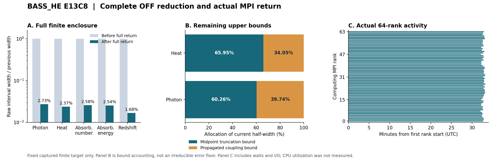

# BASS_HE E13C8 — 실제 64-rank 반환의 전체 유한 합산

## 결론

E13C7의 실제 중량 반환 **2,331개 경로**를 받아 원래 입력·코드·실행 잠금과
검증한 뒤, ChatGPT에서 전체 OFF 합산을 완료했다. 독립 검토의 결정은
**`PROMOTE_SCOPED_FULL_FINITE_CAPTURED_OFF`**이다. 최종 광자량 P의 포함 구간
폭은 1.657292521990147877067e-18, 총 가열량 H의 폭은
9.214884781103738168091e-18 eV다. 직전 E13C7 로컬 결과를 반영한 전체 구간보다
각각 **97.2747543531%, 97.6270433530%** 줄었다.

이번 새 NCP 작업은 **0개**다. 이미 완료된 N1024/P60 중량 배치를 재실행하지
않고, 전체 N2048·P80 배치나 성능 측정만을 위한 재실행도 만들지 않았다.
다음 방법 후보는 **여기서 진행할 signed Volterra 보정의 구현·소수 경로 검증**이다.
새 중량 배치는 그 방법의 필요성과 실제 비용이 확인된 뒤 별도로 고정해야 한다.

이 결정은 동일한 고정 캡처 유한 문제에 한정된다. **physical, continuum,
production, receiver는 모두 HOLD**다. 34개 포함 구간이 좁아진 정도를 물리
모형의 정확도나 연속체 오차로 바꾸어 해석하지 않는다.

근거: [독립 결정](review/INDEPENDENT_DECISION.json),
[원래 정확한 합산](analysis/FULL_RETURN_REDUCTION/REDUCTION.json),
[34개 폭 비교 CSV](analysis/FULL_RETURN_REDUCTION/FULL_WIDTHS.csv).

## 1. 실제로 반환되어 검증된 일

| 구분 | 이번에 확인한 내용 |
|---|---|
| 반환 ZIP | 124,152,692 bytes |
| 실제 SHA-256 | a7a0fd6e58a88140071a1b623897efbd35748c86c4eda6956a937171eefe6c8f |
| ZIP 구성 | 18,800 members, 516,049,596 expanded bytes |
| 내부 payload | 18,799개 실제 bytes/SHA 일치 |
| 실행 잠금 | c04cfde1838563d95389e499de9bcbe505a7d67f6bda1fff4476af953c8cc4f4 |
| 과학 소스 잠금 | 386d0abd02a33b15a015166369cec981b00fd05987dbd146f2badcb9f604688f |
| 고정 실행 파일 | 원본 60개 bytes/SHA 일치 |
| 새 중량 경로 | 2,331, N1024/P60, OFF |
| 새 구간·계수 평가 | 4,662 / 9,547,776 |
| 재사용·미완료·자동 재시도 | 0 / 0 / 0 |
| 실제 OpenMPI | 64 computing ranks, rank당 thread 1, launcher exit 0 |

전체 대상은 기존과 같은 2,440개 경로, 4,884개 구간이다. 그중 95개 source-off
경로는 정확한 영 기여이고, 이번 반환의 2,331개와 이전에 채택한 14개 비영
경로를 합쳤다. 최종 결과의 해상도는 **N1024 경로 2,335개, N512 경로 10개,
정확한 영 경로 95개**다. 전체 2,440개를 균일 N1024로 다시 실행한 것이 아니다.

원래 `reduce_returned_batch.py`를 수정 없이 사용했다. 결과를 정렬된 node 순서로
읽고, 17개 absolute·17개 correction 구간을 정확한 Fraction 산술로 직접 더했다.
기존 6개, 로컬 8개, 반환 2,331개의 서로 겹치지 않는 집합으로 직전 전체 구간도
정확히 재구성했다. 원 구간과의 교집합, clipping, 비채택 결과의 조용한 fallback은 없다.

과거 전송 실패의 NOT_RUN 영수증은 당시의 실패 기록으로 남는다. 이번 판단은
그 이름을 바꾼 것이 아니라 새 실제 실행·반환·합산 증거에 근거한다.

근거: [실제 다운로드](intake/ACTUAL_ARCHIVE_DOWNLOAD.json),
[실제 내부 검증](intake/ACTUAL_INTAKE_RECEIPT.json),
[원격 전달 기록](intake/REMOTE_DELIVERY_REPORT.json).

## 2. 전체 유한 구간의 개선

아래 값은 구간의 **전체 폭 hi−lo**다. 표의 소수는 표시용 반올림이며 권위 있는
끝점은 JSON·CSV의 정확한 분수다. 비교 기준은 E13C7 로컬 8개 결과까지 반영한
직전 전체 OFF 구간이다.

| 관측량 | 직전 전체 폭 | 이번 전체 폭 | 폭 감소 |
|---|---:|---:|---:|
| 최종 광자량 P | 6.081259221168360e-17 | 1.657292521990148e-18 | 97.2747543531% |
| 총 가열량 H, eV | 3.883292513115486e-16 | 9.214884781103738e-18 | 97.6270433530% |
| 총 흡수 수 A | 7.444568266027889e-17 | 1.917651093696987e-18 | 97.4240936141% |
| 총 흡수 에너지 B, eV | 1.443087023422928e-15 | 3.671251046192318e-17 | 97.4559739041% |
| 적색편이 에너지 Z, eV | 4.181425532942058e-21 | 7.024828530475766e-23 | 98.3199919561% |
| signed energy seam 합 | 5.710668465348222e-32 | 1.211609914218705e-33 | 97.8783395997% |

34개 구간 모두 이전 원 구간 안에 들어가고 폭이 늘지 않았다. 독립 검토자는
후보 코드와 과학 커널을 import하지 않고 2,331개 원시 경로의 입력 연결,
구간 끝점, semantic hash, photon carry, seam 부호, ledger와 반경 식을 확인했다.
별도로 만든 전체 직접 합산과 CSV의 실제 bytes도 원 reducer 결과와 일치했다.

합산 semantic SHA는
`d647ba154b84baf22a3f85f9b7dca19f029b97f466838c036a9d3321f4c315d1`이다.
CSV SHA는 `ab9879b989c7fcb08db666eddc086e808e2af92fe78c447519b2866ebe9b8d53`이다.
기계적 PASS가 남아 있는 원 reducer 파일은 불변 실행 증거이며, 최종 채택은
별도 독립 결정 파일이 적용한다.

## 3. 물리량으로 읽을 때

고정된 유한 합산의 중점은 P≈1.5478313159831407e-5,
H≈1.5988433209129242e-5 eV다. 구간 전체 폭을 각 절대량 중점으로 나눈 값은
P≈1.0707191e-13, H≈5.7634695e-13이다.

그러나 관심 대상이 작은 **캡처 보정량**이라면 다른 분모를 써야 한다.
P 보정의 중점은 +4.827658195608997e-13이고, H 보정은
−2.603057179249332e-12 eV다. 그 보정량의 절댓값에 대한 전체 폭은 각각
약 3.4329119e-6, 3.5400240e-6다. 절대량에 대한 작은 상대 폭만으로 보정량의
해상도를 과장하지 않았다.

저장된 구간으로부터 양의 구간 나눗셈을 수행하면 다음 유한 대상의 분배를
얻는다. 표는 구간 중점을 간략히 표시한다.

| 같은 유한 대상의 비율 | 중점의 백분율 |
|---|---:|
| 주입 광자 중 마지막에 남은 광자 | 84.1332596438% |
| 주입 광자 대비 흡수 수 | 15.8667403562% |
| 주입 에너지 대비 흡수 에너지 | 9.62345202311% |
| 주입 에너지 대비 가열량 | 2.75405802027% |
| 주입 에너지 대비 결합 에너지 항 ΣχᵢAᵢ | 6.86939400284% |

전체 수 보존식 P+A−QN, 전체 에너지식 E_final+B+Z−QE−anchor,
가열 관계 H−B+ΣχᵢAᵢ의 구간은 모두 0을 포함한다. 표시용 절대 상계는 각각
약 ±1.7874731e-18, ±3.4215747e-17 eV, ±3.6717267e-17 eV다.
최종 에너지는 캡처된 endpoint u를 정확히 binary64-realify하고 erg/eV로
한 번만 나눈 값에 기존 energy correction을 더했다. 독립 검토에서는 별도의
OFF_NODES endpoint 자료로 이 값을 재구성했다.

이는 현재 finite target 안에서의 ledger와 비율이다. 연속 에너지 모드 합,
새 gas feedback, 자연적인 이동 threshold를 포함하는 모형의 효율로 옮기지 않는다.

근거: [유한 관측량](analysis/FINITE_OBSERVABLES.json),
[별도 endpoint 검토](review/DERIVED_OBSERVABLE_REVIEW.json).

## 4. 남은 폭을 무엇이 만드는가

저장된 2,345개 비영 경로의 반경을 양의 항으로 분해하고, 각 photon carry를
통해 앞 구간의 기여를 다음 구간에 전달했다. 34개 전체 끝점이 원 합산과
정확히 일치한다. 이 집계에는 새 적분이나 계수 계산이 없다.

| 현재 반폭의 원인 | P | H |
|---|---:|---:|
| 중점 적분 절단오차 상계 및 그 전달 | 60.2578167210% | 65.9483598726% |
| 결합 나머지 상계 및 그 전달 | 39.7421832790% | 34.0516401274% |
| 그 밖의 수치·표현 반경 | 약 3.02e-43% | 약 2.42e-38% |

Decimal precision을 늘리는 일은 현재 잔여 폭의 원인을 해결하지 않는다.
결합 부분도 실제 오차의 측정값이나 증명된 수렴 바닥은 아니다. N이 바뀌면
계수 상계, 후보 중심, 앞 구간의 uncertainty가 함께 바뀔 수 있다. 이 비율에
근거해 전체 반경이 N^-2로 줄어든다거나 39.74% 아래로는 내려갈 수 없다고
주장하지 않았다.

P 잔여 폭의 87.9165%, H 잔여 폭의 57.5573%는 HI만 활성인 경로군에서 나온다.
이는 species별 관측량 분해와 다른 분류다. 실제 H species 구간 폭의 비율은
HI 94.6747%, HeI 0.764581%, HeII 4.56074%다. 상위 64개 경로만 택하면
P 폭의 24.8913%, H 폭의 10.4287%를 덮는다. 소수 경로만 극단적으로 큰 상황도 아니다.

이 자료는 나중에 정확도 목표가 생겼을 때 관측량별 기대 개선과 실측 비용을
비교하는 입력이다. 아직 도출되지 않은 물리 정확도 목표를 임의로 정해서
또 하나의 전체 배치를 실행하지 않았다.

근거: [잔여 상계 요약](analysis/RESIDUAL/ACTUAL/RESIDUAL_SUMMARY.json),
[분해와 이론 문서](analysis/RESIDUAL/RESIDUAL_AND_NEXT_METHOD_KO.md).

## 5. 다음 방법 후보를 여기서 좁혔다

고정 계수 해 P_f와 가변 계수 해 P의 차이를 δ=P−P_f라 두면,
현재 선형 ODE는 δ=δ₁+F e−Kδ로 쓸 수 있다. 여기서
F(t)=exp(−Λ_f t), |e|≤η는 이전 구간에서 받은 초기 불확실성이고,
K는 부호를 보존한 ΔΛ를 적분하는 Volterra 연산자다.

다음 후보 δ_[2]=δ₁−Kδ₁에 대해서는 정확히

δ−δ_[2]=(I−K)F e+K²δ

가 성립한다. 기존 저장 값 D≥∫|ΔΛ|를 사용하면 ||K||≤D이고,
S=|c|+η+B_r는 ||δ||의 상계다. 따라서 endpoint의 해석적 잔여를
(F(h)+H_h)η+H_h D S로 감쌀 수 있다. Moment에도
(|G_M|+T_M)η+T_M D S 형태의 상계가 생긴다. endpoint의 H_h만을
whole-interval operator norm으로 바꾸어 쓰거나 뒤 구간의 η를 없애지 않았다.

비영 4,694개 구간에서 저장 D의 최댓값은 **2.5636196258628445e-7**,
중앙값은 약 1.01837e-8이었다. 이 작은 값은 다음 부호 있는 항을 계산할
가치가 있다는 이론적 근거다. 다만 δ₁의 모든 prefix 값과 Kδ₁의 새로운
포함 적분은 아직 계산하지 않았다. 저장된 endpoint 숫자에 작은 계수를 곱해
새 반경으로 승인하지 않았고, 완전한 새 반경이나 실행 시간을 예측하지도 않았다.

다음 ChatGPT 단계는 이 적분을 구현할 계산 그래프, 단위·부호·seam 전파,
0-coupling 극한을 먼저 고정하고 짧은 대표 경로로 검증하는 것이다. 결과가
필요한 정확도 개선을 제공하고, 남은 독립 경로 전체가 실제로 오래 걸릴 때만
NCP 실행 계획을 새로 만든다. 이 문서 자체는 미실행 알고리즘의 채택이 아니다.

위 유도는 별도의 [이론 제안 독립 검토](review/THEORY_PROPOSAL_REVIEW.json)에서
`PASS_DERIVED_PROPOSAL_ONLY_NOT_NUMERICAL_ADMISSION`으로 확인했다. 기존 유한
결과의 채택과 새로운 방법의 아직 미실행인 상태를 분리했다.

## 6. 64코어·128GB를 어떻게 썼는가

| 실제 텔레메트리 | 결과 |
|---|---:|
| 계산 MPI rank / 전용 controller MPI rank | 64 / 0 |
| 경로 배분 | 37 rank×36개 + 27 rank×37개 |
| CPU 고정 | 서로 다른 CPU 0–63 |
| MPI launcher wall | 33.237507분 |
| controller batch wall | 33.963755분 |
| wrapper attempt wall | 33.990354분 |
| rank wall 범위 | 1,922.839904–1,993.429486초 |
| rank wall 평균 / 최댓값 | 98.4398774% |
| 64개 경로 활동 구간이 모두 겹친 시간 | 1,901.130558초, 약 31.69분 |
| 가장 큰 rank RSS high-water | 59,500 KiB |
| 64 rank 개별 최대 RSS 합 | 3.590969 GiB |

이번 계산은 모든 rank가 일했고 부하도 균등했다. 관측된 각 경로 시간을 고정한
하나의 사후 LPT 배치에서는 가장 긴 shard의 시간 합이 약 16.22초, 전체 batch의
0.80%만큼 줄었다. 모든 scheduler가 얻을 수 있는 개선의 상한이나 실제 새
scheduler의 성능 향상 측정은 아니다. 이 정도의
자료로 scheduler 교체나 benchmark 재실행을 연구의 다음 단계로 삼지 않았다.

원래 80% 효율 가정의 예상 시간 31.2076분보다 실제 batch는 8.83% 길었다.
이는 예측과 관측의 차이다. 동일 작업의 실제 직렬 실행을 측정하지 않았으므로
26.63시간 예측값이나 동시 경로 wall의 합을 나누어 실측 speedup이라고 하지 않는다.

또한 UTC 활동 구간에는 대기·검증·I/O가 포함된다. process CPU-time 또는
cpu.stat 변화량이 없어 **CPU 이용률은 NOT_MEASURED**다. 개별 process의
RSS 최대값 합도 동시 machine-wide peak가 아니다. **동시 전체 메모리 peak는
NOT_MEASURED**, provider attestation은 **NOT_ASSERTED**다.

현재 계산에 128GB를 채울 필요는 없다. 메모리 사용을 늘리기 위한 중복 배열이나
불필요한 경로를 추가하면 목적에 맞지 않는다. 다음에 실제 필요한 중량 작업이
생길 때 64개 rank를 유지할 수 있는 독립 과학 작업량과 CPU-time 계측을 함께
준비하면 된다.

근거: [실제 성능 분석](analysis/PERFORMANCE/PERFORMANCE_ANALYSIS.json),
[성능 해석](analysis/PERFORMANCE/PERFORMANCE_NOTES_KO.md).

## 7. 여기서 완료한 경량 작업과 실행 상태

| ChatGPT 작업 | 실제 wall |
|---|---:|
| 전체 반환 Fraction 합산 | 13.5160초 |
| 유한 관측량·보존식·비율 | 0.1099초 |
| 전체 비영 경로 잔여 반경 분해 | 15.769초 |
| Volterra 저장 매개변수 집계 | 4.5393초 |
| 실제 MPI 기록 분석 | 2.572초 |
| 독립 과학·합산·분해 범위 검토 합 | 약 49.10초 |

각각 별도 wall이므로 병렬로 겹친 부분까지 단순 합해 총 작업 경과시간으로
표시하지 않았다. 모든 항목의 새 계수 평가·과학 적분·NCP launcher 호출은 0이다.
NCP가 이미 끝낸 중량 경로를 여기서 재현 실행하는 대신 저장된 실제 결과를
검산했다. 이번 루프의 수학·물리 분석이 완료되었다는 뜻이며, 과학적 계산을
하지 않았다는 뜻은 아니다.

## 8. 전달과 재개 규칙

완전 백업에는 이번 보고서·정확한 수치·독립 검토·분해 자료·코드·내부 인계문과
**원래 E13C7 입력 ZIP 및 실제 중량 반환 ZIP**이 들어 있다. 별도 입력 첨부 없이
원본·반환·이번 분석을 모두 복구할 수 있게 구성했다.

Drive의 큰 파일 전송 한도로 빠졌던 실제 반환은 새 전체 백업의 64MiB 이하
조각들로 함께 보존한다. 복구 helper는 실제 bytes/SHA로 조각을 식별하므로
part002에 `.bin`이 덧붙은 이름도 허용한다. 조각 순서는 manifest로 고정하고,
복원 ZIP 및 모든 내부 파일의 SHA를 검증한다. 실패와 완료의 새 영수증은 서로
다른 새 출력 디렉터리에 남긴다.

최종 ZIP·조각·복구 kit·외부 인계문의 실제 해시, 업로드 ACK/readback,
실제 접미사 복구 검사 결과와 draft PR identity는 **외부 DELIVERY_RECEIPT**가
담당한다. 이 과학 보고서는 아직 일어나지 않은 업로드를 완료로 선언하거나
자신을 포함한 ZIP의 해시를 자기 내부에 넣지 않는다.

현재 NCP 인계 명령은 [NCP_HANDOFF_INTERNAL_KO.md](NCP_HANDOFF_INTERNAL_KO.md)에
있다. 핵심은 **새 heavy task 0, 이미 완료한 2,331개 경로 보존, 자동 재실행 없음**이다.
다음 과학 작업과 그 실행 장소는 [NEXT_DAG.json](NEXT_DAG.json)에 기록했다.
