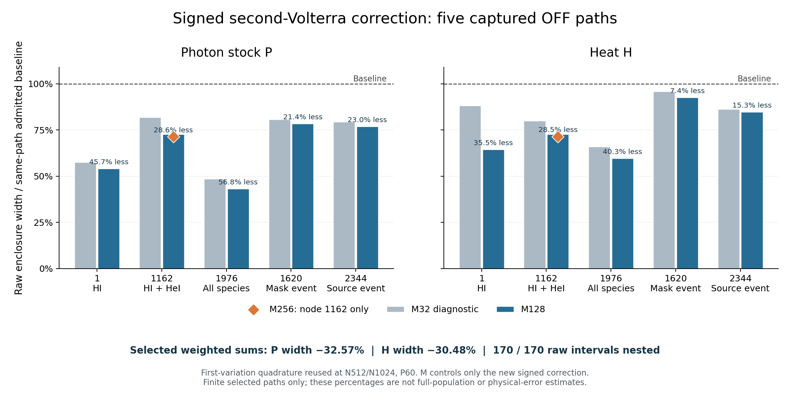

# BASS_HE E13C9 — signed second-Volterra 국소 구현과 검증

기록 일자: 2026-10-11 UTC / 2026-10-12 KST. 전달 파일명은 KST 일자를 사용한다.

## 결과와 채택 범위

E13C8에서 아직 구현되지 않았던 signed second-Volterra 보정을 구현하고, **같은 captured OFF 유한 문제의 5개 경로·12개 segment**에서 실행했다. 실제 독립 판정은 **`PROMOTE_SCOPED_LOCAL_SIGNED_VOLTERRA`**다. 최종 선택은 네 경로의 M128과 node 1162의 M256 결과이며, **170개 raw 구간 모두 각자의 기존 채택 구간에 포함되고 폭이 증가하지 않는다.** 구간 교집합이나 이전 구간으로의 fallback은 사용하지 않았다.

선택 경로의 원래 양의 가중치를 그대로 사용한 정확한 합산에서 photon P의 폭은 **32.5711822283%**, heat H의 폭은 **30.4812007649%** 감소했다. 이것은 선택한 5개 경로의 수치 포함 구간에 대한 결과다. 전체 2,440개 OFF 경로의 새 개선율, 실제 해에 대한 측정 오차, 물리 정확도 또는 continuum 검증을 뜻하지 않는다. E13C8의 전체 유한 합산 채택은 그대로 유지한다. 전체 경로의 새 second correction은 **NOT_RUN**이며 physical·continuum·production·receiver는 **HOLD**다.

근거: [독립 결정](review/independent/INDEPENDENT_DECISION.json), [독립 검토서](review/independent/INDEPENDENT_REVIEW_KO.md), [실제 분석](analysis/ACTUAL_PORTABLE/LOCAL_ANALYSIS.json), [선택 결과 identity](analysis/ACTUAL_PORTABLE/SELECTED_CANDIDATE.json).

## 1. 끊긴 지점의 복구

현재 작업 폴더에는 이전 파일이 남아 있지 않았으나, 완전한 E13C8 백업을 복구했다. Complete ZIP의 170,991,376 bytes와 SHA-256 `ba4b1ace541f52bae5dd096d3da75ca9f0bf2d1894d0c3cba40375e40b1eca80`가 일치했다. 복구 helper가 바깥 93개, 원래 입력 345개, 실제 NCP 반환 18,799개, 합계 **19,237개 payload**의 bytes/SHA를 확인했다. 복구 경과 시간은 **4.4576초**였고 과학 커널·MPI 호출은 0이었다.

실제 E13C8 CURRENT_STATE와 NEXT_DAG는 전체 합산과 독립 채택이 완료됐으며 다음 미구현 노드가 E13C9 local prototype임을 보여 주었다. 완료된 2,331개 NCP 경로와 E13C8 전체 Fraction 합산을 다시 실행하지 않았다. GPT-6 Astra research/coding v4.0.0 하네스는 stable ID로 가져온 ZIP의 SHA와 실제 진입 문서를 확인해 적용했다. 하네스 구조 검사는 과학적 검증으로 취급하지 않았다.

근거: [복구 기록](evidence/RECOVERY_INVENTORY.json), [원래 입력과 경로 선정](evidence/SELECTED_PATHS.json), [코드 위치와 API](evidence/SOURCE_MAP.md).

## 2. 새 계산의 핵심

고정 계수 기준해와 동일 캡처의 가변 계수 해를

\[
P_f'=q_f-\Lambda_fP_f,\qquad P'=q-\Lambda P
\]

로 놓고, \(\delta=P-P_f\), \(r=(q-q_f)-(\Lambda-\Lambda_f)P_f\)로 정의한다. 초기 보정은 \(\delta(0)=c+e\), \(|e|\le\eta\)로 분리한다. \(F(u)=e^{-\Lambda_fu}\)와

\[
(Kz)(u)=\int_0^uF(u-v)\Delta\Lambda(v)z(v)\,dv
\]

를 사용하면 \(\delta_1=Fc+F*r\)에 대해 정확히

\[
\delta=\delta_1+Fe-K\delta,
\qquad
\delta-\bigl(\delta_1-K\delta_1\bigr)=(I-K)Fe+K^2\delta
\]

가 성립한다. 이번 코드는 **부호를 유지한 \(-K\delta_1\)**와 종별 moment의 대응 항을 실제로 적분한다. 예전 coupling 반경에 D를 곱해 새 구간이라고 선언하는 방식은 사용하지 않는다.

기존 `local.signed`와 `local.bounds`는 incoming correction과 독립이므로, 원래 bytes·source·path-input·N/P를 검증한 뒤 그대로 재사용한다. 새 outgoing center와 uncertainty는 최초 0에서 다시 전파한다. 매 segment의 \(S=|c_{new}|+\eta_{new}+B_r\)를 새 carry로 다시 계산하며, 이전 S나 radius를 재사용하지 않는다.

정규화 좌표 \(x=u/h\), \(a=h\Lambda_f\)에서 \(Y'=hr-aY\)의 감쇠 recurrence를 사용한다. Cell별 midpoint forcing 적분에는 whole-cell Jet2 도함수로 얻은 \(h\Delta^3M_2/24\) 반경을 넣는다. 왼쪽 prefix에서 해당 cell 전체의 \(Y\) 범위를 감싼 뒤, signed kernel과 곱한 whole-cell rectangle 구간을 합한다. 계산량은 M에 선형이다. 새 coarse prefix endpoint는 작은 2차 보정 계산에만 사용하며, 기존 촘촘한 first-variation endpoint를 대체하지 않는다.

전체 구간 norm에는 \(D\ge\int|\Delta\Lambda|\)를 사용한다. Endpoint H_h로 대체하지 않는다. 출력별 analytic tail은

\[
(|G_k|+T_k)\eta+T_kDS
\]

이며 photon의 경우 \(G=F(h)\), \(T=H_h\)다. 이 유한 항등식은 D<1을 필요로 하지 않는다. Prefix의 수치 포함 폭, incoming uncertainty, 표현 오차와 finite Volterra tail을 구분한다.

기존 gas 보간, source flags, masks, cutoff와 binding energy의 구분, binary64의 정확한 실수화, eV 단위, photon stitch와 signed energy seam을 보존했다. 비교용 A/B/H total은 원래처럼 species별 구간의 합이다. 상세 수식과 부호는 [직접 유도](theory/SIGNED_PREFIX_DESIGN.md), 실행 구현은 [signed_volterra.py](code/signed_volterra.py)에 있다.

## 3. 실제 경로 결과

N_base는 이미 완료된 first-variation 적분의 해상도이고, M_second는 이번 새 보정 적분의 해상도다. 모든 실제 경로의 interval precision은 P60이다.

| Node | 판별하는 경우 | 재사용 N_base | 최종 M_second | P 폭 감소 | H 폭 감소 | 해당 실행 시간 |
|---:|---|---:|---:|---:|---:|---:|
| 1 | HI, 전체 저장 segment 중 최대 D 포함 | 1024 | 128 | 45.7490% | 35.4712% | 1.4792 s |
| 1162 | HI+HeI | 1024 | 256 | 28.6402% | 28.4944% | 3.1726 s |
| 1976 | HI+HeI+HeII | 1024 | 128 | 56.7706% | 40.2734% | 2.1704 s |
| 1620 | HeII mask event | 512 | 128 | 21.4417% | 7.4225% | 3.2628 s |
| 2344 | source OFF/OFF/ON, zero prefix | 512 | 128 | 23.0411% | 15.2618% | 3.3787 s |

시간은 각 실제 경로 실행이 기록한 경과 시간이다. 서로 다른 호스트의 예전 baseline 실행과 나누어 speedup으로 해석하지 않는다.

| 선택 5개 경로의 가중합 폭 | 기존 | 새 선택 결과 | 감소율 |
|---|---:|---:|---:|
| P | 2.72439453247586747040391e−22 | 1.83702702468600293091209e−22 | 32.5711822283% |
| H, eV | 5.94208646994966632764780e−21 | 4.13086716341852351327605e−21 | 30.4812007649% |

이 5개는 species와 event의 구현 위험을 판별하기 위한 표본이다. 전체 분포를 대표하는 통계 표본이나 weighted error budget 대부분을 차지하는 경로 집합으로 선정한 것이 아니다.

## 4. 보존한 실패와 표적 보완

최초 node 1 M32 실행은 P/H를 개선했지만 QN/QE의 4개 absolute/correction 구간이 극미하게 넓어졌다. 원인은 작은 보정에 frozen 값을 먼저 더한 뒤 captured 값을 빼면서, 기존 `(frozen−captured)` 결합 순서가 달라진 데 있었다. 최초 코드·source lock·raw 결과를 남기고 기존 결합 순서를 복원했다. 새 출력에서 34/34가 통과했다. [최초 기록](evidence/FIRST_ASSOCIATION_FINDING/FINDING.json)

M32의 넓은 helium rectangle 범위는 진단 결과로 보존했다. Uniform M128에서는 170개 중 **169개**가 통과했다. Node 1162의 absolute anchor 폭이 약 **1.6127%** 넓었다. 다른 P/H의 개선으로 이 실패를 덮지 않았다. 해당 경로의 correction만 M256으로 계산했고 34/34를 통과했다. 따라서 최종 채택은 **M128 네 경로와 M256 한 경로**다. 기존 N1024 적분이나 다른 경로를 다시 계산하지 않았다. [표적 보완 계약](evidence/TARGETED_M256_AMENDMENT.json)

새 saved-data 분석은 초기 absolute locator를 명시적인 복구 root 인자로 바꾸어 재현성을 보완했다. 원래 출력과 수정 후 수치 분석은 날짜·실행 시간을 제외하고 정확히 일치했다. 이 보완은 새 적분을 호출하지 않았다. [경로 보완과 parity](evidence/ANALYSIS_PORTABILITY_FIX/PARITY_RECEIPT.json)

## 5. 검증의 근거와 한계

별도 작성한 140자리 directed Decimal 폐형식 oracle로 9개 manufactured case를 M8/M32에서 실행했다. **18회, 3,686개 검사, 실패 0개**, wall 1.3799초였다. 정확한 zero, 상수 forcing, L=0/양의 L, 양·음 total opacity defect, 비영 c와 η, total opacity defect가 0이지만 개별 species defect가 남는 경우, D=1을 포함한다. 전체 prefix cell 범위는 끝점과 정확한 내부 stationary point를 사용해 확인했으며, 17개 signed output과 실제 상수 계수 잔여항을 검사했다. 실제 captured 계수는 호출하지 않았다.

후보와 제조 검증 작성에 참여하지 않은 독립 reviewer는 Fraction과 별도 100자리 exp 구간으로 저장된 조립·carry·ledger·prefix 포함 관계를 재구성했다. Saved arithmetic **29,424개 검사**, 최종 evidence 대조 **2,434개 검사**가 모두 통과했다. 각각의 실행 시간은 0.9333초와 0.0785초다. Reviewer는 새 경로 적분이나 제조 계산을 반복하지 않았다.

공유하는 Decimal exponential primitive, 같은 고정 물리 계수 정의, 유한 경로 범위는 명시한다. 독립 oracle와 검사 수가 별도의 물리 모델 검증 또는 proof-assistant 증명을 의미하지 않는다. 근거: [제조 검증](tests/MANUFACTURED/README.md), [제조 영수증](tests/MANUFACTURED/EXEC01/RECEIPT.json), [독립 검토](review/independent/INDEPENDENT_REVIEW_KO.md).

## 6. 남은 폭과 다음 연구 질문

새 반경을 같은 양의 항으로 분해하고 incoming gain과 signed seam의 중심화 여분을 전파해 선택 P/H의 반폭을 Fraction으로 정확히 재구성했다.

| 선택 결과의 반폭 배분 | P | H |
|---|---:|---:|
| 재사용한 first-variation midpoint 상계와 그 carry | 97.8096214% | 98.0915182% |
| 새 signed rectangle 포함 폭과 그 carry | 2.1903769% | 1.9084811% |
| finite Volterra tail과 그 carry | 약 0.000001709% | 약 0.000000706% |
| 기타 구간 평가·표현·중심화·반올림 | 위 항들보다 매우 작음 | 위 항들보다 매우 작음 |

이는 **상계의 양의 배분**이며 실제 오차 분해가 아니다. 새 M만 크게 늘리면 영향을 줄일 수 있는 부분은 현재 약 2%다. P80이나 전체 M 증가를 현재 판정에 필요하다고 볼 근거는 없다. 다음 국소 질문은 원래 first-midpoint bound를 더 효율적인 검증 적분식으로 줄일 수 있는지다. Jet2의 2차 도함수만으로 고차 Simpson/Gauss 잔여항을 주장할 수 없으므로, 필요한 새 유도와 독립 oracle부터 여기서 수행해야 한다. [정확한 반폭 배분](analysis/ACTUAL_PORTABLE/BOUND_ALLOCATION.json)

## 7. ChatGPT와 NCP의 역할

| 실제 수행 항목 | 위치와 결과 |
|---|---|
| 복구·입력/source 확인·이론·코드 | 여기서 완료 |
| 보존된 진단 포함 경로 계산 | 여기서 12회, 실제 계수 평가 4,992회 |
| 모든 경로의 개별 최대 실행 시간 | 3.3787초 |
| 경로별 기록 시간의 합 | 20.1679초; 동시 실행이 있으므로 전체 wall/CPU 시간이 아님 |
| 개별 process RSS 최고값 | 50,832 KiB, 약 49.64 MiB; 전체 동시 peak 아님 |
| 제조 control | 여기서 18회, 인공 계수 720회; 실제 계수 0회 |
| 기존 first-variation 적분 재실행 | 0회 |
| 새 NCP·MPI·native·gas advance·ODE solve | 모두 0회 |

현재 국소 목표가 완료됐으므로 **새 NCP work unit은 0개**다. 64코어·128GB를 사용하기 위해 계산 범위를 늘리지 않는다. 추가 NCP 배치는 정확한 전체 경로 accuracy 질문, 국소 검증이 끝난 방법, 아직 계산하지 않은 work list, 실제 소요 시간과 병렬화 근거가 있을 때 별도로 봉인해야 한다. 현재 인계문은 완료 상태와 재실행 방지 조건을 전달한다.

CPU utilization, 같은 workload의 serial speedup과 provider attestation은 측정·확인되지 않았다. 128GB를 채워야 효율적이라고 판단하지 않으며, 향후 memory 배치는 실제 peak 측정으로 정한다. [현재 NCP 행동](NCP_ACTION.json), [내부 인계문](NCP_HANDOFF_INTERNAL_KO.md)

## 8. 재개와 완전 백업

완전 백업에는 이번 코드·raw 결과·진단·독립 결정과 함께 원래 E13C8 complete ZIP 및 recovery kit를 포함한다. 이 두 dependency를 통해 원래 source/input과 실제 NCP 반환도 복구된다. 추가 원본 입력 첨부가 필요 없다. Drive의 조각 파일명에 `.bin`이 추가되어도 helper가 실제 bytes/SHA로 조각을 고르도록 한다. 새 출력 디렉터리와 실패 보존 원칙은 유지한다.

외부 delivery receipt가 완전 ZIP, 조각, recovery kit, 실제 업로드 ACK/readback과 additive draft PR을 연결한다. 해시는 byte identity를 나타내며 과학적 채택은 위 독립 결정이 담당한다. 실제 복구 명령과 경량 재현용 진입점은 [REPRODUCIBILITY.md](REPRODUCIBILITY.md)에 있다.
