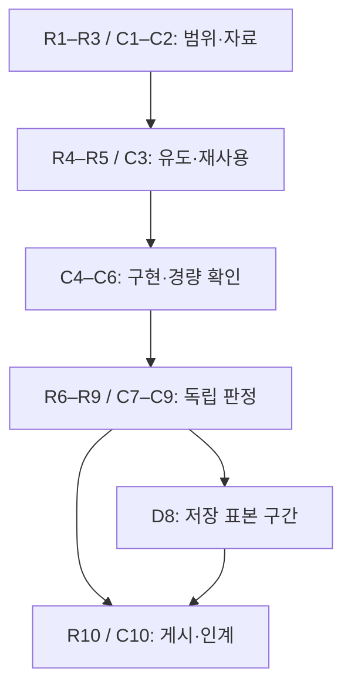

# HE30 이론·코딩 연구 루프 — 20단계 완료 기록

명명은 사용자가 호출한 physmath-research-loop의 R1–R10/C1–C10을 따른다. source가 동일한 기존 유도·실행·검토 근거는 재사용했다. 단계마다 새 ODE를 실행하거나 백업된 자료를 다시 검증하는 절차를 추가하지 않았다. 이번 HE 단위의 과학 IVP·상세 benchmark는0이다.

## 단계별 DAG·백업·게시

각 행의 CP는 아래의 실제 coherent snapshot을 가리킨다. 한 snapshot이 여러 단계를 보존하며, 이것을20개의 별도 archive를 만들었다는 뜻으로 쓰지 않는다. Source/result validity와 provider ACK는 별도 기록이다.

| 단계 | 실제 수행과 근거 | 판정 | 백업·게시 checkpoint |
|---|---|---|---|
| R1 연구 목표·계약 | 독립 성분·Frobenius·z20→2 고정, C21M27 계획을 D3 재사용으로 실행 전에 변경. CONTRACT_KO.md | COMPLETE_SCOPED | CP-A |
| R2 문헌·기존 성과 재사용 | 5repo957refs와 관련 원문, 실제 백업·첨부, Exa/SciSpace/원전/코드·license 조사. coverage/source ledger | COMPLETE_SCOPED | CP-A |
| R3 전제 정합성 | half/Frobenius√2, ΔP/3, proper-timeκ, z4/z2와warm729구간, D0/D3 identity 구분 | COMPLETE_SCOPED | CP-A |
| R4 가설·모델 탐색 | full-state continuation/reduced8/완료raw/HHe donor를 비교; 이미 완료된 D3 소비 경로 채택 | COMPLETE_SCOPED | CP-A |
| R5 구성적 유도 | LRS norm/work, canonical momentum의 에너지·수 보존, H/He frozen-rate/electron Jacobian. Wolfram·moment evidence | COMPLETE_SCOPED | CP-A |
| R6 독립 과학 심사 | 별도 담당자의237 저장결과·4그림 심사, 원본 pending기록을 보존한 sidecar admission | PASS_SCOPED_PRELIMINARY | CP-B |
| R7 판별 경량 계산 | source/raw/prefix/tail hash, exact121+33−1접합, SI정규화·signed합·cross와6savedguards | COMPLETE_SCOPED | CP-B |
| R8 과학 결과 판정 | 초기상쇄의해제, geometry-inducedstress,22sampled sign changes, D8의4latebrackets | PASS_SCOPED_PRELIMINARY | CP-C |
| R9 이론·계산 연결 | (case,epoch) arrays와정확한initialaxis·zero-keyfallback·그림좌표·meanredshift매핑 | COMPLETE_SCOPED | CP-B |
| R10 연구 정리·체크포인트 | README,심층연구,현재문서,DAG,두handoff,동시REI게시재조정 | COMPLETE_SCOPED | CP-C |
| C1 목표·기준 결과 | archive7f3856…/kernelPR147/executedwrapperSHA/237completed를기준으로고정 | COMPLETE_SCOPED | CP-A |
| C2 코드·식·데이터 조사 | full40/full56, reduced8조건, C15exactcache, resourcecode, metadata recovery를구분 | COMPLETE_SCOPED | CP-A |
| C3 알고리즘·수치 설계 | 새RHS없는immutableconsumer, batchnormalization, losslesscompact, contentidentity설계 | COMPLETE_SCOPED | CP-A |
| C4 구현·병렬 설계 | observedheadroom,CPU/caselease,one thread, boundedworkers,case별실패보존 | COMPLETE_SCOPED | CP-B |
| C5 코드 구현 | analyze_saved/continuation/shared_runner/D8script, catalog·CSV·NPZ·PNG/SVG 실제생성 | COMPLETE_SCOPED | CP-B + CP-C |
| C6 소프트웨어 검증 | runner8focusedchecks,237REUSED_COMPLETE/pending0/worker0 actualrun,publicationblobreadback | COMPLETE_SCOPED | CP-B |
| C7 물리 검증 | SI/Frobenius, signedcomponents,initialaxes,sourceidentity와4그림semanticreview | PASS_SCOPED_PRELIMINARY | CP-B |
| C8 정확도·성능 범위 | 6savedrefinement재사용; 상세benchmark·NCPscaling은사용자지시로수행하지않음 | SCOPED_NUMERICS_PASS; PERFORMANCE_NOT_RUN | CP-B |
| C9 독립 변경 코드 심사 | author와별도담당이4파일과완료receipt검토,blockingfinding0. D8는작은delta만별도검토 | PASS_SCOPED_CHANGED_CODE_REVIEW | CP-B + CP-C |
| C10 배포·실행 인계 | BASS_HE PR83,REI PR216,Draft/unmerged;sourcepin,providerACK,DAG와copyablehandoff | COMPLETE_WITH_DELIVERY_ACK | CP-C |

## Checkpoint의 실제 의미

| Checkpoint | 고정 내용 | Git 게시 | 백업 증거 |
|---|---|---|---|
| CP0 | 원래 D3 source/full raw,31,904,176bytes | 당시D0와실행SHA를구분. 후속REI결과는3a525e3… | D3_SOURCE_AUTHORITY.json; archiveSHA7f3856… |
| CP-A | intake·문헌/유도·현재D3계약 | b18895e5028ef6603471bfc85ad3f0835324e23b | delivery/CP_A_ACK.json:Drive+Dropbox completed |
| CP-B | 검토된consumer·runner·compact·네그림 | 65cc2af0caeaa4d5ce6aff37d72cf352cf24aaa7;287/287blobs일치 | delivery/CP_B_ACK.json,CP_B_GIT_READBACK.json |
| CP-B2 | D8saved-samplebrackets·독립delta·최신upstream관찰 | fb3146b94093776cad88e68cffb89b6559a405b3;REI1f32cc442ebde284bbb944455ba96066c9e0e055 | 최종CP-C에포함;REI7/7실제내용일치 |
| CP-C | 최종보고·두handoff·DAG·모든HE결과와REI전달기록 | source는CP-B2,마지막commit은metadata만 | delivery/CP_C_ACK.json와CP_C_MANIFEST.json이권위 |

CP-C archive는 자신을 업로드한 후 생긴 ACK를 포함할 수 없다. 최종 ACK와 현재 DAG는 그 고정 archive 밖의 후속 metadata로 게시한다. Archive manifest는 실제 포함 파일의 SHA를 기록하며, 마지막 metadata commit과 혼동하지 않는다.

## 실제 의존성과 정책 교정

현재 DAG의 모든 stage와 D8는 scoped 완료다. 성능 미측정과 production admission 미발행은 별도 scope이며, 이를 오늘의 preliminary 자료 완료 실패로 바꾸지 않는다. 사용자의 benchmark 제외는 저장소 일반 benchmarking 선행 지침보다 우선했다. 고정CPU55 제외를actualtopology와reserve로고쳤고,activeRAM의중복차감을제거했다. 다른세션존재는전체중지조건으로사용하지않았다.

새 strong no-go 주장은 없다. Native H/He chemistry, broad continuum certificate, observational likelihood와미측정NCP성능은이번결과의근거범위밖이다. 후속단일constructive단위는source확정electron-history donor adapter이며,동일237baseline재실행은필요없다.

## 최종 운송 검증

CP-C는 Drive와 Dropbox 양쪽에서 실제 전체 GET을 수행했다. 각각 5,902,164 bytes이며 SHA256 `a29d959197f13393f07ce0392f805be6df51834cf2cff015b6d1ddf809676852`가 일치했다. 두 다운로드 각각에서 archive 내부 payload 310개 파일의 hash도 모두 일치했다. [실제 readback](delivery/CP_C_READBACK.json)과 [완료 ACK](delivery/CP_C_ACK.json)가 그 근거다. 현재 [DAG](DAG.json)는 이 운송 완료를 반영한다. 보관된 고정 archive 안의 운송 전 DAG와 현재 게시된 DAG를 구별한다.
