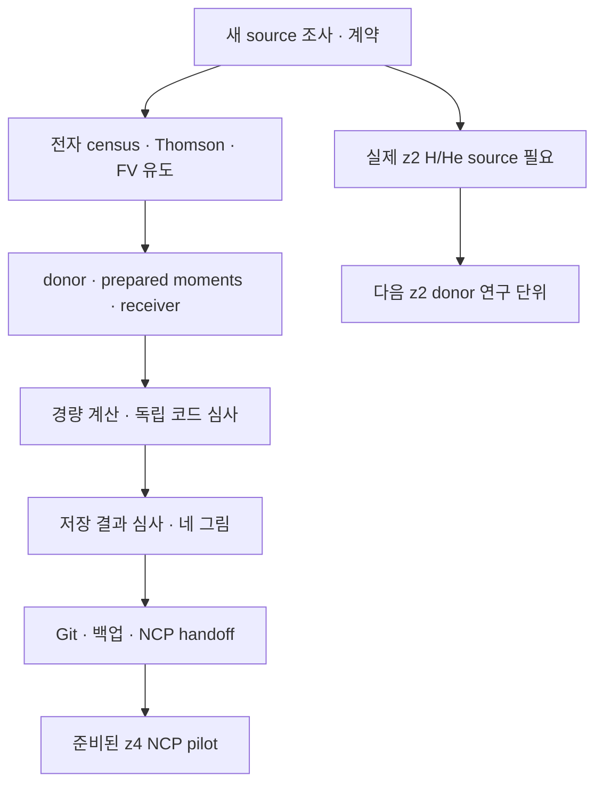

# HE31 이론·코딩 연구 루프 — 단계별 ledger

사용자가 호출한 physmath-research-loop 1.0.0 / approval v0.2의 R1–R10, C1–C10을 따른다.
같은 source의 기존 근거는 재사용했고 변경 영향의 가벼운 검사만 추가했다.
각 행의 P1/P2는 실제 coherent snapshot이다. 여러 단계가 같은 snapshot을 공유하며,
20개의 독립 archive나20개의 과학 실행을 뜻하지 않는다.

## 단계별 DAG·백업·게시

| 단계 | 수행 내용과 직접 근거 | 현재 판정 | 백업·게시 checkpoint |
|---|---|---|---|
| R1 연구 목표·계약 | [CONTRACT_KO.md](CONTRACT_KO.md) | complete_scoped | P1 |
| R2 새 문헌·기존 성과 조사 | [COVERAGE.json](evidence/context/COVERAGE.json); [UPSTREAM_DELTA.json](evidence/upstream/UPSTREAM_DELTA.json) | complete_scoped | P1_P2 |
| R3 전제·단위·구간 정합성 | [DERIVATION_KO.md](DERIVATION_KO.md); [DONOR_RECOVERY.json](evidence/context/DONOR_RECOVERY.json) | complete_scoped | P1 |
| R4 가설·모델 선택 | [CONTRACT_KO.md](CONTRACT_KO.md); [REPORT_KO.md](REPORT_KO.md) | complete_scoped | P1_P2 |
| R5 구성적 유도 | [DERIVATION_KO.md](DERIVATION_KO.md); [WOLFRAM_ALGEBRA.json](evidence/WOLFRAM_ALGEBRA.json) | complete_scoped | P1_P2 |
| R6 독립 과학 심사 | [DONOR_PHYSICS_REVIEW.json](evidence/DONOR_PHYSICS_REVIEW.json); [PAIRED_RESULT_REVIEW.json](evidence/PAIRED_RESULT_REVIEW.json) | complete_scoped | P2 |
| R7 판별 경량 계산 | [CONTRACT_CHECKS_SUMMARY.json](evidence/CONTRACT_CHECKS_SUMMARY.json); [REFERENCE_RECEIVER_PARITY.json](evidence/REFERENCE_RECEIVER_PARITY.json) | complete_scoped | P2 |
| R8 과학 결과 판정 | [PAIRED_RESULT_REVIEW.json](evidence/PAIRED_RESULT_REVIEW.json); [ANALYSIS_SUMMARY.json](plots/ANALYSIS_SUMMARY.json) | complete_scoped | P2 |
| R9 이론·코드·관측량 연결 | [REPORT_KO.md](REPORT_KO.md); [EXECUTED_SOURCE_MANIFEST.json](evidence/EXECUTED_SOURCE_MANIFEST.json) | complete_scoped | P2 |
| R10 연구 정리·체크포인트 | [REPORT_KO.md](REPORT_KO.md); [RESEARCH_LOOP_LEDGER_KO.md](RESEARCH_LOOP_LEDGER_KO.md) | complete_scoped | P2 |
| C1 기준 source·결과 고정 | [BASELINE_MANIFEST.json](evidence/BASELINE_MANIFEST.json) | complete_scoped | P1 |
| C2 코드·식·데이터 조사 | [SOURCE_REUSE.json](evidence/upstream/SOURCE_REUSE.json); [CONTRACT_KO.md](CONTRACT_KO.md) | complete_scoped | P1 |
| C3 수치·알고리즘 설계 | [DERIVATION_KO.md](DERIVATION_KO.md); [electron_donor.py](src/electron_donor.py) | complete_scoped | P2 |
| C4 병렬·불변 결과 설계 | [campaign.py](src/campaign.py); [bindings.py](src/bindings.py) | complete_scoped | P2 |
| C5 실제 구현 | [prepare_donor.py](src/prepare_donor.py); [receiver.py](src/receiver.py) | complete_scoped | P2 |
| C6 소프트웨어 검증 | [CONTRACT_CHECKS_SUMMARY.json](evidence/CONTRACT_CHECKS_SUMMARY.json); [IMPORT_SHADOW_CHECK.json](evidence/IMPORT_SHADOW_CHECK.json) | complete_scoped | P2 |
| C7 물리 규약·진단 확인 | [DONOR_PHYSICS_REVIEW.json](evidence/DONOR_PHYSICS_REVIEW.json); [PAIRED_RESULT_REVIEW.json](evidence/PAIRED_RESULT_REVIEW.json) | complete_scoped | P2 |
| C8 정확도·성능 범위 | [REFERENCE_RECEIVER_PARITY.json](evidence/REFERENCE_RECEIVER_PARITY.json); [PREPARED_MOMENTS_CHECK.json](evidence/physics/PREPARED_MOMENTS_CHECK.json) | complete_scoped | P2 |
| C9 독립 변경 코드 심사 | [RECEIVER_CODE_REVIEW.json](evidence/RECEIVER_CODE_REVIEW.json); [PREPARED_INDEPENDENT_REVIEW.json](evidence/PREPARED_INDEPENDENT_REVIEW.json) | complete_scoped | P2 |
| C10 게시·NCP 실행 인계 | [CODEX_HANDOFF.md](CODEX_HANDOFF.md); [PUBLICATION.json](delivery/PUBLICATION.json) | complete_scoped | P2 |

## 실제 checkpoint

| Checkpoint | 내용 | Git 게시 | 백업 |
|---|---|---|---|
| P1 | 새 source 조사·이론 계약·원래 실제 R15 donor 보존 | c7dde7753722339a268ee0bb02d6543be88466f9; PR84 | Dropbox completed; Drive 응답 없는 upload는 UNKNOWN. delivery/P1_ACK.json |
| P2 | 실제 구현·3완료 결과·실패 보존·독립 검토·4그림·준비한 NCP campaign·두 handoff | 1c8a56aac89d0e40ede8770009f80ebca40a4d2c; 119/119 Git blob 일치 | P2_ACK.json: Dropbox+Drive actual completed, 각2,832,001bytes |

P1 archive SHA256는 `2a6d1fae0a2ad53fe9c681c46dc1b4e0c89b584026bbba3eadff44f40690613c`,
1,213,914bytes다. Dropbox ID는 `id:BSpOijBcT10AAAAAAD_hYQ`다.
Drive는 실제 성공 응답이나 file ID가 없으므로 완료로 기록하지 않는다.
P2 구현 commit의119개 Git blob이 로컬 원시 byte로 계산한 SHA와 모두 일치했다.
최종 transport 완료는 delivery/P2_ACK.json에 실제 응답과 크기로 기록했다.
마지막 metadata 게시에서는 ACK, 완료 DAG와 고정 실행 pin 문서만 갱신한다.

## 의존성

R1–R10/C1–C10의20단계가 scoped 완료됐고 pending stage는0이다.
actual H/He z2 source 부재와 NCP campaign 미실행은 별도 실행 의존성이다.
HE30의237개 z20→2 baseline 완료를 취소하거나 무변경 재실행할 이유가 아니다.

## 판정 범위와 실패 보존

- actual donor: z20→4, reduced R15/HG97-B Q; HeIII=0, 일방향 prescription.
- full40 physics + target-clock diagnostic1, nominal tolerance 유지.
- 계약8항목: 처음7PASS+clock roundoff 기준을 교정한1개 targeted PASS.
- 첫 paired2건은 NumPy JSON packaging에서 실패해 로그 보존; 수정 뒤2건 완료.
- 원본 evaluator reference1건 완료; 상세 benchmark0, HE30 baseline 재적분0.
- actual integration attempts5, persisted completed3; manufactured collision-only ODE1은 별도.
- prepared/source/receiver/result review의 작성자와 독립 검토 범위 분리.
- 성능 향상률·실측RSS·64core scaling·native chemistry certificate는 발급하지 않음.

최종 archive는 업로드 후 생기는 자신의 ACK를 포함할 수 없다. 고정 archive의
manifest가 포함 파일의 권위이고, 이후 DAG/ACK/실행 pin 문서만 metadata로 게시한다.
이 운송 차이를 새 science execution으로 표시하지 않는다.

## 최종 P2 전달 완료

- Archive: `BASS_HE_HE31_P2_FINAL_20261021T135227Z.tar.gz`, 2,832,001bytes.
- SHA256: `e7a01a46b95ae30820bde7a46a6e94f920474a6e05574b188bb084051b51e577`.
- Dropbox actual completed: `id:BSpOijBcT10AAAAAAD_hjw`.
- Drive actual upload success + size readback: `1-3utJjmUyFlzhXymeCcgOurJ02ruzoxC`.
- payload130개, 총member132개; 원본 payload byte는 그대로이며 최종 내부manifest의
  metadata delta 목록만 교정했다. 게시 source119개와 비교해114개 동일,
  전달문서5개 변경, 새Gitreadback문서1개 추가, 원본donor3개 archive-only, 누락0이다.
- 로컬 archive hash·manifest 근거와 provider 저장 응답을 구별한다.
  업로드 후 원격 archive 전체 GET/hash를 새로 수행한 것은 아니다.
- P1 Drive는UNKNOWN 이력을 유지한다. P2가 양쪽 완료라고 해서 P1 응답을 소급 생성하지 않는다.
- 기존 P2 초안 archive는 로컬 보존, 원격 미게시다. 최종 선택은 `P2_ACK.json`이 가리킨다.
