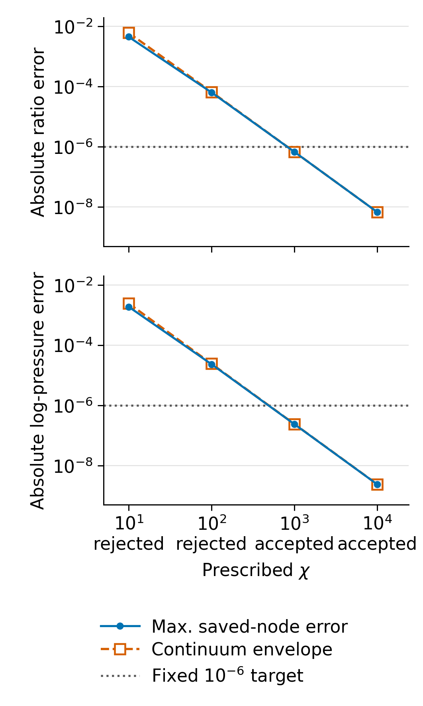
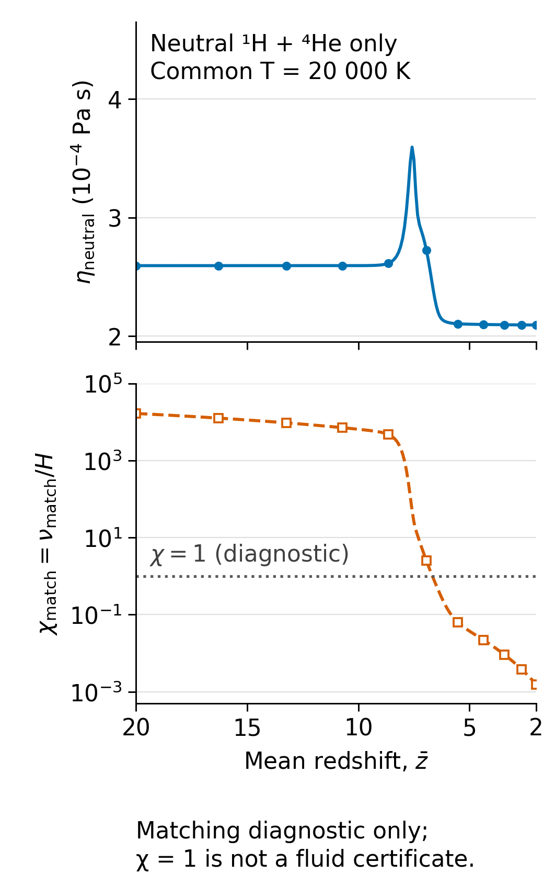

# HE34-SCR: sandbox에서 실행한 오차 상한 기반 pressure 축약과 중성 수송

## 1. 이번 단원이 실제로 얻은 결과

**workflow1.0.0 / approval0.2를 유지하면서, HE33의 pressure moment 방정식에서 빠른 이완을 직접 시간분해하지 않는 축약을 유도·구현·실행했다.** 미리 정한 `|delta(q/p)|<=1e-6`, `|delta ln p|<=1e-6` 기준에서 prescribed `chi=nu_pi/H`가 1000,10000인 두 대조를 수용하고 10,100인 두 대조는 거절했다. 별도로, 중성 H1/He4의 첫 Sonine 전단점성 선형계를 양의 유리식으로 정확히 축약하고 저장된 201개 조성에서 평가했다. 원전의 근사 차수는 유지했다.

이 연구 단원의 이름은 **HE34-SCR**이며 경로는 `research/he34_sandbox_certified_relaxation_20261022`다. 병렬 PR87의 `research/he34_lorentz_transport_20261022`와 별개다. 이 단원은 workflow1.3.0으로 이관하지 않았다.

계산 코드와 첫 실제 결과의 pin은 `1a07166434a2a9ede1464bcdc465cba3088bb795`다. 최종 그림·검토·인계가 포함된 science pin 및 최종 게시 상태는 `delivery/S2_ACK.json`과 PR88에서 확인한다. 본문의 수치는 `results/MECHANICAL_CONTROLS.json`과 `results/NEUTRAL_TRANSPORT.json`의 저장값이다.

## 2. 원래 목표와 현재 범위의 차이

| 항목 | 현재 확보 범위 | 남은 의존성 |
|---|---|---|
| HE32 원시 조성 pilot | 8핵종 21상태, prescribed UV의 photo+caseA RR, 평균 z20→2, 392 nominal+2 angular guard | 추가 반응·종·source/열 진화 |
| HE32 stress | 기존 matter stress는 nonbaryonic sector; gas pi_b=0 | 실제 바리온 stress 및 metric feedback |
| HE33 기초 | pressure tensor의 source-free mechanics, prescribed nu_pi, 양성 frozen propagator | transport 보정과 Q/J/R_part |
| HE34-SCR 기계 축약 | constant chi, Q=j=0, 정의된 선형 S(N) 입력의 연속계 오차 상한 | variable chi, thermal/reactive source, 물리적 closure 선택 |
| HE34-SCR 중성 수송 | 공통 T의 H1_q0/He4_q0 점성 및 p/eta 진단 | 전자·이온·다른 동위원소, momentum/energy 교환, tensor source |

모든 불안정 동위원소·음이온·분자 또는 fully reactive19채널 핵반응망을 완료했다는 뜻이 아니다. CI/DR/CX의 전체 혼합물 적용, 열·광원 진화, 종간 공통 온도·유속의 타당성은 `NEXT_DAG.json`에서 열린 의존성으로 남긴다.

HE32 30/30 완료와 2026-10-22 복원 증거를 재사용했다. 원 archive의 1392 payload/394 NPZ와 receipt/그림6쌍/30stage archive 전체 검증을 이번에 다시 수행했다고 쓰지 않는다. 이번 입력 연결은 미리 선택한 한 NPZ와 직접 관련된 코드·밀도 정규화만 확인했다.

## 3. 물리적 단순화: 팽창 인자를 정확히 제거하고 초기층을 보존

`D=diag(-1,-1,2)`, `P=p I+q D`, `sigma=s D`로 두고 다음 무차원 변수를 사용한다.

\[
N=\ln(a/a_0),\qquad S=s/H,\qquad \chi=\nu_\pi/H,
\qquad r=q/p,\qquad u=\ln[(p/p_0)e^{5N}].
\]

Q=j=0인 HE33 식은 정확히

\[
r'=4Sr^2-(\chi+2S)r-2S,\qquad u'=-4Sr
\]

가 된다. H와 밀도의 새 ODE를 풀지 않고 `p=p0 exp(-5N+u)`로 복원한다. 양의 pressure eigenvalue에 해당하는 cone은 `-1/2<=r<=1`이며 경계 흐름은 각각 `chi/2`, `-chi`로 내부를 향한다.

이 비선형식의 안정근을

\[
d=\sqrt{(\chi+2S)^2+32S^2},\qquad
b(S)=-\frac{4S}{\chi+2S+d}
\]

로 쓰면 작은 S에서 두 근을 빼는 cancellation을 피한다. 근 자체의 shear-work 항은

\[
-4Sb=\frac{16S^2}{\chi+2S+d}\ge0
\]

이다. 이것은 팽창 인자를 제거한 kinetic pressure의 증가분이다. 실제 pressure는 여전히 `exp(-5N)` 인자를 포함한다. 약한 shear에서는 `b≈-2S/chi`, `u'≈8S²/chi`를 회복한다.

대수근만 쓰면 초기값을 놓칠 수 있으므로 각 선형 source 구간에서 정확한 frozen nonlinear 초기층을 더했다. `tau=N-Nj`, `delta0=rhat_j-b(Sj)`, `c=4Sj delta0/dj`이면

\[
\widehat r(N)=b(S(N))+
\frac{\delta_0 e^{-d_j\tau}}{1-c(1-e^{-d_j\tau})}.
\]

상수 S에서는 이 식이 임의의 허용 초기 r에 대해 정확하다. 변하는 S에서는 다음 residual을 직접 계산한다.

\[
\rho=b'+(d-d_j)\delta+4(S_j-S)\delta^2.
\]

`kappa=chi-6 max|S|>0`, 양의 denominator, 증명된 candidate cone 조건 아래 residual의 구간 상한 R로

\[
E_{j+1}=e^{-\kappa h}E_j+
\frac{R}{\kappa}(1-e^{-\kappa h})
\]

를 전파한다. `|r-rhat|<=E`이며, `L'=4 max|S| E`를 누적하면 `|ln(p/phat)|<=L`이다. 상세한 R, 구간 적분, cone 증명 및 tensor 성분 오차로의 변환은 `theory/CERTIFIED_REDUCTION.md`와 `theory/EQUATION_CODE_MAP.md`에 있다.

pressure 적분은 느린 대수근 항과 초기층 항을 나눈 뒤 초기층에 `x=dj tau`를 사용한다. 따라서 `chi*h`가 커져도 좁아진 초기층을 원래 N 격자로 추적하지 않는다. 실제 구현은 `expm1`, cancellation-resistant 작은 구간 적분, 상수 source의 닫힌 로그식을 사용한다. `chi*h=1e14` 검사에서 초기층을 보존했고, 독립 Laplace moment 값과의 절대차는 `2.07e-25`였다.

이 증명은 **정의된 piecewise-linear S 입력에 대한 연속계 축약 오차**를 제한한다. HE32 저장점 사이의 진짜 배경 오차나 수송 fit 오차, binary64 전체 연산의 outward-rounded bound를 대신하지 않는다. `certified`와 별도로 구적 수렴·유효성 및 `estimate+tail<=1e-9` gate를 실행했다. 이 구분은 독립 리뷰에서 발견한 문제를 첫 저장배경 실행 전에 수정한 결과다.

## 4. 저장 배경에서 실제로 실행한 대조

입력은 `s07_m03_r03`, 초기 `Sigma_F=0.6`, 초기 nonbaryonic `P_m=P_r=0`이다. 선택은 실행 전에 고정했다. NPZ SHA256은 `c97ffa6a793c092b6b559b32581a7996a82b85a8e725b0e5893be9ae1e7bf30a`다. `S=signed_Sigma/sqrt(6)` 정규화를 확인했고 201개 node의 선형 보간을 새 계산의 정확한 입력으로 정의했다. r0=0이며 arbitrary p0는 무차원화로 제거된다.

독립 reference는 r 식을 다시 구현하는 대신 팽창 인자를 제거한 두 eigenpressure를 Radau로 적분했다.

\[
W_\perp'=2SW_\perp+\frac\chi3(W_\parallel-W_\perp),\qquad
W_\parallel'=-4SW_\parallel-\frac{2\chi}3(W_\parallel-W_\perp).
\]

source가 꺾이는 200개 구간 경계에서 정확히 나누고 analytic Jacobian을 사용했다. reference tolerance는 rtol=`3e-11`, atol=`3e-13`이다.

| prescribed chi | 최대 저장-node r 오차 | 연속계 최대 r 상한 E | 최대 저장-node ln p 오차 | 누적 ln p 상한 L | 고정 기준 판정 |
|---:|---:|---:|---:|---:|---|
| 10 | 4.52151e-3 | 6.12139e-3 | 1.88855e-3 | 2.44437e-3 | 거절 |
| 100 | 6.43374e-5 | 6.67812e-5 | 2.33545e-5 | 2.41469e-5 | 거절 |
| 1000 | 6.84089e-7 | 6.86890e-7 | 2.38742e-7 | 2.41072e-7 | 수용 |
| 10000 | 6.85027e-9 | 6.85306e-9 | 2.39269e-9 | 2.41029e-9 | 수용 |

수용 기준을 결과를 본 뒤 완화하지 않았다. 거절된 두 경우도 계산값·상한·거절 이유를 보존한다. 네 경우 모두 continuum certificate의 전제는 성립했지만 앞의 두 경우는 요구한 정확도를 충족하지 못했다. 이 네 표본으로 정확한 chi 임계값이나 모든 배경의 수용영역을 추정하지 않는다.

chi1000 reference를 rtol=`3e-12`, atol=`3e-14`로 한 번 더 조였을 때 차이는 r `5.9018e-14`, ln p `5.5502e-15`였다. 독립 readback에서 모든 저장-node 오차가 수치 비교용 `5e-10` allowance를 쓰지 않아도 E,L 안에 있음을 확인했다. sqrt(6) 정규화를 빠뜨리는 mutation과 초기층을 버리는 mutation도 요구 정확도를 넘는 차이를 만들어 검출됐다.

그림 1. 각 chi에서 파란 점은 독립 full-moment reference와의 저장-node 최대 오차, 주황 빈 사각형은 연속계 상한이다. 점 사이 선은 시각적 연결이며 미실행 chi의 수용을 인증하지 않는다. r는 q/p이고 pressure 오차는 로그값이다.

## 5. 중성 H1/He4 수송의 정확한 대수 축약과 진단

무거운 입자의 첫 Sonine Chapman–Enskog 점성 선형계는 Wargnier et al. (2020), Appendix C29,C30,C35–C38을 확인했다. 충돌 적분의 온도 fit은 Bruno et al. (2010)의 Eq11/TableI 및 공식 Mutation++의 pin `58678c0e038eb2f078fed3b45640741fdaf167dc`를 대조했다. 확보한 네 항은 H–H `(2,2)`, H–He `(1,1),(2,2)`, He–He `(2,2)`다. `Qbar=pi*1e-20*F(T)` m²의 pi/Ų 변환을 원전 구현에서 확인했으며 T=50–50000 K 범위 밖은 거절한다. 이 범위는 fit의 사용 범위이지 어떤 온도에서나 21상태 전체 물리 모형이 성립한다는 뜻이 아니다.

2×2 선형계 `eta=(x,y)G^-1(x,y)^T`의 공통 인자를 소거하고 determinant를 양의 항으로 다시 쓰면 `eta=N/D`의 유리식이 된다. 순수 H와 순수 He 극한도 같은 식에서 정의되며, trace 성분에 floor를 넣지 않는다. 두 비음수 가중치의 공통 배율을 제거해 overflow를 피한다. 대수 항등식과 양성 determinant는 Wolfram 및 독립 exact-Fraction 대조로 확인했다. 완전한 계수식은 `theory/NEUTRAL_TRANSPORT_KO.md`에 있다.

실제 저장 조성의 분모는 고정된 reference H1 nucleus density다. neutral H의 현재 밀도를 분모로 바꾸지 않았다. HE32의 baryon census와 동일한 A*m_u 질량 근사를 명시했다. `m_u=1.66053906892e-27 kg`이며 정밀 원자 동위원소 질량으로 간주하지 않는다. 저장된 전하 census를 다시 조립한 electron density의 상대차는 `5.9961e-16`이었다.

공통 T=20000 K를 처방해 계산한 결과는 다음과 같다.

| 양 | 초기 z20 | 최종 z2 |
|---|---:|---:|
| eta_neutral [Pa s] | 2.5938294620e-4 | 2.0928123830e-4 |
| p_neutral [Pa] | 5.2786231336e-16 | 2.1520558370e-24 |
| nu_match=p_neutral/eta [s^-1] | 2.0350694642e-12 | 1.0283080579e-20 |
| chi_match=nu_match/H | 1.6671365007e4 | 1.5526671739e-3 |

eta의 전체 범위는 `[2.0928123830e-4,3.5944630845e-4] Pa s`다. 201개 실제 조성에서 유리식과 독립 2×2 solve의 최대 상대차는 `6.4653146232e-16`으로 사전 허용값 `5e-13`보다 작았다.

`nu_match=p/eta`는 HE33의 저주파 작은 비등방성 `q≈-2ps/nu_pi`를 `q=-2 eta s`에 맞춘 정의다. 정확한 충돌 연산자의 transient eigenvalue라고 해석하지 않는다. 별도 PR87의 Lorentz 순간 Grad 투영률과도 자동으로 동일시하지 않는다. CI/RR/CX의 number reaction rate를 그대로 대입할 근거는 없다.

chi_match<1인 저장점은 97/201, <10인 점은 105/201이었다. 이 중성 부분집합 진단에서는 전 구간 빠른 이완 가정을 뒷받침할 수 없다. 반대로 이것으로 전체 플라스마가 유체 기술을 가질 수 없다는 결론도 내릴 수 없다. charged 성분, 유한 질량 교환, 반응 tensor source를 아직 포함하지 않았기 때문이다. 이 chi_match는 앞 절의 constant-chi 기계 계산에 사용하지 않았다.

그림 2. 저장된 평균 적색편이와 조성으로 평가한 중성 부분집합의 점성과 점성 일치율. 온도는 20000 K로 처방됐다. chi=1 선은 진단 기준이며 유체 closure의 타당성 증명은 아니다.

## 6. 코드 성능과 실제 실행 비용

| 새 작업·비교 | 중앙 시간 | 대조 중앙 시간 | 대조/축약 비율 |
|---|---:|---:|---:|
| chi1000 기계 축약, 201 nodes, bound+구적 포함 | 73.505 ms | 구간별 Radau 785.762 ms | 10.6899 |
| 중성 수송 vector rational, 201 epochs | 0.244831 ms | batched2×2 matrix 0.315845 ms | 1.29005 |
| 같은 수송 vector rational 대비 scalar rational | 0.244831 ms | scalar 1.150686 ms | 4.69991 |

기계 비교는 다섯 trial의 순서를 교대했고, 같은 입력과 출력 node에서 양쪽 모두 고정 `1e-6` 정확도 요구를 만족했다. Radau baseline의 실제 r 오차는 `1.0764e-9`로 요구값보다 훨씬 작았다. 이는 정확도별 최적 설정을 탐색한 baseline이 아니다. 이 표는 선택한 segmented Radau 및 현재 host/workload에 대한 측정값이다. 기계 축약 시간 범위가 20.56–304.97 ms, Radau가 250.32–1109.96 ms로 넓으므로 다른 환경이나 전체 HE32 campaign의 보편적 가속비로 확대하지 않는다.

수송 비교는 각 lane에서 한 sweep당 coefficient 준비, 입력 검사, array 구성, 계산 및 네 output의 유한성 검사를 포함했다. 다섯 trial×200 sweeps를 순환 순서로 측정했다. 파일 I/O와 module import는 lane 시간에서 제외했다. raw trial 전체는 결과 JSON에 보존했다.

실제 환경은 Python3.12.14, NumPy2.3.5, SciPy1.17.0, Linux x86_64, binary64다. Intel Xeon Platinum8573C, 보고된 logical CPU9/affinity9, cgroup CPU quota8, memory cap8 GiB이며 native OpenBLAS1thread를 확인했다. 자원을 전용으로 확보한 benchmark는 아니다. NCP job은 0이다.

첫 저장배경 기계 실행의 wall time은 17.445 s, exit0, child peak RSS는 64344 KiB였다. 중성 검증·진단 worker는 2.673 s, exit0였다. 두 그림 쌍의 실제 렌더는 5.794 s, exit0였고 동일 cache 호출은 2.580 s에 renderer를 호출하지 않고 완료됐다.

## 7. 검증, 실패, 재사용 장부

- HE33의 unchanged 실제 Node CommonJS/CLI를 한 번 실행해 17/17을 확인했다. 과거 NOT_RUN 문서는 그대로 보존하고 새 receipt로 그 실행 의무를 닫았다.
- 최종 reduction 구현의 새 검사 8그룹을 통과했다. 첫 7그룹 성공 뒤 극단적 유한 입력의 불필요한 overflow 가능성을 수정했고 두 성공 attempt를 보존했다. constant-source expm, cone 경계, 90자리 Decimal, chi*h=1e14, 입력 거절과 상한 거절을 다룬다.
- 중성 구현은 새 vector 경로와 저장상태 연결을 포함한 26 affected checks를 통과했다. 이미 완료된 40-case 원전 prototype suite는 다시 실행하지 않았다.
- 초기 reduction prototype은 8개 수치 대조를 계산한 뒤 NumPy bool JSON 직렬화에 실패했다. 수정 후 8개를 다시 계산해 저장했다. 실제 실행량은 총16 synthetic trajectory/320 interval solves이며 최종 고유 대조는8개다. 실패 기록을 삭제하지 않았다.
- 현재 저장배경 대조의 full eigenpressure history는11개다: 네 prescribed chi, 한 tolerance refinement, 한 baseline accuracy check, 다섯 timing run. 이 부분의 interval solve 합은2200이다. 독립 리뷰의 별도 sign-changing 두 control 및 고정밀 행렬·충돌 fit 검산은 별도 receipt로 구별했다.
- 독립 검토는 수학 유도→식/구현 대응→실행 출력/receipt→실제 PNG 순서로 진행했다. 완료된 결과에 대해 광범위한 과학 suite를 반복하지 않았다.
- shell Git의 proxy/promisor 문제는 exact GitHub file/blob read로 우회했고 HE33 47개 blob을 확인했다. 수치 결과의 오류로 분류하지 않는다.

**기존 HE32 IVP/render/benchmark 재실행은0/0/0, 새 coupled cosmological IVP는0이다.** 새 산출 그림은 두 PNG+SVG 쌍이다. 최초 plot을 다시 만든 것으로 계산하지 않으며, 동일 입력 재호출은 실제 renderer0의 cache 검증이었다.

## 8. 후속 연구와 재개

`NEXT_DAG.json`은 B1 수송률/행렬, B2 열·반응 source 장부, B3 closure 선택, B4 새 coupled gas pilot, B5 metric feedback의 의존성을 분리한다. 새 단원은 source hash와 물리 가정이 달라지는 부분부터 시작한다. PHYS79/THERM01/REI221 및 PR87의 이미 확인한 근거를 다시 전수 조사하지 않는다. 조사 기준 시점 이후의 직접 관련 변경만 intake한다.

`CODEX_HANDOFF.md`는 코드·환경·cache·입력·수용기준·반환 형식을, `NEXT_THREAD_HANDOFF.md`는 연구 위치·원래 목표와 남은 범위·다음 DAG를 제공한다. 최종 게시/백업 및 단계 상태는 `DAG.json`과 `delivery/`에 연결한다.

## 출처

1. [Wargnier et al., A&A635,A87 (2020), author PDF](https://jbscoggi.github.io/website/assets/pdf/Wargnier2020_A&A.pdf), [DOI10.1051/0004-6361/201834686](https://doi.org/10.1051/0004-6361/201834686). heavy-particle transport framework 및 Appendix C를 확인했다.
2. [Bruno et al., Phys.Plasmas17,112315 (2010), author-uploaded full text](https://www.researchgate.net/publication/234852143_Transport_Properties_of_High-Temperature_Jupiter-Atmosphere_Components), [DOI10.1063/1.3495980](https://doi.org/10.1063/1.3495980). collision integral fit/계수/온도 범위를 확인했다.
3. [Mutation++ pinned official implementation](https://github.com/mutationpp/Mutationpp/tree/58678c0e038eb2f078fed3b45640741fdaf167dc). 원전 file blob과 바이트 SHA256은 `evidence/prototypes/TRANSPORT_UPSTREAM_MANIFEST.json`에 있다.
4. [HE32 PR85](https://github.com/cosmosapjw-quantum/BASS_HE/pull/85), pin16a424b7290f484c57e97c8ed74f81e6d2043782; [HE33 PR86](https://github.com/cosmosapjw-quantum/BASS_HE/pull/86), pinbb1259b21c7b83b0376a5f7fcbb0c6321918ec90; [parallel Lorentz PR87](https://github.com/cosmosapjw-quantum/BASS_HE/pull/87), pin0868889acebeb4d9b70d38313a9a694d12bf8766.

기계 축약의 residual와 오차 전파는 이 단원에서 직접 유도한 결과다. 위 문헌이 이 축약 전체를 이미 증명했다고 인용하지 않는다. 이 단원의 구성적 결과가 문헌상 최초라는 전수 신규성 주장도 하지 않는다.
