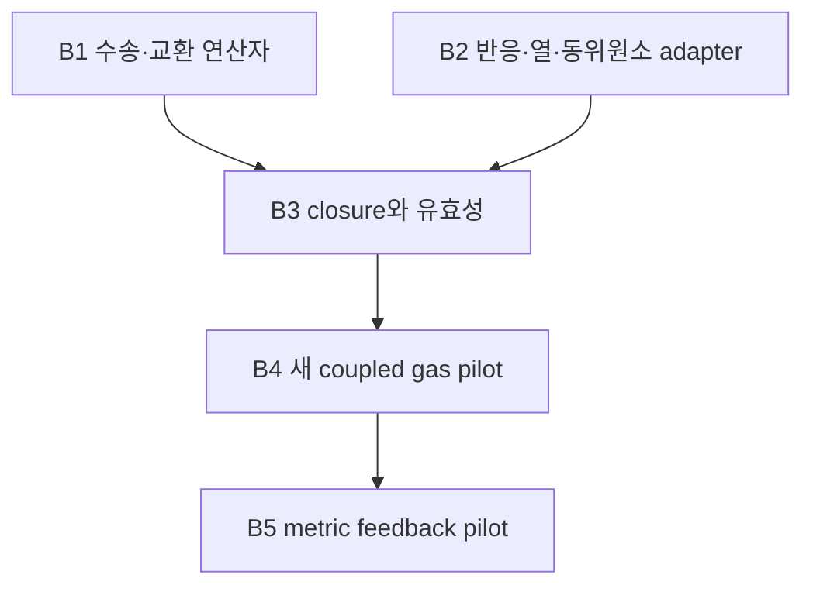

# HE34-SCR: 확보한 범위와 다음 물리 단원의 의존성

Workflow **1.0.0**, approval **0.2**를 유지한다. 이 문서는 후속 B1–B5의 설계이며, 해당 물리 단원을 실행하거나 완료했다는 기록이 아니다. 기계적 실행·전달 단계의 판정은 현재 단원의 `DAG.json`과 실제 receipt가 담당한다. 기계 판독 가능한 후속 계획은 [NEXT_DAG.json](../NEXT_DAG.json)이다.

이번 정리는 이미 저장된 HE32/HE33 산출물, HE34-SCR 증거, PHYS79/THERM01/REI221의 제한된 delta intake, PR87의 네 파일 readback만 재사용했다. 새 문헌·저장소 전수 조사, donor 검사, 우주론 IVP, 배경 재적분은 실행하지 않았다. PR87이 사용하는 별도 workflow 표기는 donor의 이력이며 HE34-SCR의 정책을 바꾸지 않는다. [S1–S6]

## 1. 원래 목표와 현재 pilot의 차이

현재 계약에 보존된 전체 목표는 primordial 종의 반응·열 진화와 물리적으로 정해진 바리온 압력텐서를 연결하고, 그 에너지·응력을 기하와 일관되게 결합하는 것이다. HE32, HE33, HE34-SCR은 이 목표의 서로 다른 부분을 제공한다. 선택한 원자 목록 밖의 불안정 핵종·음이온·분자·핵반응까지 완성한 것으로 범위를 넓히지 않는다. [S1–S3]

| 항목 | 이미 확보한 범위 | 전체 목표에 남은 의존성 |
|---|---|---|
| 종 목록 | HE32의 n, H1, D, T, He3, He4, Li6, Li7: 8핵종, 21개 원자 전하상태. 전자는 전하합으로 복원한다. | 추가 종·최종상태·핵변환을 넣을 경우 별도 목록, daughter 분기, 반응률, 에너지 배분이 필요하다. |
| 조성 진화 | 같은 원소의 전자 반응률과 초기 전하분율을 공유하고, 중성자 n·삼중수소 T의 abundance 및 핵 source가 0인 부분공간에서 9개 전하분율을 21개 상태로 정확히 lift한다. | 동위원소별 계수·source가 이 부분공간을 벗어나면 축약의 정확성을 다시 증명하거나 full 상태로 진화해야 한다. |
| 원자 과정 | prescribed UV에 의한 photoionization + total RR, case A. | CI, DR, CX, 들뜬 최종상태·공명, 열화·복사 에너지 모멘트는 채택 범위별로 연결해야 한다. 미확보율을 0으로 채우지 않는다. |
| 온도·복사 | HE32는 T=20000 K. 광자수 스펙트럼은 5.392–60 eV에서 E^-2.5, Γ_HI=10^-12 expit[(6-z)/0.3] s^-1이다. | kinetic heating/cooling, 입자수 변화, 이온화 에너지, 탈출 복사, UV 공급자의 에너지 장부가 필요하다. 다른 donor의 UV 함수를 그대로 바꾸어 끼우지 않는다. |
| 기체 응력 | HE32는 명시적으로 π_b=0. HE33은 prescribed ν_π와 Q=j=0의 기계적 압력모멘트를 유도·구현했다. | 실제 혼합물의 수송 연산자, 반응 tensor source, 공통 온도·속도의 유효성, 물리적 closure 선택이 남아 있다. |
| HE34-SCR | prescribed **상수** χ=ν_π/H의 축약·연속체 잔차 경계, 그리고 별도의 중성 H1/He4 점성 진단을 제공한다. | 이 축약의 정확성은 실제 ν_π를 결정하지 않는다. 가변 χ, Q, j가 있는 물리적 기체 pilot과 그 축약 검증은 후속이다. |
| 기하 결합 | HE32의 기존 비바리온 massive 성분, 광자, 중성미자 응력은 각각 보존된 역할을 가진다. | 바리온 e_b, p_b, π_b를 포함한 새 Einstein/에너지 장부와 feedback pilot이 필요하다. |

HE32의 `matter` 응력은 f_m=0.1인 **collisionless nonbaryonic** 성분이다. 원자 기체의 바리온 응력 π_b와 같은 물리량이 아니다. Non-tilted 조건도 압력 등방성을 뜻하지 않는다. 같은 기저에서 D=diag(-1,-1,2), σ=sD, π_b=q_bD를 쓰면 최종 signed source는 기존 q_m+q_γ+q_ν에 q_b를 더한다. 정규화된 P_b=(8πG/c²)√6 q_b/H²를 정의할 때 norm은 |P_m+P_γ+P_ν+P_b|처럼 **부호 있는 합 이후**에 계산한다. [S1, S2]

따라서 완료된 HE32의 30단계와 HE33의 기계적 결과를 다시 실행할 이유는 없다. HE33의 이전 Node 환경 미실행 항목은 현재 `HE33_NODE_SMOKE.json`의 실제 17/17 통과로 닫혀 있다. 이 사실은 후속 물리적 B1–B5의 완료 여부와 별개다. [S2, S3]

## 2. 세 가지 이완률의 정의를 구별한다

### 2.1 HE33/HE34-SCR의 prescribed mechanical rate

HE33은 충돌의 STF 이차 모멘트를 C^(2)_STF=-ν_π π로 **모형화**한다. LRS에서는

\[
\dot p=-5Hp-4sq+\frac{2Q}{3},\qquad
\dot q=-(5H+\nu_\pi+2s)q-2ps+j.
\]

실제 구현된 기존 전파기는 Q=j=0이다. HE34-SCR의 현재 certificate는 여기에 H>0, N=ln(a/a0), 지정된 선형 구간 보간 S=s/H, **상수** χ=ν_π/H를 더한 계약을 사용한다. ν_π 또는 χ를 제공하는 과정은 이 기계적 식 자체로 정해지지 않는다. [S2, S3]

### 2.2 PR87의 instantaneous Lorentz–Grad projection

별도 단원 `research/he34_lorentz_transport_20261022`, PR87, pin `0868889acebeb4d9b70d38313a9a694d12bf8766`의 정의를 보존한다. 정지하고 사실상 무한질량인 표적, 밀도 n_t, 질량 m의 projectile, Maxwellian 기준과 작은 STF Grad 섭동에서

\[
\sigma_2(v)=2\pi\int_{-1}^{1}[1-P_2(\mu)]\,
  \frac{d\sigma}{d\Omega}(v,\mu)\,d\mu,
\]

\[
\nu_{\pi,\mathrm{Grad}}
=\frac{n_t v_T}{\Gamma(7/2)}
\int_0^\infty x^3e^{-x}\sigma_2(v_T\sqrt{x})\,dx,
\qquad v_T=\sqrt{2k_BT/m}.
\]

이는 정해진 초기 radial Grad 모양에 대한 **순간 투영 감쇠율**이다. 속도별 실제 angular decay는 n_t v σ_2(v)이므로, 일반적으로 시간이 지나면 그 초기 radial 모양이 유지되지 않는다. PR87의 constant-σ_2 manufactured control에서 정규화된 시간 1의 정확한 압력비는 0.18437048354567437, 초기 투영률을 고정한 exponential은 0.16440758378370465였다. 이 기록은 한 개의 고정 ν를 과도 해로 사용하는 데 추가 closure가 필요함을 보인다. PR87은 보편적인 불가능 정리나 경험적으로 보정된 primordial rate table을 주장하지 않는다. 채택된 물리적 rate row는 0개이며, finite-domain source의 미확보 tail도 unknown/조건부 bound로 유지한다. [S4]

### 2.3 HE34-SCR의 viscosity matching

이번 중성 H1/He4 하위 범위는 공통 T의 희박 기체, near-Maxwellian Chapman–Enskog/1차 Sonine 점성을 계산한다. Wargnier의 두 종 점성 선형계를 양의 유리식으로 축약한 것이며, 그 대수적 축약은 정확하다. 원래 수송 근사의 차수·데이터 정확도는 바뀌지 않는다. Bruno fit과 pinned Mutation++ 정규화에서 Q̄=π·10^-20 F(T) m², 50≤T≤50000 K를 쓴다. [S5]

저주파의 작은 비등방성에서 q≈-2ps/ν_π를 Newtonian q=-2ηs와 맞추어

\[
\nu_{\pi,\mathrm{match}}=\frac{p_{\mathrm{neutral}}}{\eta_{\mathrm{neutral}}}
\]

로 정의한다. 이것은 점성 응답을 재현하는 유효율이며 정확한 transient collision eigenvalue라는 주장이 아니다. 실제 201개 저장 상태의 진단은 H1_q0, He4_q0만 사용했고, HE32의 A·m_u 질량 관례와 n_H,ref 정규화를 확인했다. 다른 중성 동위원소, 이온, 전자는 수송 계산에 포함하지 않았다. 유리식–행렬식의 최대 상대차 6.465314623214752×10^-16은 같은 근사식의 수치 일치를 검사하며 물리적 fit 오차를 제한하지 않는다. [S5]

| 비교 | PR87 | HE34-SCR 중성 진단 |
|---|---|---|
| 물리 모형 | 고정된 무한질량 표적의 Lorentz angular operator | 유한질량 H1/He4 혼합물의 1차 Sonine 점성 |
| 산출량 | 작은 초기 Grad 섭동의 순간 투영률 | 저주파 점성에 맞춘 p_neutral/η_neutral |
| 입력의 핵심 | dσ/dΩ 또는 σ_2(v), 속도 domain·tail | Maxwellian collision-integral fit Q̄^(l,s)(T), 두 원자 질량·조성 |
| 현재 확보된 보정 | manufactured cross sections, 물리 rate row 0개 | 원전 계수에 근거한 중성 H/He 하위 범위 |
| 자동으로 제공하지 않는 것 | finite-mass exchange, 장시간 single-rate closure | 정확한 순간/과도 ν_π, 전체 혼합물 및 반응 tensor closure |

따라서 ν_π,Grad, ν_π,match, prescribed ν_π를 같은 열에 덮어쓰지 않는다. σ_2(v)는 angular cross section이고 Q̄^(l,s)(T)는 추가적인 속도 모멘트와 정규화를 가진다. 둘 사이를 연결할 경우 해당 원전의 angular·radial 정규화와 질량 convention을 유도한 adapter가 필요하다. 총 사건률, CI/RR/CX number-rate 또는 l=1 momentum-transfer rate를 ν_π로 대신하지 않는다. [S2, S4, S5]

현재 중성 χ_match는 16671.3650에서 0.001552667까지 변하고, 201 epoch 중 97개에서 1보다 작다. 이 관측만으로 실제 전체 기체의 수송 한계를 결정할 수는 없다. 동시에 전 구간에 빠른 중성 이완이나 상수 χ를 자동 가정할 근거도 제공하지 않는다. 이 진단은 현재 mechanical input에 사용되지 않았다. [S5]

## 3. B2에서 연결해야 할 Q, J, R_part와 동위원소 adapter

HE33 convention을 그대로 사용한다. 압력 source를 \(\mathcal S^{\rm kin}_{ij}\)라고 쓰면

\[
Q=\tfrac12\operatorname{tr}\mathcal S^{\rm kin},\qquad
J=\mathcal S^{\rm kin}-\tfrac23QI,\qquad \operatorname{tr}J=0,
\]

이고 LRS에서 J=jD다. Q는 kinetic power density [W m^-3], J와 j는 pressure source [Pa s^-1]이다. PHYS79가 반응 사건률에 사용하는 J_r와 이 tensor J는 다른 기호다. 총 thermal particle density는 n_part=n_nuclei+n_e이고

\[
\dot n_{\rm part}+3Hn_{\rm part}=R_{\rm part}
\]

에서 R_part의 단위는 m^-3 s^-1이다. 핵수를 보존하는 원자과정에 한해서 R_part=R_e로 줄일 수 있다. 핵반응으로 nucleus count가 바뀌면 heavy-particle source도 포함한다. [S2, S6]

공통 온도 이상기체를 **채택한 경우에만**

\[
e_{\rm th}=\tfrac32p,\qquad
\dot e_{\rm th}+5He_{\rm th}+\sigma:\pi=Q,
\]

\[
\dot T=-2HT-\frac{T R_{\rm part}}{n_{\rm part}}
-\frac{2\sigma:\pi}{3k_Bn_{\rm part}}
+\frac{2Q}{3k_Bn_{\rm part}}
\]

가 성립한다. n_b가 보존된 baryon census이고 ε_th=e_th/n_b라면

\[
\dot\epsilon_{\rm th}
=-2H\epsilon_{\rm th}+\frac{Q-\sigma:\pi}{n_b}.
\]

THERM01의 isotropic per-baryon thermal coordinate를 가져올 때는 빠져 있던 shear work를 이 식에 연결해야 한다. T를 ε_th와 실제 입자수로 복원하면 R_part의 열용량 효과는 이미 포함되어 있으므로 에너지 RHS에 같은 입자수 항을 다시 더하지 않는다. 고정 T를 새 물리 가정으로 계속 선택하면 필요한 총 kinetic power는 Q_iso=3Hp+6sq+(3/2)k_BT R_part다. thermostat은 이 총 요구량에서 이미 채택한 물리적 heating/cooling을 뺀 나머지여야 한다. [S2, S6]

### 저장된 donor에서 재사용할 것과 남은 것

| Donor / 정확한 pin | 재사용할 수 있는 정의·구현 | 이 연결에서 남은 일 |
|---|---|---|
| PHYS79 / WU088_HH PR134, `3304d16db1dc9bf868c185a8eeb6cc9dbc270e50`, science `338fb7728e8b41f49551200b1f1ba73c047fb90c` | Domain guard가 있는 CI, D/H ground-state CX, 전역 ionic potential ε와 stoichiometry S에서 Δε=ε·S를 만드는 event ledger. | HE/Li CX 최종상태·복사 모멘트, low-T/high-stage CI, D PI/RR energy adapter, tensor source와 종간 열화가 미완료다. |
| THERM01 / rec_bianchi PR120, `d562d03415e37488cd4b5444488c77555260e0fb` | Maxwellian α(T)의 β=k_BT²α′+(3/2)k_BTα 모멘트, fit-derivative RR/DR cooling, per-baryon thermal coordinate, source quadrature. | Fitted α를 미분한 cooling의 경험적 정확도는 미측정이다. CI/CX, 전단 tensor source, 실제 ν_π는 공급하지 않는다. UV envelope와 energy support가 HE32와 다르다. |
| REI221 / `c1714f82ea7de15fee230a1a995365970ee6dc02` | 보존 baryon당 event/charge/energy 계약, 변하는 nucleus count, beta/Q의 단일 소유권, quotient source-alignment 조건. | Daughter branch, neutral-plasma nuclear rate, stopping/thermalization provider는 아직 의존성이다. |

원전의 Maxwellian moment identity와 fitted-rate derivative closure는 같은 강도의 경험적 정확도 주장이 아니다. DR의 부호 있는 fit 항을 각각 양의 확률 채널로 해석하거나 clipping하지 않는다. THERM01의 corrected scope도 유지한다. 60 eV 이하에서 retained direct Li 1s photoionization 항이 없다는 사실은 50–60 eV 안의 core-excitation resonance까지 물리적으로 0이라는 뜻이 아니다. 후자는 생략 과정이며 오차가 0으로 제한되지 않았다. [S6]

Adapter의 입출력은 최소한 다음을 고정해야 한다.

1. **Inventory와 정규화:** species key, 질량·전하, 전자/중성자·불안정종 소유권, per-reference-H와 per-conserved-baryon의 변환. HE32의 Y_i=n_i/n_H,ref는 n_i/n_b와 다르며, baryons_per_H를 사용한 명시적 변환이 필요하다.
2. **단위:** PHYS79의 cm^-3, cm³ s^-1, eV/H/s를 HE33의 m^-3, s^-1, W m^-3, Pa s^-1로 변환한다. 예를 들어 Q=n_H,ref[m^-3]·q_th[eV/H/s]·(1.602176634×10^-19 J/eV)다.
3. **에너지 기준:** 모든 PI/RR/CI/CX가 같은 전역 누적 ionization potential과 생성물 분기를 사용한다. D/H의 43 k_B K 결손을 CX에만 넣고 D PI/RR 장부를 그대로 두지 않는다. 전자 이온화는 bound electron을 free electron으로 옮기는 과정이며 전자 rest mass를 새로 생성한 것으로 계산하지 않는다.
4. **Source 모멘트:** 사건수·열 모멘트와 함께 유입/유출 분포의 이차 STF 모멘트를 명시한다. 등방 incident radiation이라는 이유만으로 이미 비등방인 parent population의 제거 source까지 J=0으로 둘 수는 없다. J를 생략하려면 선택한 분포·반응·프레임에서 그 근거 또는 오차 예산이 필요하다.
5. **Ledger와 isotope lift:** 핵자수·전하·원자과정의 isotope 보존, 한 사건의 kinetic+ionic+radiative energy, source별 합산을 확인한다. 기존 lift L을 쓸 경우 R_full(Lz)=L R_reduced(z)와 thermal/source projection까지 성립해야 한다. D-specific kinetics나 핵변환이 이를 깨면 기존 9분율 정확축약을 재사용하지 않는다.

이 항목들은 연결 설계다. PHYS79/THERM01의 실행 수를 HE34-SCR의 새 실행으로 합산하지 않았으며, 해당 donor 검사를 반복하지 않았다.

## 4. 후속 DAG와 종료 조건

B1과 B2는 저장된 근거를 공유하면서 병렬로 준비할 수 있다. B3는 두 산출물이 해당 물리 범위에서 준비된 뒤 판단한다. B4는 B3의 물리 계약을 실행하며, B5는 B4의 새 기체 해와 에너지 장부가 검증된 뒤에만 기하로 연결한다.

### B1 — transport calibration와 종별 교환 연산자

**상태: 부분 해결, 전체 B1 미완료.** 중성 H1/He4의 공통-T viscosity subset과 PR87의 Lorentz–Grad 계산 함수는 재사용한다. Charged transport, recoil/finite-mass momentum·energy exchange, 전체 mixture pressure relaxation matrix, reactive species transfer에 필요한 source 연결은 아직 확보하지 않았다. CX에 따른 charge/species 소속 변경은 B2의 반응 소유권과 연결하고, elastic collision 자체를 species 생성/소멸로 세지 않는다.

**선행조건:** HE33의 압력·프레임 convention, PR87 및 중성 점성의 정의, 선택하려는 species/process inventory와 T/n/source envelope.

**수용기준:** 각 pair가 어떤 angular/energy moment를 공급하는지, 단위·질량·대칭성·T/energy/density domain·uncertainty·screening 가정을 가진 source record가 있어야 한다. Elastic terms의 총 운동량·에너지 보존과 선택한 equilibrium 근방의 소산성을 독립적으로 검사한다. ν_π,Grad, ν_π,match, 연산자 고유모드를 구별하고, 실제 single-rate transient 모델이 필요하면 그 근사와 잔차를 별도 검증한다. Finite-domain 적분은 tail이 근거 있는 bound 안에 들거나 명시적으로 partial이어야 한다. 중성 subset의 기존 5×10^-13 식 일치 gate는 데이터의 물리적 오차 gate로 전용하지 않는다.

**산출물:** pair/provider inventory, 보존·교환 구조를 갖는 species-resolved tensor/energy/momentum operator 계약, source-domain/uncertainty 표, 변경된 부분만의 검사. 누락된 필수 pair가 있으면 전체 B1은 계속 partial이다. 더 좁은 물리 범위를 선택하면 그 제외와 새 목표를 B3에서 명시한다.

### B2 — Q/J/R_part와 isotope adapter

**상태: donor 구성요소 존재, HE 통합 미완료.** 위의 Q/J/R_part, 단위·energy owner·lift 규약을 하나의 명시적 API로 연결한다.

**선행조건:** HE33 모멘트 정의, hash-verified PHYS79/THERM01 readback, REI221의 보존 baryon/source 계약, 선택된 원자·핵 source와 초기 상태.

**수용기준:** exact stoichiometry 보존, 사건별 energy disposition, thermal+ionic+radiation 장부, isotope projection의 commute 여부가 확인되어야 한다. 채택한 Q,J,R_part의 모든 항에 provider 또는 조건부 모델이 있어야 하고, 미확보 항은 unknown/omitted로 남겨야 한다. 다른 UV/temperature/initial-charge 계약은 새 입력 identity로 구분한다. 새 반응망에 필요한 D adapter·He/Li CX branch·공명 또는 핵 daughter/stopping provider가 없으면 그 전체 scope는 통과하지 않는다.

**산출물:** source adapter 계약·모듈, 단일 energy-owner 목록, atom/isotope/charge conservation 증거, 실제 source-domain 교집합, 남은 source gap. 이미 실행된 donor의 결과는 hash가 맞는 범위에서 재사용한다.

### B3 — closure 선택과 물리적 유효성

**상태: B1/B2 의존, 미실행.** Species-resolved pressure/temperature를 유지할지, 어떤 유효 tensor·공통 속도·공통 T를 채택할지 결정한다. 공통 속도의 momentum exchange와 공통 T의 energy exchange는 서로 다른 gate다. [S2, S5]

**선행조건:** 채택하려는 물리 범위에 대한 B1/B2 산출물, 명시된 n_s,T_s,source 및 epoch envelope, 물리적 source/fit/closure 오차 예산.

**수용기준:** 각 relevant relaxation/exchange mode를 H, |s|, 조성·T·source 변화율과 비교하고, 초기 layer·작은 비등방성·비상대론적 조건·rate domain을 확인한다. 종별 ν_sπ_s의 합을 단일 ν_πΣ_sπ_s로 줄이는 근거와 오차를 제시한다. Source/fit uncertainty, closure error, 시간·보간 오차, quadrature·roundoff를 분리한다. 필요한 numerical tolerances와 물리적 허용 오차가 수치로 고정되지 않으면 execution gate는 열리지 않는다. 이는 미결정 물리량을 자동으로 채우는 절차가 아니다.

현재 증명의 r=q/p 식에 Q,j를 추가하면

\[
r'=4Sr^2-(\chi+2S)r-2S
+\frac{j}{Hp}-\frac{2Qr}{3Hp}
\]

가 된다. χ가 변하면 root/layer의 도함수에도 새 항이 생긴다. 따라서 상수-χ, Q=j=0 certificate를 그대로 물리적 source 해에 붙일 수 없다. 새 식의 잔차 경계를 유도하거나 독립 full solver와 그 오차 gate를 사용한다. 이 식 확장은 직접적인 대수 연결이며, 여기서 새 source IVP나 certificate를 실행·검증했다는 의미가 아니다.

**산출물:** 선택된 physics contract와 해석 범위, mode/timescale 판정, solver·reference·오차 예산, 정확한 source/input hash. 현재 prescribed constant-χ 축약은 이 B3를 완료하지 않는다.

### B4 — 저장된 한 배경 위의 새 coupled gas pilot

**상태: B3 의존, 미실행.** B4는 선택된 chemistry, thermal energy, pressure tensors, source moments를 **서로 결합한 새 기체 상태**를 계산한다. 배경 H,s,기하를 고정한다면 이를 test-background approximation으로 명시한다. 물리적 closure가 없는 prescribed-χ mechanical control이나 저장 조성의 순간 점성 postprocessing과 구별한다.

**선행조건:** B3의 source·closure·초기값·tolerance·execution identity, B2의 Q/J/R_part adapter, B1에서 허용한 연산자, 검증된 HE32 저장 배경 하나. 후보는 이미 복원된 s07_m03_r03이며 SHA256은 `c97ffa6a793c092b6b559b32581a7996a82b85a8e725b0e5893be9ae1e7bf30a`다.

**수용기준:** 동일한 물리식과 입력의 독립 reference 또는 tolerance refinement에서 정해진 오차 목표를 만족하고, nonnegative species/eigenpressures·charge/nuclei·kinetic/ionic/radiative ledger를 확인한다. 시간 적분된 energy/work/source 장부는 algebraic RHS identity와 별도로 평가한다. Trial/accepted state의 source domain 이탈은 보존된 실패로 처리한다. Rerender나 새 경로를 통한 completed/failed identity 우회는 하지 않는다. Source·조성·온도를 고정하는 실험을 따로 선택하면 frozen diagnostic으로 표시하고 fully coupled gas 완료로 세지 않는다.

**산출물:** 유일한 새 pilot의 실제 gas trajectory, 오차·domain·ledger 증거, coarse/tight/reference 정의, 자원·실행 receipt. 새 기체를 고정 배경에서 계산했으므로 metric feedback 완료로 세지 않는다. 초기에는 한 nominal pilot과 식별력 있는 최소 control만 계획하고, sweep는 자동으로 열지 않는다.

### B5 — metric feedback pilot

**상태: B4 의존, 미실행.** 새 e_b,p_b,q_b와 필요한 source reservoirs를 Einstein budget에 연결한다. 기존 nonbaryonic matter 역할은 그대로 구분하고, 이미 dust/background에 포함된 바리온 rest-mass 예산을 새 gas energy와 중복 계상하지 않도록 ownership을 정한다.

**선행조건:** B4의 검증된 물리적 gas 결과, 에너지·운동량 source/reservoir 분담, homogeneous Einstein/shear 방정식과 stress normalization의 일치, feedback approximation의 허용 범위.

**수용기준:** gas의 q_b뿐 아니라 trace energy/pressure와 화학·복사 교환이 같은 budget에 들어가야 한다. Friedmann/Einstein constraint, signed shear-source budget, total stress-energy exchange, photon Thomson에 쓰는 새 n_e의 소유권을 독립 검사한다. Feedback-off limit는 저장된 HE32 reference 및 연산자 수준의 일치로 검사하며 과거 IVP를 다시 계산하지 않는다. Prescribed UV bath의 에너지를 외부 source로 두면 그 열린 시스템 조건을 명시한다. 그 reservoir와 방사 source까지 닫지 않은 결과를 완전한 폐쇄 우주론 계산이라고 부르지 않는다.

**산출물:** 새 coupled metric/gas pilot 하나의 실제 결과와 독립 conservation/constraint 증거, source/closure uncertainty 및 feedback 범위. 추가 종·source·parameter coverage가 남아 있으면 원래 전체 목표의 잔여 항목을 계속 보존한다. 이 단계 하나가 production 또는 전체 parameter sweep의 승인으로 바뀌지 않는다.

## 5. 다음에 실행할 수 있는 최소 연구 단위

다음 실작업의 우선순위는 **B1의 pair/domain inventory와 B2의 SI·normalization·energy-owner adapter 계약을 나란히 고정하는 것**이다. 기존 중성 viscosity와 PR87 Lorentz 함수를 보존하고, 아직 없는 charged/finite-mass/exchange 자료와 reactive STF moments를 구체적인 provider 의존성으로 만든다. 새로운 자료 없이 상수 χ를 물리적 ν_π로 해석하는 연결은 다음 단계로 채택하지 않는다.

새 물리 범위가 고정된 뒤에만 그 변경의 영향을 받는 finite checks를 계획한다. 완료된 HE32/HE33·donor suite, 과거 배경, 그림, benchmark를 그대로 반복하지 않는다. 이번 설계에서 B1–B5의 새 과학 실행 수는 **0**이다.

## 근거와 정의의 위치

- **[S1] HE32, pin `16a424b7290f484c57e97c8ed74f81e6d2043782`:** [README](../../he32_sandbox_primordial_20261021/README.md), [PHYSICS_CONTRACT](../../he32_sandbox_primordial_20261021/evidence/physics/PHYSICS_CONTRACT.json), `src/primordial_network.py`. 종·초기 상태·source·질량 및 n_H,ref·stress 소유권의 근거다.
- **[S2] HE33, science pin `1d7dab57becc5829f0282b88a7516360ccad718a`, delivery pin `bb1259b21c7b83b0376a5f7fcbb0c6321918ec90`:** [THEORY_KO](../../he33_baryon_moment_foundation_20261022/THEORY_KO.md), [SOURCES](../../he33_baryon_moment_foundation_20261022/SOURCES.json), [CONTRACT](../../he33_baryon_moment_foundation_20261022/CONTRACT.json). Generic pressure-moment/BGK 원전은 Kuldinow et al., JCP 508 (2024) 113030, DOI [10.1016/j.jcp.2024.113030](https://doi.org/10.1016/j.jcp.2024.113030), 및 [Hakim의 author note](https://ammar-hakim.org/sj/_static/files/moment-eqns.pdf)다. Bianchi 계수와 열 장부는 HE33의 직접 유도다.
- **[S3] HE34-SCR의 현재 범위:** [CONTRACT](../CONTRACT.json), [CERTIFIED_REDUCTION](CERTIFIED_REDUCTION.md), [HE33_NODE_SMOKE](../evidence/HE33_NODE_SMOKE.json). 상수 χ·source-free certificate와 환경 smoke의 범위를 분리한다.
- **[S4] 별도 PR87의 보존된 readback:** [PARALLEL_LORENTZ_DELTA](../evidence/PARALLEL_LORENTZ_DELTA.json). `0868889acebeb4d9b70d38313a9a694d12bf8766`의 README/THEORY/DAG/TRANSPORT_VALIDATION 본문과 Git blob을 포함한다. [Pinned THEORY](https://github.com/cosmosapjw-quantum/BASS_HE/blob/0868889acebeb4d9b70d38313a9a694d12bf8766/research/he34_lorentz_transport_20261022/THEORY.md)는 angular projection·Grad weighting·단일 exponential의 한계를 직접 유도한다. 이 문서가 읽지 않은 후속 논문의 식을 근거로 가져오지 않았다.
- **[S5] 중성 수송:** [NEUTRAL_TRANSPORT_KO](NEUTRAL_TRANSPORT_KO.md), [원전 manifest](../evidence/prototypes/TRANSPORT_UPSTREAM_MANIFEST.json), [실제 진단](../results/NEUTRAL_TRANSPORT.json), [실행 receipt](../evidence/TRANSPORT_VALIDATION.json). Wargnier et al., A&A 635 A87 (2020), DOI [10.1051/0004-6361/201834686](https://doi.org/10.1051/0004-6361/201834686), Appendix C.29–C.30/C.35–C.38; Bruno et al., Phys. Plasmas 17, 112315 (2010), DOI [10.1063/1.3495980](https://doi.org/10.1063/1.3495980), Eq. 11/Table I; Mutation++ commit `58678c0e038eb2f078fed3b45640741fdaf167dc`를 재사용한다.
- **[S6] 제한된 provider 조사:** [DELTA_INTAKE](../evidence/DELTA_INTAKE.json), [DELTA_READBACK_MANIFEST](../evidence/DELTA_READBACK_MANIFEST.json). `/tmp/he34_delta_intake/`에 이미 있던 PHYS79 thermal derivation/implementation, THERM01 contract/implementation/correction의 SHA256을 이 manifest와 대조했다. REI221에 관한 서술은 저장 intake가 읽은 selected C1/continuation 범위로 한정한다. [THERM01 corrected scope](https://github.com/cosmosapjw-quantum/rec_bianchi/blob/d562d03415e37488cd4b5444488c77555260e0fb/research/rec_rei_thermal_yield_20261022/SOURCE_SCOPE_CLARIFICATION.md)는 historical contract의 과도한 core-excitation zero 문장보다 우선한다.
