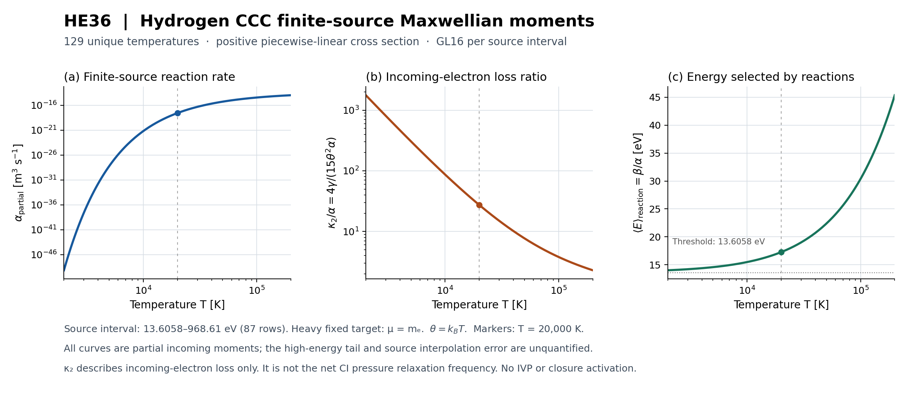

# HE36-RMB 결과: 반응 입사 모멘트와 보존적 source 연결

## 0. 현재 판정과 보고 범위

**HE36은 반응이 제거하는 두 부모 입자의 수·열에너지·STF 압력 모멘트를 유도하고, 이를 유한 단면적 자료와 명시적으로 공급된 사건 source에 연결하는 sandbox 코드를 확보했다.** 사건률 α와 평균 제거 에너지 β만으로 압력 source를 대체하지 않고, 두 번째 에너지 모멘트 γ와 유한질량 교차항을 별도로 유지한다. 실제 CCC H1 자료의 유한 구간에서 129개 온도 진단을 수행했고, 같은 GL16 kernel의 온도 batching 성능을 측정했다. 핵반응 쪽에서는 기존 REI의 정수 stoichiometry·입자 수·에너지 장부를 재사용하여 SI 부피 source와 supplied net tensor를 연결했다.

이 결과의 과학적 판정은 **명시된 입력·정의역에 한정한 PASS_SCOPED**다. 반응 생성물 전체의 gain operator, nuclear daughter의 charge·energy spectrum, recoil·stopping, 완전한 원자·핵종 inventory, 유한 비등방성 closure, gas/metric feedback은 여전히 별도 의존성이다. 이 단원에서 새로운 우주론 IVP는 실행하지 않았다.

정책은 **workflow1.0.0 / approval0.2**다. 단원 날짜 `20261023`은 한국 날짜 표기이며 실제 실행 receipt의 시각은 UTC 2026-10-22다. 이 문서를 작성하기 위해 기존 결과 파일을 읽고 집계했으며, 수치 시험·모멘트 평가·benchmark·render를 추가 실행하지 않았다.

**전달 상태:** 이 보고서의 과학·구현 결과는 아래 실제 증거로 수용되었다. R1–R10→C1–C10 각 단계의 현재 완료·Git commit·백업 ACK는 [DAG.json](DAG.json)과 [STAGE_LEDGER_KO.md](STAGE_LEDGER_KO.md)에 있다. 최종 science pin·전체 archive SHA256·Dropbox ID·복원 검증은 [delivery/FINAL_ACK.json](delivery/FINAL_ACK.json)에 결합한다. 게시·백업 상태와 전체 B1–B5 물리 모델의 상태는 별도로 관리한다.

## 1. 원래 목표, 기존 완료분, 이번에 좁힌 차이

원래 목표는 primordial 원자·핵 반응과 열진화에 바리온 비등방 압력 및 일관된 metric/source feedback을 결합하는 것이다. 기존 HE32는 **8핵종 21상태의 prescribed-UV photo + case-A RR pilot**이며, 392 nominal + 2 angular guard, 평균 z=20→2, 그림 6쌍을 실제 실행·저장한 단원이다. 그 30/30 단계와 2026-10-22 복원 증거는 재사용한다. 기존 matter stress는 nonbaryonic sector이고 HE32 gas의 π_b=0이라는 범위도 유지된다. 모든 불안정 isotope·음이온·분자 또는 fully reactive 19채널 핵반응망이 완료되었다는 뜻은 아니다.

최신 branch 조사에서는 HE33의 source-free 열·압력 기초, HE34-SCR의 완료된 20단계, 병렬 HE35의 유한질량 탄성 pair를 확인했다. 이들을 새 계산으로 반복하지 않았다. 최신 원자·열 donor에는 scalar number rate, RR energy factor, Compton 열원, 사건 에너지 adapter, isolated CI/CX 축약이 이미 있었다. 남은 연결은 반응에 의해 제거되는 분포의 tensor 모멘트와 생성물 tensor를 같은 사건 장부에 정렬하는 것이었다. HE36은 그중 **incoming loss와 supplied-source interface**를 별도 단원으로 처리한다. [계약](CONTRACT.json), [전체 목표 DAG](GLOBAL_GOAL_DAG.json), [최신 통합 조사](evidence/intake/INTAKE_KO.md)에 범위와 선행 의존성이 있다.

| 전체 목표 노드 | 이번 단원 후에도 유지하는 상태 | 남은 의존성 |
|---|---|---|
| B1: 충돌·수송 coefficient와 유한질량 교환 | 부분 확보 | 실제 charged/neutral pair의 보정된 coefficient와 채택 정의역 |
| B2: 원자·핵 반응 source 모멘트 | 부분 확보 | outgoing/gain, isotope-matched 자료, daughter charge·spectrum, recoil·stopping, 추가 종·과정 |
| B3: 혼합물 closure와 오차 예산 | 미완료 | B1/B2, common-T·common-bulk·유한 비등방성의 적용 근거 |
| B4: 저장된 배경 위의 결합 gas 계산 | 미실행 | B3 및 명시된 열·광원·종 source |
| B5: metric/source feedback | 미실행 | B4, 바리온과 radiation/fast 저장고의 일관된 에너지·압력 source |

HE36의 R1–R10 + C1–C10은 이 **좁은 단원의 20단계**다. 그 완료율을 원래 전체 목표의 완성도로 바꾸지 않는다. 전체 목표에는 합의된 분모가 없으므로 [GLOBAL_GOAL_DAG.json](GLOBAL_GOAL_DAG.json)의 `overall_percentage`는 null이다.

## 2. 최신 저장소·대화·백업 조사와 실제 재사용

이번 사용자의 전수조사 요청에 따라 접근 가능한 최신 목록을 다시 조사했다. owner 저장소 51개를 열거했고, 관련 7개 저장소의 branch **1,276행**과 모든 상태 PR **927행**은 pagination 종료까지 확인했다. 이는 관련 metadata 목록에 대한 완결성이다. 모든 역사 branch의 모든 파일 또는 모든 51개 저장소의 전체 코드를 읽었다는 주장은 아니다. [INTAKE_SUMMARY.json](evidence/intake/INTAKE_SUMMARY.json)

| 저장소 | Branch 행 | PR 행 |
|---|---:|---:|
| BASS_HE | 93 | 88 |
| WU088_HH | 145 | 136 |
| rec_bianchi | 143 | 125 |
| rei_bianchi | 263 | 221 |
| bass_cr | 175 | 97 |
| bass | 266 | 181 |
| vigilode | 191 | 79 |

선택한 최신 원문 **114개**는 실제 byte의 Git blob SHA1을 대조하고 SHA256을 보존했다. 산정은 원자·열 49개, 핵·source 49개, HE 12개, 지원 자료 4개다. 이후 VigilODE 장부·검토 2개를 더 읽었으나 114개 산정에 합치지 않았다. WU/REC에서 PR head와 겹치지 않는 branch tip 33개의 날짜도 확인했고, 관련 8개 PR의 discussion/review 24개 collection에서 실제 REC120 comment 4개를 읽었다. 상세 범위와 readback은 intake의 [원자·열 manifest](evidence/intake/atomic_donors_READBACK_MANIFEST.json), [핵·source manifest](evidence/intake/nuclear_donors_READBACK_MANIFEST.json), [HE manifest](evidence/intake/he_latest_MANIFEST.json)에 있다.

Dropbox는 주 dossier 4,739항목/8페이지와 REC 지정 폴더 116항목/1페이지를 열거했다. 관련 파일명 검색과 원문 metadata를 대조했지만, 이번 조사에서 모든 기존 archive의 전체 byte를 다시 내려받아 복원하지 않았다. 이전 full-byte verification은 해당 pin/receipt가 유지되는 범위에서 재사용했다. Google Drive의 초기 query 문법 오류는 보존한 뒤 수정했고, 수정 검색의 0건 결과는 ZIP을 제외하는 도구 범위 때문에 백업 부재의 증거로 쓰지 않았다. [백업 metadata](evidence/intake/BACKUP_SELECTED_METADATA.json), [intake archive ACK](evidence/intake/RAW_ARCHIVE_ACK.json)

이전 대화는 현재 보이는 handoff와 personal-context에서 반환된 관련 요약을 원문·receipt와 대조했다. 모든 ChatGPT 대화의 목록과 전문을 열람하는 기능은 없으므로 미반환·미색인 대화 전문은 접근 불가로 남겼다. **이번 조사 범위를 HE32 복원 당시에 소급하여 “그때 모든 repo/대화를 조사했다”고 쓰지 않는다.**

### 채택한 donor와 그대로 남긴 한계

| Donor / 확인 pin | 재사용한 내용 | 자동 승격하지 않은 범위 |
|---|---|---|
| HE34-SCR PR88 / `fd11542ea8236e3c17eeb798bcafa8956e0eb248` | source-free 압력 convention, 완료 증거, B1–B5 의존성 | 실제 reactive closure |
| 병렬 HE35 PR87 / `96338b7d3c04b18e31a080e56b34985d31921104` | 유한질량 탄성 pseudo-Maxwell pair의 맥락 | 반응 incoming/gain operator 및 물리적 보정 |
| HH1 PR135 / `6c3b12554288893d5d7e221d77be943324285ceb` | D PI/RR 사건 에너지 component | D microscopic number rate·capture moment |
| PHYS80 PR136 / `951182dd59bbb59dba454bbaab78ad56d029355a` | isolated CI/CX의 22→4/1 축약, generic kernel 구조 | 우주론·임의 isotope source·전체 네트워크 |
| REC121 / `892aad5c3e9fb0b2abd021154b62a42c39277125` | RR loss factor와 scalar energy moment의 조건 | 별도 number-rate fit과 결합한 hybrid를 독립 microscopic γ로 해석 |
| REC125 THERM02 / `407a280aff51abefc10374cb6e21c4224140328c` | compact34 RR/Compton 열 source와 완료된 8 IVP 증거 | 바리온 STF·핵 source·metric feedback |
| REI221 / `9620e1fcc4bdda76e0311206f614234926600381` | `local.py`의 정수 event, 입자 수, 에너지 장부를 byte 동일하게 재사용 | 실제 daughter 분포·stopping·핵반응 에너지 분배 provider |
| CR96 C22D/E / `ba39fc75521aa18705ec832d789e50dd5c6565bc` | CCC H1 CI 87행, 단위·에너지 convention | 미측정 tail, 전 isotope의 CI 및 유한질량 source |
| BASS181·VigilODE79 | 보존량을 쓰는 affine 사상과 full-state 오차 metric의 제약 | 새 source에서도 자동 성립하는 축약·미확인 work counter |

CR의 secondary 문서에 있던 HE32 recovery-rerun 문장은 사용자의 pin과 원래 복원 receipt에 반하므로 채택하지 않았다. HE35 문서의 오래된 HE34 R1–R4 표기도 실제 완료 20/20 증거보다 우선하지 않았다. HH1 에너지 adapter가 존재한다는 사실을 D 물리 provider 완료로 해석하지 않았다. 다른 단원의 workflow 버전도 이 단원의 workflow1.0.0/approval0.2로 가져오지 않았다. [충돌 해소 장부](evidence/intake/INTAKE_SUMMARY.json)

## 3. 확보한 이론 결과: 반응률에서 pressure source로

### 3.1 같은 kernel의 α·β·γ

공통 bulk rest frame과 공통 온도 T에서 비상대론적 두 종을 고려한다. metric signature는 $(-+++)$이고 c, ℏ, k_B를 1로 놓지 않는다. θ=k_B T, μ=m_a m_b/(m_a+m_b), E=μg²/2이며, K(g)=gσ(g)는 상대속력만의 비음수 kernel이다. [전체 유도](theory/THEORY_KO.md), [별도 유도](theory/independent_DERIVATION.md)

\[
\alpha=\langle K\rangle,\qquad
\beta=\langle EK\rangle,\qquad
\gamma=\langle E^2K\rangle.
\]

각 단위는 m³/s, J·m³/s, J²·m³/s다. K와 적분 domain이 T와 무관하고 미분·적분 교환 조건을 만족하면

\[
T\partial_T M_j=\frac{M_{j+1}}{\theta}-\frac32M_j,
\]

\[
\beta=\theta(T\alpha'+3\alpha/2),\qquad
\gamma=\theta^2(T^2\alpha''+5T\alpha'+15\alpha/4).
\]

미시적 kernel 없이 empirical α fit을 두 번 미분한 값은 조건부 fit-derivative construction이다. 작은 α fit 오차만으로 α′·α″ 또는 γ 오차가 제한되지는 않는다. K 자체가 T에 의존하면 별도 kernel derivative 항을 포함해야 한다. 이 구별 때문에 서로 다른 rate fit과 RR energy factor를 결합한 hybrid를 microscopic γ의 검증 자료로 사용하지 않았다.

비음수 kernel은 α, β, γ≥0과 αγ≥β²를 만족한다. 유한 support [L,U]에는 Lα≤β≤Uα 및 γ≤(L+U)β−LUα도 적용된다. 이들은 채택한 유한 모형 내부의 moment consistency이며, 미측정 단면적이나 tail의 물리 오차 한계가 아니다.

### 3.2 정지한 heavy target에서의 STF loss

P_s=n_sθI+π_s, tr π_s=0이고, 압력 source S_s에 대해 Q_s=tr(S_s)/2, J_s=STF(S_s)로 정의한다. 작은 Grad 방향의 angular contraction으로

\[
R_s=-n_sn_t\alpha,\quad Q_s=-n_sn_t\beta,\quad
J_s=-n_t\kappa_2\pi_s,
\qquad \kappa_2=\frac{4\gamma}{15\theta^2}
\]

를 얻는다. 사건률 α와 STF 가중 coefficient κ₂는 일반적으로 다르다. κ₂의 단위는 m³/s이고 밀도 n_t를 곱해야 주파수 s⁻¹가 된다. 이 식은 정지한 heavy target의 **입사 제거**에 대한 것이다. 유한질량 Maxwellian bath의 scalar energy에는 다음 절의 CM 항이 필요하다.

Grad 다항식은 유한한 π를 넣었을 때 모든 속도에서 양수인 분포가 아니다. 여기서의 식은 무한소 first variation이며, |π|/p가 작다는 수치만으로 threshold 먼 꼬리의 유한 진폭 오차를 제어하지 않는다. 압력 source를 실제 trajectory에 적용하려면 별도 closure 검증이 필요하다.

### 3.3 유한질량 두 부모의 교차 결합

M=m_a+m_b, a=m_a/M, b=m_b/M, a+b=1로 놓는다. 공통 T에서 V와 g는 독립 Gaussian이고 c_a=V+bg, c_b=V−ag다. 두 부모의 제거 에너지는

\[
Q_a=-n_an_b(3a\theta\alpha/2+b\beta),\qquad
Q_b=-n_an_b(3b\theta\alpha/2+a\beta).
\]

합은 −n_an_b(3θα/2+β)이며 **제거된 두 부모의 CM kinetic energy도 포함**한다. 이를 net RR/CI/nuclear cooling으로 사용하면 생성물에 남는 CM 운동에너지를 중복 제거할 수 있다. Net source는 생성물·살아남은 전자·recoil·radiation contribution을 합한 뒤에 해석한다.

κ₁=2β/(3θ), κ₂=4γ/(15θ²)로 두면

\[
A=a^2\alpha+2ab\kappa_1+b^2\kappa_2,
\quad B=b^2\alpha+2ab\kappa_1+a^2\kappa_2,
\quad C=ab(\alpha-2\kappa_1+\kappa_2),
\]

\[
\begin{pmatrix}J_a\\J_b\end{pmatrix}
=-\begin{pmatrix}n_bA&n_aC\\n_bC&n_aB\end{pmatrix}
\begin{pmatrix}\pi_a\\\pi_b\end{pmatrix}.
\]

모든 STF 성분에 같은 2×2 block을 사용한다. 이 구조는 거대한 velocity 배열이나 전체 반응 Jacobian을 만드는 대신, 세 scalar 모멘트와 작은 block으로 필요한 local source를 계산하게 한다. 구현은 [reactive_moments.py](components/pair/reactive_moments.py), 식–코드 연결은 [EQUATION_CODE_MAP.md](EQUATION_CODE_MAP.md)에 있다.

양의 밀도에서 W=diag(1/n_a,1/n_b)가 loss block을 대칭화하며

\[
AB-C^2=(a+b)^2\{(a-b)^2\alpha\kappa_2
 +2ab\kappa_1(\alpha+\kappa_2)\}.
\]

양의 질량·비퇴화 kernel에서 determinant는 양수다. 따라서 **밀도와 계수가 고정된 순간 loss subproblem**의 weighted quadratic STF norm은 소산된다. 반응으로 밀도가 변하는 전체 문제에는 W의 시간 미분을 별도로 포함해야 한다. 이 결과는 각 종의 signed 성분이 개별적으로 단조 감소하거나 유한 step에서 분포가 양수라는 정리가 아니다.

C는 음수일 수 있다. K∝E^s에서 C/(abα)=4s(s−1)/15이고, 상수 단면적 K∝g는 s=1/2이므로 C<0이다. 같은 질량·밀도에서는 A=B=79α/60, C=−α/60이며 loss eigenvalue는 13nα/10과 4nα/3이다. 음의 교차항을 clipping하지 않았다.

### 3.4 한 온도의 scalar 자료가 충분하지 않은 구체적 예

고정 θ₀=k_B T₀에 대해 K₁=K₀, K₂=(2K₀/5)(E/θ₀−5/2)²를 선택하면 두 kernel은 모두 비음수다. T=T₀에서 다음과 같다.

| 양 | K₁ | K₂ |
|---|---:|---:|
| α/K₀ | 1 | 1 |
| β/(θ₀K₀) | 3/2 | 3/2 |
| γ/(θ₀²K₀) | 15/4 | 27/4 |
| 정지 target의 κ₂/K₀ | 1 | 9/5 |
| 같은 유한질량·밀도의 loss eigenvalue / nK₀ | (1,1) | (1,7/5) |

한 온도의 사건수·제거 열 모멘트가 같아도 STF source가 달라진다. 이것은 그 제한된 adapter 입력의 비식별성에 대한 반례다. 모든 T에서 정확한 α(T)가 주어졌거나 microscopic kernel 전체가 있는 경우까지 불가능하다고 주장하지 않는다. 문헌 전체의 신규 strong no-go 성과로 채택하지 않았다. 표준 라이브러리 exact rational 계산과 Wolfram 결과는 [independent_CHECKS.json](theory/independent_CHECKS.json), [WOLFRAM_CORRECTED.json](evidence/WOLFRAM_CORRECTED.json)에 보존되어 있다.

## 4. 유한 자료 적분: 실제 CCC H1 계산

### Source와 수치 모형

재사용한 CCC 파일은 **87행**, 입사 전자 에너지 **13.6058–968.61 eV**, σ 단위 **a₀²**이며 추가 π 또는 multiplicity factor가 없다. 원본 SHA256은 `7a87a2c9f2116ee36c0786b379dac08e1f4d92a49504fe542e6aa71cbb279bae`다. [원자료](components/diagnostic/data/CCC_TICS_1S.txt), [source 출처](SOURCES.md)

실제 자료 진단은 μ=m_e인 heavy fixed-target convention을 쓴다. μ만 교체하여 이 입사 laboratory energy를 일반 유한질량 relative energy로 바꾸지 않는다. 두 에너지의 사상과 microscopic source 검증은 별도 의존성이다. 새 adapter도 실제 CCC record의 finite-mass pair 진입을 거부한다.

표의 endpoint를 양의 선형 결합으로 보간하고, 86개 구간마다 GL16을 써서 총 1,376개의 양의 node를 준비했다. node·weight·σ·E의 거듭제곱을 재사용하고, 온도마다 지수함수 하나를 α·β·γ·δ에 공유한다. δ=M₃는 γ의 온도 도함수 검산을 지원하며 새 반응 channel을 의미하지 않는다. threshold tail은 공통 exponential anchor로 분리하여 로그와 표현 범위 flag를 보존한다. [모듈](components/moments/maxwellian_moments.py), [수치 계약](components/moments/CHECK_CONTRACT.json)

이 계산은 유한 support의 piecewise-linear 모형에 대한 적분이다. **미측정 high-energy tail은 UNMODELED이고 물리적 보간 오차도 UNQUANTIFIED**다. 작은 quadrature 차이를 원자료 정확도 또는 전체 물리 반응률의 오차 한계로 바꾸지 않는다. 2000–200000 K는 이번 수치 진단 domain이며 기존 donor chemistry의 적용 온도 범위를 확대하는 선언이 아니다.

### 실제 129개 온도 결과

2000–200000 K의 logarithmic grid 129개를 사용했고 중간 노드를 **정확히 20000 K**로 설정했다. 129행은 모두 고유하다. 전체 결과는 [CSV](components/diagnostic/outputs/ccc_moments.csv), [단위·정의가 포함된 JSON](components/diagnostic/outputs/ccc_moments.json), [진단 receipt](components/diagnostic/outputs/DIAGNOSTIC.json)에 있다.

| T [K] | α_partial [m³/s] | β_partial [J·m³/s] | γ_partial [J²·m³/s] |
|---:|---:|---:|---:|
| 2000 | 7.210750815982397e−50 | 1.61858863681738e−67 | 3.6344621984752714e−85 |
| 20000 | 2.7441444073979985e−18 | 7.592366503063968e−36 | 2.1434413489542e−53 |
| 200000 | 1.056633326699312e−14 | 7.679560888066842e−32 | 6.932519969680909e−49 |

| T [K] | κ₂/α | β/(θα) | 평균 입사 에너지 β/α [eV] | Feasibility margin |
|---:|---:|---:|---:|---:|
| 2000 | 1762.795137946184 | 81.29104772335923 | 14.010240989222781 | 0.5992872897929828 |
| 20000 | 27.317869001614586 | 10.019750888548216 | 17.268706522059013 | 0.5457602366645169 |
| 200000 | 2.2946106262079176 | 2.6320783039351436 | 45.362991834142 | 0.4471876400622907 |

여기서 feasibility margin은

\[
\mathcal F=\frac{\kappa_2}{\alpha}
-\frac35\left(\frac{\kappa_1}{\alpha}\right)^2
=\frac{4\operatorname{Var}_{\rm reaction}(E)}{15\theta^2}
\]

이며, sampled 최솟값은 0.4471876400622907이다. 네 모멘트는 모두 양수·유한하고 이 129온도 진단에서 underflow/subnormal 출력은 없었다. 평균 입사 에너지는 모두 source interval 안에 있다.

저온에서 큰 κ₂/α는 rare high-energy 입자가 반응에 선택되는 가중 효과를 나타낸다. 그 자체가 큰 실제 gas 완화 주파수라는 뜻은 아니며 α도 함께 보아야 한다. 또한 β/α는 반응으로 선택된 **입사 에너지**이지, outgoing electrons가 같은 thermal pool에 남는 CI의 net cooling energy가 아니다.

C_moment=1−2κ₁/α+κ₂/α는 200000 K에서 **−0.2148271123722738**이다. 부호 있는 이 조합을 그대로 저장했고 0으로 clipping하지 않았다. C_moment 자체를 양의 반응률 또는 완성된 pressure-relaxation 예측으로 부르지 않는다.

그림은 세 패널과 20000 K marker, 단위, finite-source 범위, incoming-loss 해석을 표시한다. 물리 오차막대는 넣지 않았다. [SVG](components/diagnostic/plots/ccc_finite_moments.svg), [render receipt](components/diagnostic/plots/RENDER_RECEIPT.json), [시각 검토](components/diagnostic/plots/VISUAL_INSPECTION.json)

## 5. 검증 결과와 실패를 보존한 수정

### 5.1 유한 모멘트: 9개 고유 그룹, 10회 그룹 시도

초기 8개 그룹은 한 실행에서 통과했다. 이후 극소 단면적의 조건부 평균 에너지에서 구체적 연산 순서 문제를 발견했고, 실패를 보존한 뒤 해당 경로만 수정·재검사했다. 따라서 **고유 그룹 9개, 총 그룹 시도 10회 = PASS 9회 + 보존된 FAIL 1회**다. 초기 8개 전체 suite를 다시 돌리지 않았다. [최종 검증](components/moments/FINAL_VERIFICATION.json), [초기 8개 결과](components/moments/attempts/attempt_001.json)

| 고유 그룹 | 방법·결과 |
|---|---|
| 유한 구간 상수 σ | 독립 80자리 SI incomplete-gamma 적분과 비교 |
| 온도 도함수 | 독립 antiderivative의 80자리 미분; −3/2 항을 누락한 변형을 검출 |
| 실제 CCC quadrature | 9온도 GL16/GL32, 선택 3온도 SI-energy adaptive integral 비교 |
| μ·σ scaling | manufactured 자료에서 질량 및 단면적 선형성 |
| 구간 분할 | 같은 piecewise-linear 함수를 더 나눈 경우의 일치 |
| 입력 domain | 음의 σ, 역전/중복 E, NaN, threshold, 잘못된 mapping·T·전체률 주장 등 21개 거부 |
| Underflow·명시적 0 | 표현 underflow와 zero table을 구별; partial 의미 유지 |
| 불변 입력·identity | 입력 복사와 source identity 변화 확인 |
| 극소 σ의 조건부 평균 | 초기 FAIL 보존 후 divide-first 수정, 해당 fixture PASS |

GL16/GL32 최대 상대 차이는 **2.842170943040401e−14**다. 독립 SI adaptive integral과의 최대 상대 차이는 T=2000, 20000, 200000 K에서 각각 **3.008704396734174e−14**, **2.886579864025407e−14**, **2.7644553313166398e−14**로 사전 gate 2e−9를 통과했다. 이들은 수치 적분 일치이며 물리 source 오차 한계가 아니다.

극소 manufactured σ=1e−300 m² 사례에서 기존 `EV_J * sum1 / sum0`는 첫 곱셈의 underflow 때문에 평균 에너지가 **1.1364001103549737%** 낮아졌다. `EV_J * (sum1 / sum0)`로 나눗셈을 먼저 수행하여 수정했고 해당 기준과의 상대 차이가 0이 되었다. α·β·γ·δ·로그·온도 도함수·domain guard는 바뀌지 않았다. [보존 FAIL](components/moments/attempts/extreme_mean_before_fix.json), [수정 PASS](components/moments/attempts/extreme_mean_after_fix.json), [정확한 diff](components/moments/attempts/mean_fix.diff)

### 5.2 유한질량 pair: 10/10 그룹

새 pair 구현 검증은 한 실행에서 10개 그룹을 통과했다. [전체 receipt](components/pair/attempts/attempt_20261022T222801Z/RESULT.json)

| 그룹 | 판별한 내용 |
|---|---|
| 불변 값 | 입력 및 반환 배열의 변경 방지 |
| Moment domain | 양성·Cauchy 조건, roundoff defect 보존, 잘못된 입력 거부 |
| 지수 안전성 | α=1e±250, 밀도=1e∓100 같은 manufactured 조합; 실제 표현 불가 결과는 거부 |
| 명시적 0·빈 종 | 0 source와 부재 종의 비영 tensor를 구별 |
| Tensor·contract guard | 대칭성·trace·정의역, 정규화 잔차를 숨기지 않음 |
| 상수 K | 수·열·전체 tensor의 비례 제거 확인 |
| 음의 교차항·소산 | C<0 유지, 두 양의 loss eigenvalue와 frozen norm 감소 |
| 같은 수·열, 다른 STF | 위 반례의 1 및 1.4 pair eigenvalue 확인 |
| Derivative adapter | ordinary T-second derivative와 log-second derivative를 구별 |
| 반응 frame source | birth/death의 mR_n uuᵀ 항, boost 및 한 step 대수 관계 |

Frame 검사에서 한 step 대수 차이는 1.942890293094024e−15, boost 차이는 3.3306690738754696e−16이었다. 반면 number-source 항을 누락한 변형은 0.35의 오류를 냈다. 이 한 step은 source 변환의 대수 검사이며 우주론 IVP가 아니다. Pair 검사 시간은 import 이후 wall 0.03721619899442885 s, peak RSS 25,400 KiB였다.

### 5.3 독립 6D 원적분: 6개 control

구현 식을 다시 같은 형태로 계산하는 비교와 별도로, 다른 구현자가 두 Maxwellian의 **Cartesian 6차원 Gauss–Hermite 원적분**을 구성했다. 두 질량·밀도·온도 조합에 K∝E⁰, E¹, E²를 적용한 6개 control이고, control당 node 15,625개, 총 93,750개다. 수 source, 각 부모 Q, STF J, 전체 S를 비교했다. [원적분 receipt](evidence/review/CARTESIAN_LOSS_RESULT.json), [독립 코드 심사](evidence/review/INDEPENDENT_REVIEW.json)

최대 상대 차이는 **7.46229818803753e−14**, gate는 **2e−11**이었다. 사라져야 하는 scalar first variation의 최대 잔차는 8.700012365530878e−16이었다. Wall 0.16086018198984675 s, peak RSS 28,464 KiB이며 기존 suite·IVP·benchmark·render 재실행은 0이다. 이것은 선택한 polynomial controls에서 원적분과 projection을 독립 비교한 결과이며 모든 physical kernel의 전역 오차 증명은 아니다.

### 5.4 이론과 구현의 심사 역할

독립 유도 작성자는 다른 구현자가 만든 모멘트·pair 코드와 Cartesian oracle을 비교하고, 이후 bridge·진단·실제 최종 PNG도 읽어 심사했다. 자신의 유도 자체에 대한 비저자 심사로 표기하지 않았다. 별도 비저자 이론 심사자는 root와 독립 유도 파일의 수학·범위를 검토하되, 자신이 작성한 모멘트·진단 코드에 대한 독립 코드 심사 권한을 주장하지 않았다. [구현 심사](evidence/review/INDEPENDENT_REVIEW.json), [최종 bridge/plot 심사](evidence/review/FINAL_BRIDGE_PLOT_REVIEW.md), [비저자 이론 심사](evidence/theory_review/nonauthor_THEORY_REVIEW.md)

이론 심사에서 세 가지 문구를 구체적으로 고쳤다. 첫째, §3 bath를 정지한 heavy target으로 명시했다. 둘째, weighted norm 소산을 고정 밀도·계수에 제한하고 변하는 W 항을 남겼다. 셋째, thermal particle count에 charge-neutral 21상태와 all-retained-thermal 가정을 명시하고 별도 fast 수 source를 요구했다. 최종 파일 readback에서 세 항목 모두 닫혔다. 이 수정 때문에 수치 suite를 반복하지 않았다.

## 6. 사건 tensor, 핵·전자 수, source-aware lift

### 6.1 기존 REI 장부의 정확한 재사용

REI의 `local.py`는 SHA256 `d0998261323609901f0cf9636d71282e7848bac6c00c1e5f7240ed7fc540e88a` 그대로 포함했다. 기존 unary/binary 사건, factorial symmetry, 정수 baryon 보존, 명시된 rate 상태, 9개 energy reservoir 장부를 바꾸지 않았다. [donor provenance](components/event_bridge/DONOR_PROVENANCE.json)

Y_i=n_i/n_B인 donor의 rate r는 baryon당 사건률이다. 사용자가 같은 common bulk frame의 **완전한 signed net thermal central second moment** C_event를 J/event 단위로 공급하면

\[
S=n_BrC_{\rm event},\qquad
Q=\tfrac12\operatorname{tr}S=n_Br\,dE_{\rm th},\qquad
J=S-\tfrac23QI
\]

로 변환한다. S,J는 Pa/s이고 Q는 W/m³다. `Q`와 원장의 `dEth`는 같은 열원에 대한 두 표현이므로 서로 더하지 않는다. Parent-only loss tensor는 완전한 net tensor가 아니다. Tensor·provenance·frame·unit이 없으면 현재 사건률이 0이어도 unknown으로 거부한다. Signed source tensor는 covariance가 아니므로 반드시 positive semidefinite일 필요는 없다. [bridge 설명](components/event_bridge/README_KO.md), [구현](components/event_bridge/event_bridge.py)

Charge-neutral heavy species + free-electron 21상태에는 positron·음이온이 없다. 모든 retained 핵과 전자가 thermal일 때

\[
R_e=n_Br\,q\cdot\nu,\quad
R_{\rm nuclei}=n_Br\,1\cdot\nu,\quad
R_{\rm part}=n_Br\,(1+q)\cdot\nu.
\]

핵 수가 변하는 반응에서는 R_part=R_e를 사용할 수 없다. 현재 bridge는 `ALL_RETAINED_THERMAL`과 `NEUTRAL_21_STATE_CENSUS`를 명시적으로 요구한다. 비영 dEfast는 이 제한된 adapter에서 미해결로 거부한다. 별도 fast population이 있으면 그 수 source를 thermal count에서 빼야 하며, fast energy만으로 입자 수를 결정하지 않는다.

### 6.2 새로운 bridge 검사 7/7

새 bridge는 첫 실행에서 **7개 그룹 모두 PASS**, exit 0이었다. 기존 REI suite, 실제 CCC 129온도 진단, 6D oracle, HE32를 다시 실행하지 않았다. [실행 receipt](components/event_bridge/attempts/attempt_001/RESULT.json)

| 그룹 | 실제 검사 |
|---|---|
| Donor identity·portable import | byte 동일 donor, 격리 subprocess import |
| 21상태 census·에너지 | 아래 세 manufactured 사건의 baryon·핵·전자·열입자 수와 trace |
| Net tensor 소유권·누락 guard | incoming-only, heat 중복, unit/frame/scope 누락, fast energy만 있는 count를 거부 |
| Rate 상태·STF projection | underflow와 support zero 구별, pure-shear·등방 source 처리 |
| Finite source identity·mapping | 원 T·μ·identity 유지, 실제 fixed-target의 finite-mass 승격 거부 |
| Finite underflow·명시적 0 | 양의 미소 값을 물리적 0으로 바꾸지 않음 |
| Source lift | commute하는 fixture와 합은 보존하지만 isotope별 lift를 깨는 fixture 구별 |

| Manufactured 사건 | 핵 수 변화 | 자유전자 수 변화 | 열적 입자 수 변화 |
|---|---:|---:|---:|
| H⁰ → H⁺ | 0 | +1 | +1 |
| D⁺ + p⁺ → ³He²⁺ | −1 | 0 | −1 |
| n → p⁺의 β census | 0 | +1 | +1 |

반응률과 에너지 분배는 모두 임의로 선언한 manufactured 입력이다. 실제 neutron lifetime, 핵반응률, Q 분배 또는 daughter spectrum을 측정·보정한 검사가 아니다. 부피당 열원 일치의 최대 정규화 잔차는 **2.220446049250313e−16**이었다. 첫 실행 wall은 0.32311488200502936 s, peak RSS 30,208 KiB다.

Finite record는 원 prepared/evaluation type, source identity, 행 번호, T, energy mapping, mass, support를 보존한다. 실제 CCC는 `RADIAL_DIAGNOSTIC` 경로로 유지하고, `MANUFACTURED_PAIR`에는 별도의 relative-energy mapping과 일치하는 μ,T를 요구한다. α·β·γ의 양의 underflow는 거부하며, zero table은 해당 유한 support에서의 선언된 0으로만 남긴다. Value/log identity gate 때문에 표현 가능한 일부 subnormal도 보수적으로 거부할 수 있다는 한계는 문서화했다. 물리적 0으로 숨기거나 floor를 추가하지 않는다.

### 6.3 Source-aware 축약의 판별

고정 선형 lift L에 대해

\[
d=R_{\rm full}(Lz)-LR_{\rm red}(z)
\]

를 성분별 explicit atol·rtol로 검사한다. 두 source callback은 각 1회 호출하며, 먼저 full lifted state의 양성을 확인한다. 같은 비율의 source는 defect 0이었다. 두 isotope에 +1e−4, −1e−4를 더한 source는 전체 합을 보존하면서도 두 성분의 약 1e−4 defect가 약 1e−14 gate를 넘어 거부되었다. [source_lift.py](components/event_bridge/source_lift.py)

이 검사는 한 양의 상태에서의 compatibility 판별이다. 전체 domain의 반응망 축약 정리나 시간 적분 오차 한계가 아니다. Moving/nonlinear lift, 열·tensor projection, 경계 상태의 source 생성에는 각각 추가 조건이 필요하다. 일반 isotope source를 전자계수의 대칭성만으로 줄이지 않는다.

## 7. 같은 kernel의 실제 성능 측정

성능 실험은 준비된 **동일 GL16 kernel**에서 129개 T를 한 번에 넣는 vector 호출과 129개의 scalar T 호출을 비교했다. 둘 다 동일한 네 moment order, 로그, 도함수, slope, 평균, flag를 반환한다. Scalar list 구성은 timing에 포함했고, 비교를 위한 최종 concatenate, preparation, I/O, plotting은 제외했다. 각 경로 warmup 1회 뒤 실행 순서를 번갈아 **5쌍** 측정했다. [전체 원시 timing·환경](components/diagnostic/outputs/BENCHMARK.json)

| Pair | 순서 | Vector [ms] | Scalar loop [ms] |
|---:|---|---:|---:|
| 1 | vector → scalar | 4.680058 | 50.921037 |
| 2 | scalar → vector | 12.333806 | 21.312333 |
| 3 | vector → scalar | 3.714566 | 19.355767 |
| 4 | scalar → vector | 4.228976 | 25.487915 |
| 5 | vector → scalar | 3.751415 | 22.770529 |

쌍별 speedup 중앙값은 **6.0269708317096145×**, 범위는 **1.72796077707076–10.880428618619684×**다. 각 경로 중앙값은 vector 4.228976 ms, scalar 22.770529 ms이며, 그 중앙값들의 비는 별도로 **5.384407241847672×**다. 서로 다른 두 통계량을 하나로 섞지 않았다. 전체 payload 최대 상대 차이는 **2.8482781212955235e−14**로 gate 3e−13을 통과했고 flag는 정확히 같았다.

이 측정은 한 shared host의 같은 kernel에 대한 온도 batching 결과다. 산포가 크므로 cross-machine 보장이나 전체 campaign speedup으로 일반화하지 않는다. Adaptive ODE와의 비교, native rewrite 성능, 물리 정확도 향상 주장은 없다. 독립 reviewer는 저장 원시 timing에서 비율을 다시 계산했으며 benchmark 자체를 재실행하지 않았다. [readback](evidence/review/FINAL_DIAGNOSTIC_READBACK.json)

실제 환경은 Python 3.12.14, NumPy 2.3.5, OpenBLAS 0.3.30의 1 thread, Intel Xeon Platinum 8573C다. CPU affinity 9개, cgroup quota 8 CPU, memory limit 8 GiB가 기록되었다. SciPy 1.17.0은 독립 adaptive quadrature witness, Matplotlib 3.10.8은 그림에 사용했다. 진단과 benchmark를 포함한 본문 wall은 0.348766743 s, outer process는 0.702625994 s였다. 프로그램 import/launch를 제외한 timing과 outer process 시간을 혼용하지 않는다.

## 8. 전체 실제 실행 횟수와 재사용

| 구분 | 실제 횟수 또는 상태 |
|---|---:|
| HE32 완료 IVP 재실행 | 0 |
| 기존 donor 완료 IVP 재실행 | 0 |
| 새 우주론/결합 gas IVP | 0 |
| 새 NCP 실행 | 0 |
| 모멘트 검증 | 9개 고유 그룹, 10회 그룹 시도; 보존 FAIL 1개 |
| 유한질량 pair 검증 | 10개 그룹, 첫 실행 10/10 PASS |
| 독립 Cartesian 원적분 | 6개 control, 첫 실행 PASS |
| 새 event/finite/lift bridge | 7개 그룹, 첫 실행 7/7 PASS |
| 실제 CCC 온도 진단 | 1회, 129개 고유 T |
| 새 benchmark experiment | 1회, 측정 5쌍 |
| 위 benchmark의 warmup | 경로별 1회 |
| 새 render invocation | 2회: 최초 + display-only 수정 |
| 최종 과학 그림 | PNG/SVG 1쌍; 이전 attempt 별도 보존 |
| Render cache-hit 검증 | 2회, 각 신규 render 0 |
| 최종 review·이 보고서 집계를 위한 추가 과학 실행 | 0 |

진단·benchmark의 evaluate 호출은 vector 6회와 scalar 774회, 합계 **780호출 / 1548개 온도 평가**다. 이는 두 구현 경로, warmup, 5쌍의 timing을 합한 정확한 작업량이며 1548개의 독립 물리 simulation을 뜻하지 않는다. 수치 검증·사건 검사의 내부 fixture 평가는 각 receipt에 따로 기록되어 있으므로 이 수치를 전체 단원 모든 함수 호출의 총합으로 해석하지 않는다.

첫 그림의 threshold 문구가 곡선과 조금 겹쳐 최초 코드·그림·receipt를 [보존](components/diagnostic/plots/attempts/render_001/PRESERVATION.json)한 뒤 문구 위치만 바꾸었다. 모멘트와 timing은 재실행하지 않았다. 최종 render는 내부 1.915329865 s, outer process 3.279887178 s였고, 실제 PNG를 작성자와 별도 reviewer가 각각 확인했다. 최종 cache는 identity와 두 출력 해시를 확인한 뒤 `REUSED_COMPLETE_RENDER`를 반환했다. 최초 계약의 예상 render 1회 대신 실제 2회를 정직하게 기록한다. [실행 transport](components/diagnostic/receipts/PROCESS_TRANSPORT.json)

다른 실패도 지우지 않았다. Optional SymPy는 모듈 부재로 과학 실행 전에 중단되었고, 표준 라이브러리 exact rational 경로가 결과를 제공했다. Wolfram의 최초 determinant 질의는 보호된 기호 C 때문에 실패하여 기호를 고친 결과를 별도 보존했다. 극소 평균의 실제 numerical FAIL과 display 수정은 서로 다른 종류의 기록으로 남겼다. [SymPy 실패](theory/independent_OPTIONAL_SYMPY_FAILURE.json), [최초 Wolfram 기록](evidence/WOLFRAM_INITIAL.json)

## 9. 재현 identity, 원전, 백업·게시

| 핵심 payload | SHA256 |
|---|---|
| 유한 모멘트 모듈 | `644260261b82d6a528fd049b2bb20702e4c66de087406c7868a395a41ec99c2c` |
| 유한질량 pair 모듈 | `49104bb9244af92f707f83b489f217a0573566b2d9f3e5154366b7d35eaaab89` |
| 재사용 REI scalar donor | `d0998261323609901f0cf9636d71282e7848bac6c00c1e5f7240ed7fc540e88a` |
| CCC 원자료 | `7a87a2c9f2116ee36c0786b379dac08e1f4d92a49504fe542e6aa71cbb279bae` |
| 진단 identity | `cfa2e14c6c53111593e744709df5ebff7a73ec676dd5e2a7bc8d3462b2c7e8b8` |
| 최종 render identity | `b11262ce43a52a841ec5c8d5353cb477617b184b8b5954ee5c9c1877d1e5d3a6` |
| 최종 PNG | `d5bcd1ba86c5ee6d15bddd7399805a70757deb2595f7c7f0cbed60db2d15782e` |
| 최종 SVG | `b903f81062d879a9f8c0e858264ab2f32f5cf41d14e970ebcbe35fabe6062e4a` |

진단 component의 22개 payload는 최종 reviewer가 크기·해시를 모두 readback했다. 실행 코드·입력·source pin·명령·환경·exit·자원·원시 결과는 각 receipt 및 manifest가 소유한다. 부모 단원으로 복사된 component의 provenance는 [INTEGRATION_COPY.json](evidence/INTEGRATION_COPY.json)에 둔다. 이미 검증된 코드의 다른 경로 사본을 새 검증 실적으로 세지 않는다.

문헌 맥락과 저자 자료는 [SOURCES.md](SOURCES.md)에 모았다. Le–Cambier의 [2016 ionization/recombination 연구](https://doi.org/10.1063/1.4953050)는 incoming과 outgoing differential moments를 구별하는 기존 맥락이다. [2022 Grad reactive moment 논문](https://doi.org/10.1063/5.0095019)과 [2026 high-order electron closure 논문](https://doi.org/10.1103/lm1z-bzt3)의 publisher 자료도 조사했다. 후자는 abstract 수준 확인이며 전문 equation audit를 했다고 쓰지 않는다. CCC는 [저자 database](https://atom.curtin.edu.au/CCC-WWW/index.html)의 H1 자료를 기존 donor의 고정 byte로 재사용했다. 전체 ZIP을 이번 단원에서 다시 받거나 permissive license를 추정하지 않았다.

Exa의 scoped query 1회에서 반환된 8개 결과, SciSpace의 10-paper 반환, primary source follow-up은 이번 단원에서 먼저 확보한 검색 증거를 재사용했다. 반환 결과 수를 읽은 논문 전문 수로 바꾸지 않는다. 이 결과 보고서 작성에서는 새 문헌 검색을 하지 않았다.

게시·백업은 과학 계산과 다른 상태 축이다. 각 단계의 Git commit과 별도 Dropbox checkpoint ACK는 [DAG.json](DAG.json)의 해당 node 및 `delivery/*_ACK.json`에 연결한다. 최종 원격 pin, archive SHA256, Dropbox ID, 실제 최종 readback은 **[delivery/FINAL_ACK.json](delivery/FINAL_ACK.json)**에만 최종 확정한다. ACK 전의 예정 값을 실제 게시 결과로 쓰지 않는다.

## 10. 다음 의존성

다음 과학 단원은 현재 incoming-loss 결과를 그대로 재사용하면서, 선택한 반응의 **outgoing/gain moment와 energy·particle owner**를 source 수준에서 채우는 일부터 시작한다. CI라면 outgoing primary/secondary electron, RR라면 product CM·recoil·photon, CX라면 species transfer, nuclear channel이라면 daughter charge·spectrum·stopping을 각각 명확히 정해야 한다. 같은 scalar 열 연구나 완료된 IVP를 새 성과를 위해 반복할 필요는 없다.

그 다음 순서는 B1/B2 자료 및 source 범위 확정 → B3 common-T/common-bulk·비등방 closure와 오차 예산 → B4 저장 배경 위의 새로운 결합 gas 계산 → B5 metric feedback이다. Thermal/UV 진화나 추가 종을 넣을 경우에도 해당 provider·normalization·에너지 owner를 별도 DAG 의존성으로 먼저 고정한다.

이 단원의 인계는 [복사 가능한 다음 연구 대화용 handoff](HANDOFF_CHAT_KO.md)와 [Codex·외부 실행자 handoff](HANDOFF_CODEX.md) 두 종류다. 두 문서는 최종 ACK의 science pin과 archive를 기준으로 재개 지점을 가리키고, `PASS_SCOPED`의 조건과 아직 열린 물리 source를 함께 전달한다. 이번 결과가 닫은 범위는 **유한 source 모멘트, 유한질량 부모 제거, 공급된 사건 tensor의 보존적 연결**이다.
