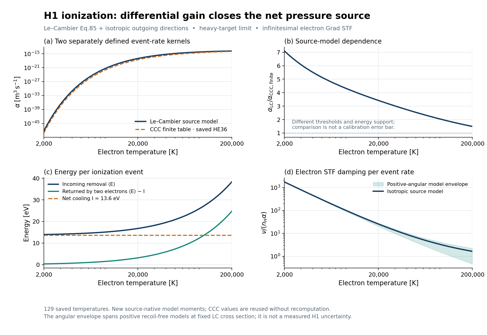

# HE37-H1DG — H1 differential ionization gain and net source

**workflow1.0.0 / approval0.2. Scientific outcome: PASS_SCOPED.**

This unit continues completed HE36 at `6403055c3d574ec0bd1ece80147f9711315902e7` and implements one source-defined process, e + H(1s) → e + e + p. It adopts Le–Cambier (2016), Eq.85 and §III.E: semiclassical energy sharing, isotropic outgoing electrons and a heavy fixed target. Source threshold I = 13.6 eV and the explicitly recorded modern Bohr radius are retained. The numerical contract is 2000–200000 K.

The admitted model gives `rate = ne*nH*alpha`, `Q = -I*rate`, and the **electron** STF source `J = -nH*kappa2*pi_e`, with `kappa2 = 4*gamma/(15*(kB*T)^2)`. Analytic positive moments use `expn(2,x)` and are bound to the unchanged HE36/REI event ledger. Returned Q and donor dEth have one energy owner; do not add them. The physical abundance Jacobian includes ne(Yp); the donor unary Jacobian freezes ne.

## Read first

- [Korean scientific report](RESULTS_KO.md), [derivation](theory/DERIVATION.md), [source record](SOURCES.md).
- [Original contract](CONTRACT.json), [equation/code map](EQUATION_CODE_MAP.md), [coding contract](CODING_CONTRACT.md). The contract was opened at R1; its primary-source admission was completed at R2 and independently reviewed.
- [Current stage DAG](DAG.json), [per-stage backup/publication ledger](STAGE_LEDGER_KO.md), [execution accounting](RUN_RECORD.json).
- [Whole-goal DAG](GLOBAL_GOAL_DAG.json), [next scientific dependencies](NEXT_DAG.json).
- [Final archive ACK](delivery/FINAL_ACK.json), [research handoff](HANDOFF_CHAT_KO.md), [executor handoff](HANDOFF_CODEX.md).

## Saved results

The package contains one newly executed 129-temperature native-source diagnostic and one final PNG/SVG pair. Provider6groups, independent theory11controls and bridge7groups passed. Independent review found no material defect within the admitted scope; two documentary findings were corrected with originals preserved. A targeted tiny-STF control confirms that callers must use returned direct J instead of subtracting the rounded isotropic tensor. No completed old suite/IVP was replayed. New IVPs:0.

At20000K, alpha=9.39264787331677e-18m³/s and kappa2/alpha=25.62744167910542. Mean incoming energy16.745419384350164eV returns3.1454193843501645eV through outgoing electrons, leaving13.6eV/event net kinetic loss. A local matched-workload benchmark gives median paired GL96/analytic ratio4.482508×; it is not a cosmological or whole-network speed measurement.



## Resume without scientific replay

From this unit directory, use the delivered stdlib-only verifier:

```bash
python verify_saved.py --require-delivery
```

This reads hashes, existing receipts, saved rows and delivery ACKs. It does not import NumPy/SciPy or scientific components and runs no model, test suite, IVP, benchmark or render. The original provider receipt has6/6PASS but no process-exit field; the verifier reports that absence explicitly. Historical stage hashes refer to their archived snapshots; corrected present documents are checked against the final science manifest.

`SCIENCE_MANIFEST.json` binds immutable code, evidence and scientific documents. Delivery metadata, handoffs and the stage ledger are excluded to avoid self-referential hashes. The C10 commit is the science basis; a later delivery-only commit contains its ACK and the final archive locator. A Git commit cannot contain its own final SHA: the final publication pin is supplied by the PR head, final publication readback and the accompanying chat handoff. The sealed archive is a full unit snapshot before its own provider ACK; restore its payload and then use final Git delivery metadata. No remote archive redownload/restore is claimed.

## Remaining physical scope

This is a source-defined reference approximation. H1 angular calibration, finite-mass target motion/recoil, finite anisotropy, thermalization/common-T/common-u, electron-to-total-gas stress partition, evolving UV, RR/DR/CX, additional species and nuclear daughters/stopping remain explicit dependencies. A positive angular envelope is conditional on the admitted kernel, not an empirical uncertainty band. HE32 remains an8-nuclide21-state prescribed-UV photo+case-A RR pilot with gas pi_b=0 and nonbaryonic matter stress. Its394oldIVPs and six figure pairs are reused.

PR: https://github.com/cosmosapjw-quantum/BASS_HE/pull/90
