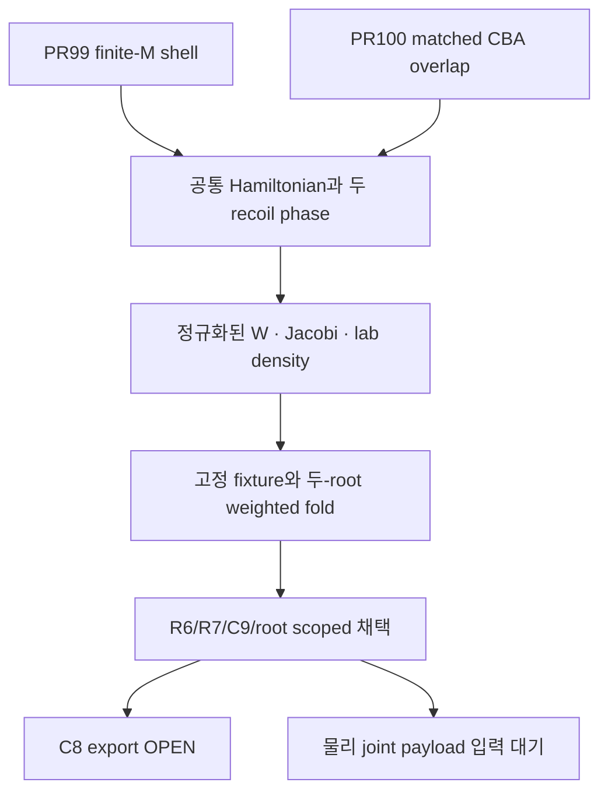

# 물리 의존성과 실제 전달 DAG

불변 과학 S `9fc8185437f145a6ba4569e1b38aa2e12d15acd9`/draft PR101은17/20이다. 실제 C readback과 B2 dual ACK를 확보했으므로 현재 D 전달 스냅샷은19/20 준비 완료다. 물리·수치 scoped 채택과 전달 상태를 구별하며 C8 PARTIAL_EXPORT는 OPEN으로 남는다. D own SHA와 후속 E/B3/final tail은 실제 게시 뒤 external receipt에서 확정한다.

| 의존성 | 실제 확보 범위 | 다음 의무 |
|---|---|---|
| HE-X1 / HE-ANG-CONTRACT / HE38 / Hex | 기존32fixture·moment gate, source/frame/event 계약, model-numerics, selected source intake를 재사용 | 물리 angular law·보정·full support/uncertainty로 확대하지 않음 |
| DDCS20 | E0=20eV, E3–6eV/theta15–120degree,32primary의 고정 finite-window 관측 | Joint law와 recoil 상관은 별도; box는 CI 아님 |
| PR99+100 | Exact shell 및 stable overlap/Nc | 원모듈 byte와 기존 원장/실패/unknown 유지 |
| 현재 finite-M CBA | B=mu/2와 두 recoil phase, W/Jacobi/lab branch weight, 유한 수치 근거·PNG | C9-EXPORT-01/C8 미완료 보존 |
| HE-ANG-SOURCE-PAYLOAD | Source-consistent physical payload는 아직 없음 | count/spin/exchange/support/frame/recoil/validity/uncertainty 계약이 첫 물리 입력 |

## 단계와 백업

| 노드 | 실제 상태 | 근거 / 통과 뒤 실행할 전달 행동 |
|---|---|---|
| B1 | 실제 dual ACK | `delivery/B1_BACKUP_ACK.json`; RECOVERY2의746657bytes/SHAa15dd819… |
| B1R | 실제 dual ACK | `delivery/B1R_BACKUP_ACK.json`;776704bytes/SHA79dbf442… |
| Science S | 실제17/20 | S9fc8185437f145a6ba4569e1b38aa2e12d15acd9,84selected-file readback; PR101 draft |
| Central C | 실제 게시·readback 완료 | C46a102b22b54cc03a91ad92bbd58d68dd82b7964; fresh8e946b46… 위 own3files mismatch0;40계약/39다른node/7authority/17edge와 병렬 owner 변경 보존 |
| B2 | 실제 dual upload+별도 metadata ACK 완료 |2732504bytes/SHA0662cb03…; Drive15RPRyRzRorUuYA4t5MvUMm2np_Nt7rjR / Dropboxid:BSpOijBcT10AAAAAAD_90g; `delivery/B2_BACKUP_ACK.json` |
| Delivery D |19/20 전달 스냅샷 준비 완료 | R10/C10 실제 S/C/B2 근거 확보; C8 OPEN; D own SHA는 actual external receipt에서만 기록 |
| Fresh E / B3 / final tail | 실제 receipt 대기 | Actual D/E exact backup와 별도 provider ACK를 실제 PR tail에 기록 |

미래 C/D/E commit 또는 B2/B3 provider identity를 예측해서 넣지 않는다. 실제 receipt가 생기면 root가 해당 전달 표를 갱신한다. 원 immutable S의17/20은 당시 관측으로 남긴다.

Post-S/pre-C 실제 중앙 base는8e946b46aa44581f09141184f193223277f2ec88로 이동했다. `evidence/survey/POST_S_CENTRAL_CHANGE.json`의 WU PHYS90 FINAL9d32d115…/S260d06210… 관측을 보존한다.11628pair threshold `(0.5006839145935373,0.5006839145944469]`, full153PSD UNRESOLVED, parent PARTIAL_INPUT_DEPENDENCIES, actual consumer ACK null, physical CI false다. 옛 survey의 S0 관측으로 최신 owner 상태를 되돌리지 않는다. C46a102b22b54cc03a91ad92bbd58d68dd82b7964는 그 base 위 실제 게시·readback되었고 B2 actual dual ACK도 확보했다. 다음은 D 실제 게시와 fresh E/B3/final external tail이며 새 계산은 없다.

## 실행의 종료 지점

Post-C 중앙53b2c135a1203a8784b6cc4acdec1d4fe174f166에는 CR PR105 H1 ground spontaneous RR finite-chain scoped child(S bdfd34499153575305871bd68a139e2878f5f49f)가 추가됐다. 근거는 `evidence/survey/POST_C_CENTRAL_CHANGE.json`이다. Full N4/N5 PARTIAL/OPEN, N6/N7 predecessor-gated, final canonical backup ROOT_PENDING을 fresh E에서 보존한다. 이 변화는 HE physical joint payload를 공급하지 않으며 actual C46a102b2…와 현재 D-ready19/20을 바꾸지 않는다. D는 E 이전에 게시할 수 있고 이후 actual E/B3 identity는 별도 external tail에 기록한다.

실제 시도는 PASS/FAIL/FAIL이다. 새11.882829CPU/11.985978921002243wall(상한12/35), lineage16.870803CPU/17.108468335994985wall(상한20/60), repair reserve0이다. 과학 실행은 중단되어 있다. 남은 C8이나 물리 입력의 OPEN을 이유로 예산을 초기화하거나 새 node를 만들어 자동 실행하지 않는다. 향후 승인된 행위가 있다면 원 실패·누적 비용·비양도 reserve를 유지하는 additive actual receipt를 사용한다. C9-NB-01, C23E, 다른 owner OPEN과 global completion=null을 보존한다.
