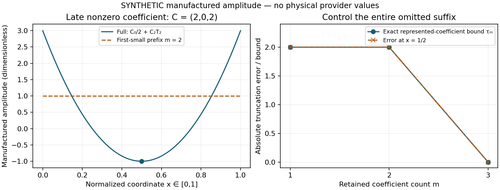

# HE-ANG-SOURCE-HEX-INTAKE 연구 결과

2026-10-24 KST · physmath-research-loop 1.0.0 / approval 0.2

## 판정

**현재 source intake 단위는 COMPLETE_SCOPED다. 부모 HE-ANG의 물리적 H1 이온화 각분포 공급자는 SOURCE_INPUT_PENDING이다.** 실제 원전·공개 데이터의 범위를 확인했고, source BLOB의 명시적 ABI 처리와 저장 Chebyshev 계수의 생략 오차 제어를 구현·검증했다. 이 결과는 실제 이온화 진폭이나 경험적 각분포 보정을 제공하지 않는다.

고정 인계에서 지정한 HE-ANG-CONTRACT는 실제 조사 시 이미 PR92에서 완료되어 있었다. 과학 핀 `896e5427100ad48d017deff2697b6f992ba029cd`, 당시 HEAD `0a11bf9e1f6ffcc696625de0caf1c581c27cf7f0`의 계약·이론·실행·독립 검토를 재사용하고, 다음 source intake로 진행했다. HE-X1 과학 핀 `eb03981d15ad291375dd6d574a9c28809f85fc02`의 이론·32 fixture·독립 검토도 그대로 재사용했다.

[CLAIM_GATE.json](CLAIM_GATE.json)이 과학적 판정의 권위이고, [LOOP_PROGRESS.json](LOOP_PROGRESS.json)이 R1–R10/C1–C10의 실제 근거를 연결한다.

## 1. 공개 자료에서 실제 확인한 내용

저자 기관이 배포한 [Hex v2.02 source](https://utf.mff.cuni.cz/data/hex/hex-src.tar.gz)와 [Hex-170210.sql.xz](https://utf.mff.cuni.cz/data/hex/Hex-170210.sql.xz)를 실제 확보했다. source에는 ECS 해에서 ionization Chebyshev coefficient를 생성하고 `ionf`에 쓰는 경로가 있다. source archive 자체에는 이온화 coefficient dataset이 없었다. 포함된 DCS 표본은 elastic 1s→1s 사례였다. 원전 기능과 실제 numerical payload를 구분했다.

공개 SQL은 압축 전후 전체 byte identity를 기록하며 EOF까지 읽었다. SQL을 실행하지 않았다.

| 항목 | 실제 관측값 |
|---|---:|
| 압축 파일 크기 | 7,880,672 bytes |
| decoded 파일 크기 | 69,441,007 bytes |
| INSERT 전체 | 948,557 |
| `tmat` 행 | 948,557 |
| H1 초기 `(ni,li,mi)=(1,0,0)`의 `tmat` 행 | 86,457 |
| H1 raw incident `Ei` 최솟값 | \(10^{-7}\) Ry |
| H1 raw incident `Ei` 최댓값 | 0.9374 Ry |
| `ionf` 행 | 0 |
| 물리적 provider 값 생성 | 0 |

raw extrema는 에너지의 연속적 coverage나 정확도 인증을 뜻하지 않는다. 원전의 fixed-nucleus H1 이온화 문턱은 1 Ry다. 이 파일의 H1 행들은 그 문턱 아래에 있고 `ionf`도 없다. 따라서 **선택한 이 파일은 현재 이온화 각분포 payload를 공급하지 않는다.** 다른 자료의 존재 여부나 이온화 단면적 0을 결론내리지 않는다.

- 압축 SHA256: `afa8d83ada688ecf91c40340da669e204885ec5c52d04fc55b48837b52135101`
- decoded SHA256: `82def29890bba56bb31f31524dcbea58bd0a0f5b39441ee7b6594bd28fc54896`
- 원전 archive SHA256: `ebb2695ff7dbf40274d329cf706a93e040d4997254c1f6677d0ccf791a9fe6ad`
- 실제 raw 판정: [A2 catalogue output](evidence/execution/A2/04_catalogue.stdout.txt)

## 2. 완성한 수학적 결과

source의 유한 complex Chebyshev 표현은

\[
P_N(t)=\frac{C_0}{2}+\sum_{j=1}^{N-1}C_jT_j(t),\qquad t\in[-1,1].
\]

\(1\le m\le N\)개의 계수를 남기고

\[
\tau_m=\sum_{j=m}^{N-1}\bigl(|\operatorname{Re}C_j|+|\operatorname{Im}C_j|\bigr)
\]

로 두면 \(|T_j(t)|\le1\)과 삼각부등식에서

\[
\boxed{|P_N(t)-P_m(t)|\le\tau_m}
\]

를 얻는다. 계수 단조 감소 가정은 필요 없다. 구현은 입력 binary64 성분을 정확한 유리수로 바꾸어 전체 생략 suffix를 합산하므로, 이 상계의 합산 과정에서 아래 방향 반올림이 생기지 않는다. 기본 평가는 저장 계수를 전부 사용한다. 절단을 선택할 때는 명시적인 절대 tolerance를 만족하는 최소 prefix를 고른다.

원전의 first-small-coefficient 절단 규칙에 대한 국소 반례는 \(C=(2,0,2)\)다. \(t=0\)에서 두 계수만 남기면 \(P_2=1\), 전부 사용하면 \(P_3=-1\)이므로 오차는 2다. 전체 suffix 상계 \(\tau_2=2\)는 이를 정확히 포착한다.

이 정리는 **저장된 유한 계수의 생략 오차**에 대한 결과다. floating Clenshaw roundoff, 저장되지 않은 source fit 계수, ECS·partial-wave 수렴, endpoint의 radial division, 물리 모형·실험 불확실성은 각각 별도 항목이다. 새로운 문헌상의 strong no-go 정리나 신규성 주장은 채택하지 않았다.

그림은 합성 계수만 사용했다. 두 패널의 곡선·축·범례·범위 표기를 실제로 열어 확인했다.

## 3. source/frame/event 의무의 현재 위치

원전의 coefficient schema는 `ni,li,mi,L,S,Ei,l1,l2,cheb`이다. generic decoder는 H1 외의 합법적인 초기 상태도 읽을 수 있고, H1 catalogue 판정은 초기 100만 별도로 센다. BLOB에는 producer의 endian·scalar precision·complex layout을 식별하는 정보가 내장되어 있지 않다. 이번 utility는 외부에서 명시한 little/big endian 및 binary64 real/imag layout을 요구한다.

source 내부에서 `ionf`/`ionamp`와 `tdcs`의 \(k_1k_2\) 나눗셈 차이를 발견했다. 이 convention이 정리되기 전에는 decoded coefficient를 하나의 물리적 amplitude로 승격하지 않는다. incident energy는 Ry이고, TDCS와 half-shell ICS의 내부 관계를 맞추면 outgoing energy density를 Hartree당으로 해석해야 한다는 유도를 얻었다. 이것은 내부 일치 관계이며 absolute physical calibration은 열려 있다.

또한 source는 fixed proton Hamiltonian을 사용한다. proton-relative coordinate에서 유한 질량 \(M\)의 내부 운동은

\[
H_{\rm int}=-\frac{\hbar^2}{2\mu}(\nabla_1^2+\nabla_2^2)
-\frac{\hbar^2}{M}\nabla_1\!\cdot\!\nabla_2+V,
\qquad \mu=\frac{m_eM}{m_e+M}
\]

를 포함한다. fixed-nucleus energy shell에 recoil momentum만 덧붙이면 일반적으로 recoil kinetic energy만큼 에너지 수지가 바뀐다. finite-mass dynamics 또는 이름과 오차 의무를 가진 별도 근사 모형이 필요하다.

따라서 이번 단계에서 \(K_e,D_e\), ion momentum·energy·STF, 공통 event law의 실험 보정은 새로 승인하지 않았다. inclusive count2, spin/exchange, half-shell event counting과 frame map은 완료된 HE-ANG 계약의 gate를 따른다. 상세 원전·유도는 [SOURCE_QUALIFICATION_KO.md](theory/SOURCE_QUALIFICATION_KO.md)에 있다.

## 4. 실제 구현·검증과 실패 처리

새 구현은 SQL을 실행하지 않는 catalogue, 명시적 ABI decoder, normalized coordinate, full-default Clenshaw, 정확한 suffix 상계와 tolerance 선택기로 구성된다.

| 실행 | 결과와 범위 |
|---|---|
| 최초 synthetic tests | 15개 PASS: 독립 rational forward recurrence, ABI, schema, domain, missing/zero 구분 |
| A1 line-dialect tests | 5개 PASS: chunk·EOF·optional semicolon 및 linewise source 형식 |
| A2 literal-path tests | 3개 PASS: 동일 숫자 문법·BLOB/NULL fallback·schema·integer·finite energy |
| A2 actual prefix 비교 | 동일 3,627행의 old/new parse 결과가 정확히 일치 |
| A3 최종 guard test | 해당 method 1개 PASS: INSERT token 경계의 미지원 입력 거부 |
| Actual catalogue | 시도 3회 중 마지막 1회 EOF 완료; 앞선 2회 실패 보존 |
| Synthetic plot | 1회 생성 및 시각 확인 |
| 기존 suite / IVP / physical provider scan | 모두 0회 |

첫 실제 catalogue는 semicolon을 가정한 framing 때문에 8 MiB statement cap에서 실패했다. 65,536 decoded bytes의 제한된 진단과 원전 `hex_import_` 확인으로 newline-per-record 형식을 찾았고, explicit `hex-lines` dialect를 추가했다.

다음 시도는 설정된 CPU 제한 근처에서 SIGKILL로 종료했다. kernel의 구체적 종료 원인은 receipt만으로 확정하지 않는다. 동일 literal grammar의 반복 검사를 compiled whole-row match로 바꾸고, 262,144-byte prefix에서 결과 동일성과 비용을 측정한 뒤 전체 catalogue를 완료했다. 마지막 code review의 INSERT token guard 교정은 한 method만 재실행했다. 전체 catalogue는 반복하지 않았다.

[POLICY_AMENDMENT_A1.json](POLICY_AMENDMENT_A1.json), [POLICY_AMENDMENT_A2.json](POLICY_AMENDMENT_A2.json) 및 aggregate ledger의 A3 항목이 진단·최소수리·횟수 변경을 보존한다. 처음의 계약과 실패 기록을 덮어쓰지 않았으며 정확도나 물리 목표를 바꾸지 않았다.

## 5. 자원과 독립 검토

현재 단위의 실제 누적 자원은 **CPU 18.434312초 / wall 18.739399초**다. 총 상한 **20 / 60초**에서 잔여는 약 **1.565688 / 41.260601초**다. 이 값에는 두 실패 catalogue와 두 진단, 모든 새 테스트 및 plot이 포함된다.

nominal per-child CPU 설정 8초에 대해 두 실제 catalogue의 측정값은 각각 **8.349479초(실패)**, **8.144439초(완료)**였다. 이 overshoot를 줄여 쓰거나 strict 8초 준수로 보고하지 않는다. 성공한 자료 판정, 총예산 준수, 개별 제한 편차를 구분한다. 권위는 [RESOURCE_LEDGER.json](evidence/execution/RESOURCE_LEDGER.json)이다.

이전 HE-ANG-CONTRACT의 0.592202 CPU초 / 0.516821 wall초와 잔여 예산은 별도 장부에 그대로 남아 있다. HE-X1·D10 등의 과거 미확정 실패 비용은 UNKNOWN_NOT_ZERO를 유지한다. 이를 0으로 바꾸거나 새 단위에 예산을 이전하지 않았다.

독립 원전·수학 검토와 구현 검토는 저술·실행에서 분리했다. 원전 R6 보고서는 복구 전후 동일 SHA256으로 재사용했고, 최종 검토는 변경된 parser 경로·실제 raw·claim 범위만 확인했다.

- [최종 과학 검토](evidence/review/SCIENCE_REVIEW_FINAL.json)
- [최종 코드 검토](evidence/review/CODE_REVIEW_FINAL.json)
- [그림 시각 검토](evidence/review/FIGURE_REVIEW.json)

## 6. 저장·재개

작업 중 실행 환경의 파일 소실을 관측했다. 과학 실행 전이었으며, 이미 저장된 preflight capsule을 Dropbox에서 실제 복원하고 SHA256을 확인한 뒤 source와 계약을 회복했다. 새 코드와 모든 실제 실행은 복구 뒤 수행했다. 이 환경 사건을 과학 실패나 비용 0의 실행으로 합치지 않았다.

중앙 브랜치는 작업 중 `0f9d9df...`에서 `68420637a9ab54ada92afd786c5733bc0764b8c9`로 이동했다. 새 bass_cr C23C 근거를 보존하고 HE-ANG 관측 상태만 추가한다. 원 저자 계약과 다른 39개 node는 유지한다.

정확한 science/delivery commit과 expected-SHA push 결과는 `delivery/PUBLISHED_PINS.json`, 최종 Dropbox/Drive의 provider ACK는 `delivery/FINAL_ARCHIVE_ACK.json`에 기록한다. science archive와 그 archive의 전달 ACK는 별도 identity다.

다음 실행점은 [NEXT_SOURCE_CONTRACT.json](NEXT_SOURCE_CONTRACT.json)의 **HE-ANG-SOURCE-PAYLOAD**다. 실제 이온화 coefficient 또는 동등한 joint differential payload, producer ABI, normalization, spin/exchange·support, finite-mass 연결이 필요하다. 새 입력이 없는 현재에는 물리 gate를 유지한다. 완료된 X1·HE38·HE-ANG 계약과 이번 unchanged algebra는 다시 실행하지 않는다.

no_merge / no_activation. 전체 물리 목표에 대한 완료율은 산출하지 않는다.
