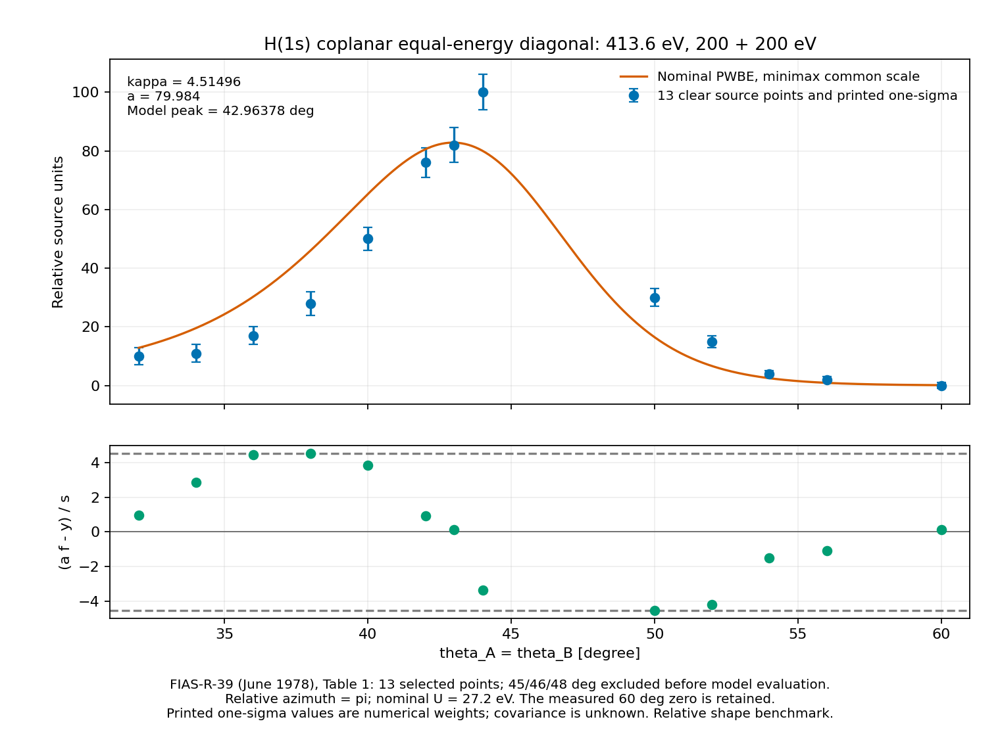

# HE-ANG-TDCS413-DIAGONAL 결과
2026-10-24 · Astra root의 과학 판정과 해석 · physmath-research-loop 1.0.0

## 1. 확보한 결과
Weigold FIAS-R-39 (June 1978) Table 1에서 명확히 판독된 13개의 상대 joint TDCS를, PR97에서 도출한 비편극 exact-swap PWBE의 명목 대칭 절단과 연결했다. 최적 공통 배율은 **a=79.98401712311731**, 최소 가중 최대잔차는 **kappa=4.514958607183564**다. 극값을 정하는 점은 **50도와 38도**이며 각각 -kappa와 +kappa 잔차를 낸다.

계산된 명목 모델의 창 안 최대점은 **theta_star=42.96377691157668 degree**다. q=0 각도 **44.02578398781171 degree**보다 약1.06200708 degree 작다. 최대점의 존재와 유일성은 고정 창 전체에 대해 해석적으로 증명했고, 실제 위치는 이분법과80자리 참조로 계산했다.

이 결과는 같은 원전의 유한 joint 기하 절단에 대한 **모델 형태 비교**다. 전체 HE-ANG-SOURCE-PAYLOAD는 SOURCE_INPUT_PENDING을 유지한다. 이 단위는 event total, finite-mass recoil provider 또는 HE-X1의 경험적 각분포 보정을 공급하지 않는다.

## 2. 자료와 명목 모델의 대응
원자료는 입사413.6 eV, outgoing200+200 eV, thetaA=thetaB, relativephi=pi다. 입력은 source/SELECTED_INPUT.json에 원문 decimal strings로 보존했다. 원표16개 설정 중45/46/48도는 스캔의 숫자/오차 판독이 불명확하여 모델 계산 전에 제외했다. 이 세 행의 원래 가능한 판독과 제외 사유는 candidate JSON에 남아 있다. 60도의0(1)은 그대로 사용했다.

원전의 정규화는 상대값이고 절대 단면적은 제공되지 않는다. 선택된 대각선 series의 sigma_N=0은 상대 정규화 기준의 표기다. 괄호 안 숫자는 점별1sigma지만 전체 공분산과 detector response는 미제공이다. 따라서 s_i는 이 계산에서 **양의 수치 가중치**이고, kappa는 통계적 유의도나 신뢰수준이 아니다.

원문의13.6 eV 분리에너지와 일관되도록 명목 단위U=27.2 eV를 정의했다. 무차원 epsilon=125/17, epsilon0=517/34=2epsilon+1/2를 사용한다. 이 명목 대응은 정밀 물리 Hartree 상수에 대한 주장과 구별된다. 분리에너지 해상도와 beam divergence를 정량 convolution으로 모델링하지 않았다. 그 결과, 현재 편차를 특정한 누락 물리 하나로 분해하는 해석은 남은 입력을 필요로 한다.

## 3. 구성적 유도와 계산식
기존 PWBE source amplitudes와 독립 비편극 spin trace를 재사용한다. 동일 에너지와 동일 극각, 반대 방위각에서는 D=X이므로 triplet은0이고 비편극 밀도는 양의 singlet 기여를 가진다. 점별 밀도에는 별도2나1/2를 곱하지 않는다.

k^2=250/17, r^2=517/17, z=r-2k cos(theta), h=(1+k^2)^(-2)라 두면
Delta^2=k^2+r z,
d=((1+z^2)^(-2)-h)/(k^2+r z),
K(theta)=(32/pi^2)(k^2/r)d^2,
f(theta)=K(theta)/K(44degree).
원전 Eq21의 인쇄된 -2DX와 이 모델의 독립 비편극 trace는 구별하여 보존했다. 원논문의 실제 수치 프로그램을 재현했다고 주장하지 않는다.

이 대칭 절단에서는 triplet가0이고 공통 배율a가 자유다. 따라서 이 비교가 식별하는 것은 상대 각도 형태이며, 전체 상수 배율에 해당하는 spin/count 정규화를 실험적으로 검증하지는 않는다. 해당 convention은 기존 독립 유도에서 재사용한다. 이 구분은 f의 공통 배율 불변성에서 직접 따른다.

도함수 부호를 정하는 다항식은
N(z)=r h(1+z^2)^3-r(1+5z^2)-4k^2 z.
THEORY_KO.md §4는 창이 -1<z<k에 포함되고 N의 유일한 영점이(-1/2,0)에 있음을 보인다. N은 그 전후에서 각각 양/음이므로 K의 유일한 창 최대점이 정해진다. q=0에서의 운동량밀도 항만으로 peak를 정하면 Delta^-4 인자의 위치 이동을 놓친다.

공통 배율 문제는
kappa_star=min_{a>=0} max_i |a f_i-y_i|/s_i.
모든 f_i>0,y_i>=0,s_i>0인 유한 자료에서
kappa_star=max(0,max_{i,j}(y_i f_j-y_j f_i)/(s_i f_j+s_j f_i)).
각 절댓값 제약을 배율 구간으로 바꾸고, 모든 lower endpoint가 모든 upper endpoint 이하라는 조건을 풀어 얻은 필요충분식이다. 0인 y도 분모에 들어가지 않아 그대로 다룰 수 있다. 이 식의 유도와 exact rational toy는 R6 독립 손계산 및 R7 Wolfram으로 확인했다.

현재 active pair는(50,38)도다. 따라서
a f_38=28+4kappa,
a f_50=30-3kappa
가 동시에 포화한다. 다른11개 행의 잔차도 이 최대값 이하인지 직접 확인했다. 이는 알려진 유한 minimax 구조를 이 입력에 적용한 구성적 결과이며, 새로운 보편적 배제 정리를 채택한 것이 아니다.

## 4. 전체13점의 실제 결과
s는 원문에 인쇄된 점별1sigma를 수치 가중치로 사용한 값이다.

| theta [degree] | y | s | a f(theta) | (a f-y)/s |
|---:|---:|---:|---:|---:|
| 32 | 10 | 3 | 12.844097761 | 0.948032587 |
| 34 | 11 | 3 | 19.582313745 | 2.860771248 |
| 36 | 17 | 3 | 30.299213804 | 4.433071268 |
| 38 | 28 | 4 | 46.059834429 | 4.514958607 |
| 40 | 50 | 4 | 65.324634910 | 3.831158727 |
| 42 | 76 | 5 | 80.534660182 | 0.906932036 |
| 43 | 82 | 6 | 82.806293367 | 0.134382228 |
| 44 | 100 | 6 | 79.984017123 | -3.335997146 |
| 50 | 30 | 3 | 16.455124178 | -4.514958607 |
| 52 | 15 | 2 | 6.655004185 | -4.172497908 |
| 54 | 4 | 1 | 2.498385585 | -1.501614415 |
| 56 | 2 | 1 | 0.914560492 | -1.085439508 |
| 60 | 0 | 1 | 0.125678374 | 0.125678374 |

하나의 공통 배율로 명목 잔차를 각각s_i 이내로 제한하는 kappa=1 기준의 배율 조건은 L=156.2421590878588, U=52.79610067753418로 벌어진다. 이 고정 문제에서 kappa=1 조건은 충족되지 않는다. 최적 배율에서도38도에서46.0598344287 대28,50도에서16.4551241784 대30의 반대 부호 잔차가 남는다. 따라서 현재 형태 차이는 공통 정규화 배율만으로 제거되지 않는다.

이 유한 수치 진단을 Gaussian 기각 확률이나 물리 모형 전체의 불가능성으로 바꾸지 않는다. 원전의 상대 정규화, 미제공 공분산, 기기 응답, 명목 에너지 대응이 후속 물리 판정의 입력이다.

## 5. 검증 결과와 수치적 해석
- 변경된 기능의 테스트11개가 모두 통과했다.
- 새13개 기하에서 closed diagonal, 독립 원전 벡터 amplitude, 기존 PR97 point kernel을 대조했다. 기존 완료 suite는 실행하지 않았다.
- 80자리 독립 벡터식과의 최대 상대K 차이는3.690884345585919e-15, shape 차이는3.3120292964298546e-15다. 동결 허용치는 각각1e-11이다.
- 기존 kernel과 새13점의 최대 상대 차이는2.4969857819742395e-15다.
- a의80자리 참조 대비 절대 차이는9.947598300641403e-14, kappa 차이는3.552713678800501e-15다. 허용치는1e-10이다.
- pair 식과 독립 interval-feasibility bisection의 kappa 차이는8.881784197001252e-16이다.
- peak 각도의 binary64와80자리 참조를 같은 binary64로 비교한 차이는0이다. 이는 정확한 물리 peak 오차가0이라는 뜻이 아니다. 명목 최대점의 수치 기준1e-9degree를 충족한다.
- R7 Wolfram은 기호 항등식3개, 유리수 경계11개, toy 일치2개를 True로 반환했고 toy a=2/3,kappa=8/3을 확인했다.

최적 kappa를 binary64로 배율 구간에 대입하면 L-U=1.4210854715202004e-14, raw feasible=false가 나온다. 이 raw 값은 삭제하지 않았다. 이는 exact-real minimax 해의 부재가 아니라 부동소수점 endpoint 반올림이다. 실제 residual,80자리 해와 별도 bisection의 일치로 현재 수치 기준을 판정한다. Directed-rounding interval certificate를 주장하지 않는다.

## 6. 그림과 제한된 교정

위 패널은 상대 TDCS와 최적 공통 배율 모델, 아래 패널은13개 가중 잔차다. 연속곡선721개 점은 표시용이고 각도/에너지 적분은 수행하지 않았다.

첫 렌더는 정상 종료했지만 하단 설명 한 줄이 양 끝에서 잘렸다. C9-FIG-01에 따라 그 그림과 코드/로그를 보존하고 설명을3줄로 나누어 저장 결과만 재렌더했다. source/test/analysis는 변경하거나 재실행하지 않았다. 준비 시점에 남아 있던 원장 summary 문구는 실제4회 완료 상태로 교정했다. 독립 검토의 실제 최종 판정과 닫힌 finding은 reviews/C9_REPORT.json에 기록한다.

## 7. 비용과 재사용
새 단위의 실제 child4회는 tests,analysis,첫plot,저장결과plot교정이다. 누적CPU3.117567 s / wall3.242023329999938 s, 자체한도10/40,512MiB,1thread이며 reserve1회는 사용했다. 실패한 과학 child는0이지만 초기 그림의 presentation finding과 준비 실패는 별도로 보존한다.

Wolfram evaluator1회: toolwall8.288 s, 반환 bodyCPU0.03232899999999983 s/bodywall0.032433 s. 전체 원격CPU 및 금전 비용은 UNKNOWN_NOT_ZERO다. SciSpace/Exa와 host orchestration의 미계측 비용도 보존한다.

mpmath 미설치 준비 실패를 기록하고 동일80자리 방법을1.3.0 wheel로 제공했다. wheel download/install CPU와 포장 비용은 별도 준비 계측이며 위 child누적에 섞지 않는다. 전 프로젝트 end-to-end 비용 상한을 확인했다고 주장하지 않는다.

기존 PWBE C8은 같은 기존 원장에 추가1회CPU1.337593 s/wall1.371633684 s를 기록하여 기존 누적3.304038 s/3.450794949 s가 됐다. 기존8/30한도, 사용한 reserve, 초기 두 test assertion 실패와 첫plot 실패를 유지했다. 새 TDCS413한도로 전용하지 않았다.

DDCS20,CCC,TDCS54,HE-ANG-CONTRACT,Hex,HE-X1,HE38,D10의 비용·실패·unknown은 evidence/REUSED_LEDGER_REFERENCES.json의 원래 기록을 재사용한다. C9-NB-01 future partial mu_window theta metadata 의무도 열려 있다.

## 8. 통합과 다음 입력
시작 시점7개 repo의1330branches/863openPRs metadata를 terminal까지 읽고 변경된26개 pinned files를 조사했다. Dropbox4908항목을 terminal까지 읽었다. Drive는 API의1000반환 제한 및 노출된 pagination 입력 부재를 확인해 partial로 기록했다. 대화 검색은 query-selected이며 전체 대화 export가 아니다. PR97B2/B3는 실제 provider ID와 크기를 다시 읽었다.

실행 직전 중앙85f9ba1은 HH의 PHYS83 재사용과 PHYS87 S2 완료 관측을 추가했다. HE 노드와 authorities/integration은 그대로임을 직접 비교했다. PHYS87의147검사와 source-native finite-window claim, 별도 비용, 복구된S2 backup 및 남은 atomic-to-bare/full-support/consumer 의무를 보존한다. 이 n+atomicH source를 H electron-impact joint law로 옮기지 않는다. CR C23E/fullN4N5, REC의target0/313와H5, BASS의locked-cell 범위 및 다음coupling 의무, REI pressure/stock의 서로 다른 완료 범위도 유지한다.

다음 물리 입력은 HE-ANG-SOURCE-PAYLOAD의 source-consistent joint outgoing law 또는 amplitude/event payload다. 필요한 count/spin/exchange/support/frame/recoil 및 불확실성/검출기 응답을 함께 제공해야 한다. 이번13점은 그 입력을 판별할 추가 benchmark다. 미해결3개 표 셀은 더 선명한 원전으로만 교정한다. 현재13점 계산과 완료된 이전 suite는 입력이 바뀌지 않는 한 재실행하지 않는다.

