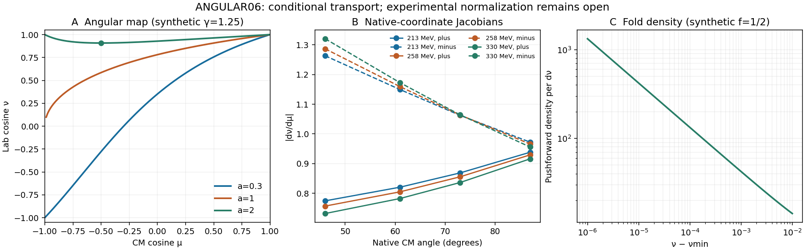

# BASS_HE ANGULAR06 결과 — 유한질량 각도 사상과 동일입자 사건 measure

## 판정

**HE-EXP-ANGULAR-06의 조건부 이론과 참조 구현을 확보했다. 신규 검증은 첫 실행 26/26 PASS, 신규 저장자료 plot은 PASS, 독립 결과 검토의 blocking finding은 0개다.** 이번 local DAG는 **5 complete + 3 physical open / 8**이다. GitHub 공개 게시가 자동 승인 심사에서 거절되어 전체 전달 workflow는 **PARTIAL_PUBLICATION**이다. 원문 정규화·완전한 angular law/flux·named deposition의 세 물리 입력은 열린 상태로 남는다.

이 문서의 수치와 판정은 `evidence/validation/RESOURCE_LEDGER.json`, `evidence/plot/FINISH.json`, `review/RESULT_REVIEW.json`, `DAG.json`에 연결된다. 유도 전문은 `THEORY_KO.md`, 재현 계약은 `MODEL_CONTRACT.json`과 `VALIDATION_CONTRACT.json`이다. 문헌 신규성이나 strong no-go를 주장하지 않는다.

## 1. 최신 조사에서 채택한 입력

관련 다섯 저장소의 모든 branch ref를 페이지 끝까지 열거했다. BASS_HE 107, rei_bianchi 282, WU088_HH 159, bass_cr 188, rec_bianchi 157로 합계 **893개 ref**다. 이 중 직접 의존하는 최신 owner branch와 계약·상태·인계 내용을 읽었다. 전체 893개 tree의 모든 파일을 읽은 것은 아니다. 조사는 여러 요청으로 이뤄진 비원자적 관측이며 branch는 이후 이동할 수 있다. 원 기록은 `preflight/BRANCH_INVENTORY.json`과 `preflight/REPO_SURVEY.json`에 있다.

| 입력 | 최신 관측과 이번 결정 |
|---|---|
| HE | 원격 program-expansion은 ac6042a6…, 로컬 PHOTON05 전달 기준은 4db5ce72…. 후자를 분리 clone하여 새 연구 branch를 만들었다. 원 작업본의 untracked 중앙 후보도 보존했다. |
| WU | provider-registry의 R6 S10은 4f4e7b6b…. HD–para-H2, 100 K, J=0…8의 조건부 interval block 결과다. GL2022 물리 소멸·밀도·named consumer와 HE photon 정규화는 공급하지 않는다. R4/R5 과거 백업 복구 종료 기록도 반영했다. |
| CR | proper injection source 022c1637… / delivery 8482ed83…의 실제 100 K 전자 source를 확인했다. recipient/RR/nb 결속은 열려 있으며 MeV 광자 flux나 daughter deuteron deposition으로 옮기지 않았다. |
| REC | source synthesis delivery d6dbe39a…는 source/parser와 history의 조건부 결과다. physical epsilon/outgoing bound는 null, physical coverage 0/313을 유지한다. |
| REI | thermal assimilation source 600503e5… / delivery ee6746ab…는 manufactured fast-pool 및 독립 지정 constant-nu의 조건부 결과다. 실제 deuteron stopping을 공급하지 않는다. affine/cohort 최신 3aa0cd80…의 예산 보류와 상태 차이도 유지했다. |
| 중앙 | 관측 기준은 152b82ca…, 과거 HE 후보의 검토 base는 1a38f94f…다. 그 뒤 B3h 변경을 보존하는 최신 base 재적용이 필요하다. 중앙 parent-declared 27/88과 REI working 32/88은 구분한다. |

다른 대화 검색은 실제 Personal Context 호출이 `Personal context is unavailable for this conversation`으로 실패했다. 백업은 알려진 HE/WU 폴더 각각 500개 direct child와 제목·내용 검색 결과를 읽었으며, 모든 하위 폴더와 모든 비공개 대화의 전수 내용 확인을 주장하지 않는다. 과거 HE 원본 ZIP의 완료 근거는 재사용했고 다시 생성하거나 다시 실행하지 않았다. 상세 범위와 서비스 오류는 `preflight/BACKUP_CONTEXT_SURVEY.json`에 남겼다.

Exa와 SciSpace를 통해 Arends et al., *Experimental investigation of the 4He(gamma,d)d reaction*, Physics Letters B 62 (1976), 411–412, DOI [10.1016/0370-2693(76)90671-7](https://doi.org/10.1016/0370-2693(76)90671-7)의 서지를 식별했다. 본문의 입자/사건 정규화 식은 확보하지 못했다. Rice et al., PRC 61 (2000) 064612의 다른 에너지 구간 자료를 1976년 native law 대신 사용하지 않았다. EXFOR M0475002의 pinned 원본과 PHOTON05가 저장한 12개 사건 좌표를 재사용했다. 출처와 실제 접근 수준은 `sources/SOURCE_MANIFEST.json`에 있다.

이 종합 결과에 따라 다음 독립적인 미충족 연결을 선택했다. PHOTON05의 유한질량 사건 운동량을 lab 각도 measure로 옮기되, 두 역상과 동일입자 정규화를 명시한다. 다른 저장소의 조건부 계산을 HE의 물리 입력으로 승격하지 않는다.

## 2. 직접 유도한 결과

### 2.1 각도 사상과 fold

표적 정지, bare alpha + photon → 두 bare deuteron, 에너지 단위 q=cp, 계량 (-,+,+,+)를 사용한다. A=m_target c², M=m_d c², 입사 photon energy e, 0<A<2M이고 문턱 위 e>e_th라 둔다.

\[
\Delta=2M-A,\qquad e_{\rm th}=\Delta+\frac{\Delta^2}{2A},\qquad
W=\sqrt{A^2+2Ae},\qquad \kappa=\sqrt{\frac{A(e-e_{\rm th})}{2}},\qquad
\gamma=\frac{A+e}{W},\quad a=\frac{e}{2\gamma\kappa}.
\]

CM 극각 cosine mu에 대해 q_z=gamma kappa mu+e/2, |q_perp|=kappa sqrt(1-mu²)다. 따라서

\[
D^2=1-\mu^2+\gamma^2(\mu+a)^2,\qquad
\nu=\cos\theta_{\rm lab}=\frac{\gamma(\mu+a)}{D},\qquad
\frac{d\nu}{d\mu}=\frac{\gamma(1+a\mu)}{D^3}.
\]

방위각은 정규 방향에서 보존된다. Solid-angle 밀도에는 절대 Jacobian이 들어가며 signed derivative는 분기의 방향을 기록한다.

| 조건 | CM→lab 구조 | 처리 |
|---|---|---|
| 0≤a<1 | 전체 구면에서 한 분기 | 유효 역상 하나 |
| a=1 | mu=-1에서 daughter 정지, 나머지는 nu∈(0,1] | 정지점의 방향 undefined |
| a>1 | mu_c=-1/a에서 fold, nu_min<nu<1에 두 역상 | 두 분기 합산 |
| e=e_th | kappa=0, lab 방향 nu=1로 원자화 | 연속 density와 분리 |

\[
\nu_{\min}=\frac{\gamma\sqrt{a^2-1}}{\sqrt{1+\gamma^2(a^2-1)}}.
\]

M<A<2M이면 stopped-direction transition은

\[
e_{\rm tr}=\frac{A(2M-A)}{2(A-M)},\qquad
e_{\rm tr}-e_{\rm th}=\frac{M(2M-A)^2}{2A(A-M)}>0
\]

이다. 사건 발생 문턱과 한 daughter의 방향이 사라지는 에너지는 서로 다르다. A≤M에는 유한한 transition이 없고 문턱 위 전체가 fold regime다.

### 2.2 역상과 가중 관측량

G=gamma²(1-nu²), L=G+nu², B=L-a²G라 두면 제곱식의 후보 역상은

\[
\mu_\pm=\frac{-aG\pm |\nu|\sqrt{B}}{L}
\]

이다. 원식의 부호, |mu|≤1, D>0을 다시 적용한다. 원식의 부호를 버린 quadratic root만으로 branch를 인증하지 않는다.

주어진 CM density f와 관측량 Q에 대해

\[
g(\nu,\phi)=\sum_i\frac{f(\mu_i,\phi)}{|J_i|},\qquad
g_Q(\nu,\phi)=\sum_i\frac{f(\mu_i,\phi)Q(\mu_i,\phi)}{|J_i|}
\]

를 구성했다. 같은 lab 방향에도 두 CM 역상에서 E=gamma E*+gamma beta kappa mu가 다르므로 energy/stress를 운반하려면 각 분기의 mu, J, f, Q를 유지해야 한다. 각도 marginal 하나에 단일 에너지를 붙이는 축약은 일반적으로 그 정보를 잃는다.

Fold에서는 nu''_c=gamma a/D_c³이고, 연속 f(mu_c)≠0에 대해

\[
g\sim\frac{\sqrt{2}\,f(\mu_c,\phi)}{\sqrt{\nu''_c(\nu-\nu_{\min})}}.
\]

점별 밀도는 발산하지만 유한 각도 bin의 질량은 O(sqrt(delta nu))로 유한하다. 구현은 fold에서 가짜 유한 density를 내지 않는다. f가 fold에서 소거되는 경우의 limit는 별도 정칙성에 의존한다.

### 2.3 동일입자 사건수와 daughter 수

Unordered event orientation은 S²/{u∼−u}다. 전구면에 대칭 lift한 사건 density f를 integral f=Sigma_event로 두면 inclusive daughter density h=2f는 integral h=2Sigma_event다. Pair 관측량 F=B(q_+)+B(q_-)에 대해

\[
\int fF=\frac12\int hF=\int hB(q_+)
\]

가 성립한다. 한 hemisphere 대표를 쓰면 두 daughter 기여를 명시적으로 더해야 한다. 코드의 convention은 event full sphere, inclusive daughter full sphere, event representative hemisphere의 세 가지다. 알 수 없는 정규화는 거부한다. EXFOR 숫자에 임의로 1/2 또는 2를 곱하지 않았다.

사건수, 입자수, 열용량, rest/binding energy와 비열적 kinetic energy는 별도다. 기존 `population_rest_energy_witness`가 binding을 한 번 소유하는 규칙을 유지한다. 독립 binding RHS, Gamma_thermal, Cv, species heating, thermal deposition은 아직 null이며 birth_pool은 UNASSIGNED다.

## 3. 구현과 실제 판별 검증

`src/angular_pushforward.py`는 forward/inverse, density, weighted_density, mass adapter, 세 정규화 계약을 제공한다. 일반 map은 finite nonbool binary64 입력으로 1≤gamma≤10^6, 0≤a≤10^6를 받는다. 내부는 Decimal80, 출력은 binary64다. 질량·문턱·transition admission은 Fraction.from_float의 저장 입력에 대한 정확한 유리수 비교를 사용한다. 반환 threshold의 반올림 값을 다시 admission 기준으로 삼지 않는다.

역상은 안정화한 quadratic pivot와 root product로 만든 뒤 원식 부호를 검사한다. Binary64로 분해할 수 없는 cone·root는 `AngularResolutionError`로 명시한다. Fold 좌표의 저장값은 선언된 API sentinel이며 정확한 실수 fold와 동일하다고 주장하지 않는다. 이 구현은 전체 domain에 대한 interval certificate가 아니다.

사전 독립 검토에서 threshold 반올림의 원자 오분류, branch별 가중 정보, fold 경계, pole 처리 및 precision 문서 문제를 교정했다. 수정 후 사전 검토는 PASS, 이후 실제 결과 검토는 `ACCEPT_SCOPED_CONDITIONAL_ANGULAR_REFERENCE`로 끝났다. 검토자는 과학·테스트·plot을 다시 실행하지 않고 실제 로그·해시·그림을 읽었다.

| 실행 | 실제 결과 | 사전 한도 | 재실행 |
|---|---|---|---|
| 신규 구현 검증 | 첫 실행 26/26 PASS, CPU 0.273874185 s, wall 0.268156042 s | CPU 4 s, wall 15 s, 256 MiB, 1 thread | 0, repair 0 |
| 신규 각도 그림 | PASS, CPU 5.791514953 s, wall 5.852712830 s | CPU 6 s, wall 15 s, 512 MiB, 1 thread | 0, 과학 함수 호출 0 |
| Wolfram | derivative·fold curvature·discriminant·transition 차이·rest-shell 식의 실제 출력 저장 | 기호 검산 1회 | 0 |

26개 검증은 native 12개 사건의 저장 q에서 직접 얻은 nu, 별도 Decimal vector 미분, bracketed inverse, 부호·경계·fold·stopped·정확 문턱, weighted energy 정보, quotient multiplicity, finite fold bin, invalid/overflow, parent identity를 다룬다. 출력에는 오차의 최대값을 따로 인쇄하지 않았으므로 PASS를 계약 허용오차 충족으로 보고한다. 확인하지 않은 residual maxima를 만들지 않는다.

그림 A는 합성 map의 분기, B는 native12의 plus/minus Jacobian, C는 합성 f=1/2의 fold 점근 추세다. 실제 이미지 판독은 `evidence/PLOT_READ_KO.md`와 독립 결과 검토에 남겼다. 원 DCS 보간이나 새 실험 law의 fit은 없다.

## 4. DAG와 열린 물리 입력

| ANGULAR06 local 노드 | 상태 |
|---|---|
| Source survey와 근거 재사용 | complete_scoped |
| Identical-particle quotient measure | complete_scoped |
| Finite-mass angular map | complete_scoped |
| Inverse branches와 가중 pushforward | complete_scoped |
| 검증·그림·독립 검토를 갖춘 참조 구현 | complete_scoped |
| 원 실험 정규화 및 liquid-He 실험 projection | physical open |
| 완전한 angular law와 실제 photon encounter flux | physical open |
| Named nonthermal birth/deposition/thermalization consumer | physical open |

**5/8**은 새 조건부 산출물의 집계다. PHOTON05는 기존 **4 complete + 1 partial + 3 physical open / 8**을 유지한다. 중앙 parent-declared **27/88, delta 0**, 별도 REI working **32/88**은 서로 합산하지 않는다. Global physical completion=null, L4_ready=false, production=NOT_APPROVED, activation=false다.

다음 물리 진전에는 원 Arends/Hartmann의 정규화 식·coincidence/event convention과 detector/target projection의 실제 근거가 먼저 필요하다. 그 근거가 확보되면 이미 구현한 세 정규화 convention 중 무엇과 연결되는지 결정할 수 있다. 별도로 전각 law/flux 및 deuteron nonthermal consumer가 결속되어야 rate와 deposition으로 이어진다. 이번 성공을 근거로 그런 입력을 대입한 것으로 처리하지 않는다.

## 5. 전달·게시와 보존

`LOOP_PROGRESS.json`은 R1–R10/C1–C10 각각의 실제 근거, local DAG 수, 공동 보존 체크포인트와 게시 상태를 기록한다. 보존 묶음은 S01(조사·계약), S02(유도·구현·사전검토), S03(실제 결과), S04(최종 전달)다. 각 단계마다 별도 20회의 공개 게시가 성공한 것으로 쓰지 않는다. 실제 업로드 ACK와 ID/name/size 확인은 `delivery/`의 영수증과 최종 외부 closeout에서 확인한다.

공개 GitHub push는 자동 승인 심사가 두 번 거절했으며 실제 원격 변경은 0회다. 인증된 owner와 공개 저장소·변경 범위를 확인한 재시도 뒤에도, 상속된 미게시 PHOTON05 이력을 포함하는 구체적인 공개 payload에 대한 승인이 필요하다는 이유가 남았다. 우회 API로 재시도하지 않았다. source와 central 모두 미게시다. 중앙 후보는 최신 관측 base 위에서 HE observation delta만 적용하고, B3h/CR 및 다른 83개 노드, status·owner·budget·dependency를 보존하여 별도로 검토한다.

게시가 별도로 승인되어 재개되면 먼저 최신 source/central HEAD와 AGENTS를 다시 읽고, 바뀐 base에 HE delta만 재적용·검토한 뒤 실제 expected SHA와 force=false로 처리한다. 이 문서에 보이는 과거 SHA를 미래의 expected 값으로 그대로 쓰지 않는다.

PHOTON05 S05 `251c6baa6c3359b1d6997dbce51cea65500b53d6`, D05 `4db5ce7297a7ded4624b93721873aacc9b4ebf30`, 원 24/24 PASS, **plot CPU 4.40726504 > 4 s FAIL**, workflow **PARTIAL**을 보존했다. HE101 C8 **PARTIAL_EXPORT 19/20**, reserve **0**, 원 **PASS/FAIL/FAIL**도 보존했다. 이전 과학·plot·백업의 재실행/재생성과 예산 초기화·전용은 0회다.

새 후속 노드를 시작하지 않고 이 ANGULAR06 결과와 검토 가능한 게시 후보에서 멈춘다. 복사 가능한 다음 스레드 지시는 `HANDOFF_KO.md`, 실제 최종 commit·백업 receipt·게시 후보 identity는 종료 closeout을 따른다.
