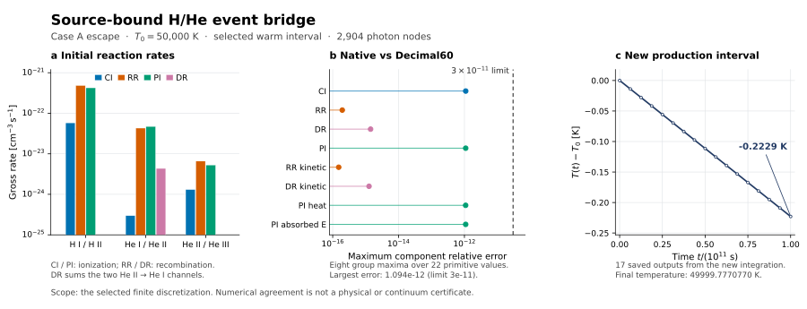

# BASS_HE — HERE_RUX03_EVENT_BRIDGE_02

독립 판정: **PROMOTE_SCOPED_CONDITIONAL_EVENT_BRIDGE**. 전체 설명은 [REPORT_KO.md](REPORT_KO.md),
정확한 주장 범위는 [CLAIMS.json](CLAIMS.json), 검토자가 고정한 판정과
artifact identity는 [review/DECISION.json](review/DECISION.json)을 따른다.

실제 receiver 구현은 [초안 PR114](https://github.com/cosmosapjw-quantum/rei_bianchi/pull/114),
정확한 head는 `a5c958c414dea41216b445c05f58df837f05cacb`다.
이 dossier는 BASS_HE PR29의 후속이며 원래 owner DAG의 상태를 일괄 덮어쓰지 않는다.

현재 연구 상태: [state/RESEARCH_STATE.md](state/RESEARCH_STATE.md).
완료 기록: [state/CLOSEOUT.md](state/CLOSEOUT.md).
다음 작업: [HANDOFF_KO.md](HANDOFF_KO.md).
원시 evidence ZIP과 최종 사용자 전달물의 위치는 publication/과 별도 전달 영수증에 기록한다.
